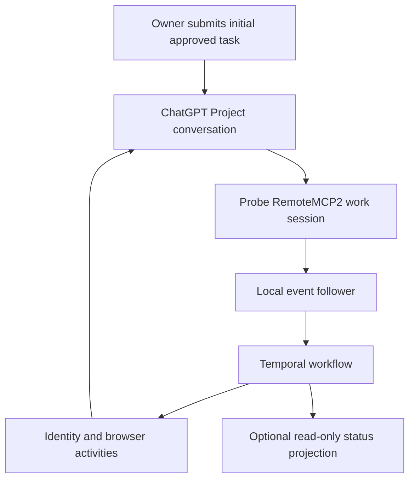

# Flowdeck

**An experimental Temporal-backed supervisor for approved tasks in ChatGPT Projects.**

An owner submits the first task once. Flowdeck adopts that conversation, observes work-session events, continues unfinished work in the same chat, and can submit the next independent approved task in a new chat within the same Project.

Implementation completion is recorded as **`implementation_done / review_pending`**. Code review, acceptance, merging, and release belong to external systems.

> **Maturity:** development MVP, not unattended production automation. A bounded attended two-task cycle is documented as completed, with independent review pending. Automatic initial launch and the complete unattended production composition still need integration and acceptance. Historical results describe their tested builds, not guarantees for this checkout.

## Start here

| Goal | Read |
|---|---|
| Understand the system | [Architecture](docs/architecture/overview.md) |
| Find documentation | [Documentation index](docs/README.md) |
| Test on the configured MacBook | [Step-by-step manual tests](docs/operations/manual-mac-testing/README.md) |
| Finish the MVP | [Single implementation plan](docs/plans/FLOWDECK_AUTONOMOUS_MVP_PROGRAMMER_GUIDE.md) |
| Understand event delivery | [Work-event bridge](docs/operations/FLOWDECK-WORK-EVENTS.md) |
| Contribute safely | [Contributing](CONTRIBUTING.md) |
| Prepare a GitHub release | [Publication checklist](docs/publishing.md) |
| Understand retained compatibility files | [Document file map](docs/FILE-MAP.md) |

## Architecture



- **Temporal TypeScript SDK:** durable, deterministic orchestration; non-deterministic operations stay in activities.
- **Oracle / Helium Profile 4:** the existing browser stack; authenticated browser operations use local CDP.
- **Probe RemoteMCP2:** work execution and machine-readable work-session events.
- **Local journals and claims:** preserve task/chat identity and prevent blind retries after uncertain side effects.
- **Dashboard / Jazz widget:** optional visibility, never dispatch authority.

A session-ending event is not task acceptance. Exact identity checks, approved task-source routing, final status markers, and send budgets remain authoritative. There is no guaranteed exactly-once delivery through the external browser service.

## Development setup (no live dispatch)

Use a current Node.js runtime with `node:sqlite` support for the event bridge; Node 24 is the CI target. Install dependencies from the lockfile in a development checkout:

```sh
npm ci
npm run build
node scripts/check-docs.mjs
node --test tests/check-docs.test.mjs tests/flowdeck-pilot-budget.test.mjs
```

These commands install dependencies, compile files, and run local checks. They do not launch the live supervisor. Building changes `dist/`: **do not rebuild a frozen operator checkout during a live attempt.**

The broader suites are available, but are not fully hermetic:

```sh
npm run test:portable
npm test
```

Some tests depend on local services, installed integrations, or historical evidence. A fresh-clone failure is not permission to create production enrollment or bypass identity checks. The GitHub workflow runs only type checking, documentation checks, and the bounded local test tier; it is not a live acceptance test.

## Operational boundaries

Live operation is deliberately **not a clone-and-run quick start**. The current adapter supports one specific enrolled Project and the established browser/connector environment; replacing an example URL does not make arbitrary Projects supported. See [configuration examples](examples/README.md).

The current coordinated entrypoint is `scripts/flowdeck-launch.mjs`. It starts a real worker, durable workflow, and event follower, and can lead to real submissions. Follow the human runbook before using it. Do not run independent launchers against the same browser.

Safe inspection entrypoints include:

```sh
node scripts/flowdeck-supervisor.mjs --help
node scripts/flowdeck-supervisor.mjs status
node scripts/flowdeck-launch.mjs --help
```

`status` is a saved projection; it can be stale. Authoritative execution inspection uses `workflow-status` with the exact configured workflow identity. See the [script catalog](scripts/README.md) for commands grouped by side effects.

**Never delete `.state` to retry a test.** It contains claims, bindings, inboxes, and audit journals. An uncertain send must be reconciled, not repeated. Browser-owner claims are checkout-local, not machine-wide across clones. Stopping a launcher does not itself cancel the Temporal execution or undo an in-flight browser action.

The root `seed`, `worker`, `start`, and `verify` npm scripts belong to the **historical fixture**, not the active Flowdeck supervisor. Required historical contracts and fixtures remain for compatibility, not as current launch instructions.

## Repository layout

```text
src/          Workflow definitions, activities, browser/event adapters, dashboard
scripts/      Operational CLIs, read-only checks, synthetic test harnesses
tests/        Automated tests (see CONTRIBUTING.md for scope)
public/       Dashboard assets
widgets/      Optional Jazz status widget and its own dependency lockfile
examples/     Non-executable configuration examples; generated fixtures are ignored
docs/         MVP plan, manual test steps, architecture, operating references
.state/       Ignored local runtime/evidence — never publish or reset casually
dist/         Ignored build output
```

## Publishing and security

Repository organization is complete enough to navigate, **not a certification that all historical content is safe to publish**. Retained records and some source/tests still contain environment-specific paths and Project identifiers. Review the current tree **and Git history** before public release. `.gitignore` does not remove already tracked content.

Read [SECURITY.md](SECURITY.md) and the [publication checklist](docs/publishing.md). No project-wide license has been chosen; do not describe this as an open-source release until the owner selects a license and reviews third-party obligations. Package `private: true` prevents accidental npm publication, not GitHub exposure.
