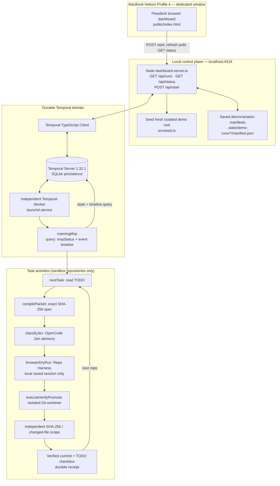

# Codegraph Architecture Map — Flowdeck MVP

**Updated:** 2026-10-14. Generated as a developer diagram from inspected Codegraph symbols, call relationships, and current source. The graph database is local and not committed.

## Codegraph evidence

After `codegraph sync .`, the index reported **10 files, 125 symbols, 230 edges**. Relevant confirmed symbols:

- `src/dashboard-server.ts`: HTTP server, `workflowStatus`, `beginRun`, `getRuns` and API route handling.
- `src/workflows.ts`: `roamingMvp`, `statusQuery`, stage transitions, event timeline.
- `src/activities.ts`: `nextTask`, `compilePacket`, `classifyJev`, `browserDryRun`, `executeVerifyPromote`.
- `src/worker.ts`: independent Temporal Worker on task queue `repo-harness-mvp`.
- `src/seed.ts` and `src/verify.ts`: actual disposable fixture seeding and independent validation.

## Runtime / observable diagram



## What the audience sees

The dashboard connects directly to Temporal state every 700 ms and displays **running stage, task cards, event timeline, SHA verification outcomes, optional Jev decisions and saved browser dry-run sessions**. Reopening/refreshing the dashboard is read-only. Clicking **Start fresh demo** makes a new, throwaway Alpha/Beta pair and a distinct Workflow ID. Previous demonstrations remain queryable by their IDs.

## Browser window isolation

The profile mapping in the Helium Chromium `Local State` is `Profile 4 = drunkod gpt`. The **existing Helium process** accepts a command-line `--profile-directory="Profile 4" --new-window` handoff from a short-lived child invocation. Verified: main Helium PID unchanged, windows increased to two, the front window's title matched Flowdeck, and HTTP connections to the local dashboard were observed. The authenticated ChatGPT browser tab is not selected, navigated, or automated.

## Truthful demo boundary

- **Real:** Temporal Server + Worker, live status queries/events, Jev low-risk classifications, Repo Harness dry-run artifacts, disposable worktree writes, Git evidence verification.
- **Not included:** actual ChatGPT website consultation, live browser tab automation, real Codex execution, arbitrary autonomous software specification writing, RemoteMCP-Jazz additions, auth bypass.
- The global Oracle is 0.21.3; the installed Repo Harness doctor requires 0.20.0 for *live* Oracle browser runs. This diagram intentionally does not claim that the dry-run opened ChatGPT.

## Rebuild the Codegraph and inspect

```bash
cd ~/Documents/work/temporal-harness-mvp
codegraph sync .
codegraph status .
codegraph query roamingMvp -p .
codegraph query dashboard -p .
codegraph explore 'executeVerifyPromote browserDryRun nextTask' -p .
```
