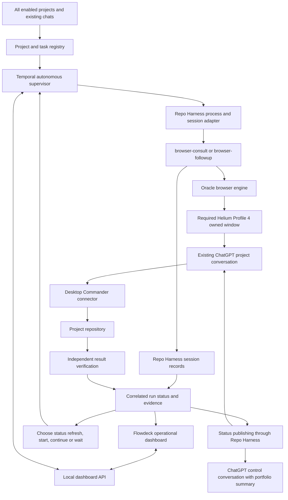

# ChatGPT Project Orchestrator — Repo Harness overnight MVP plan

> **ARCHIVED DESIGN — SUPERSEDED.** The active implementation removes Repo Harness and follows [ORACLE-SASHAI-SUPERVISOR-PLAN.md](ORACLE-SASHAI-SUPERVISOR-PLAN.md). Do not use the Repo Harness commands below for this MVP.

Date: 2026-10-14
Status: amended implementation plan; no live browser automation is claimed implemented.
Target: a working demonstration by tomorrow morning, conditional on provider readiness and existing-chat/Profile 4 routing.
Primary reference: https://www.repoharness.com/guides/browser-extension/

## 1. Required use case and corrected decision

The product is a persistent autonomous supervisor of the owner's projects and current tasks on ChatGPT.com, not a one-shot queue of two prompts and not merely a local dashboard. Each project may have multiple existing chats; Desktop Commander MCP is available in the owner's chats. The supervisor must obtain current task state, decide whether to start or continue work, trigger that action through Repo Harness Browser commands, observe results, and repeat across every enabled project.

Required model: the ChatGPT project is the persistent workspace; each chat is a work session. Track project -> task -> assigned chat/work session -> execution attempts -> Repo Harness sessions. Preserve project membership, repository binding, inherited instructions and cross-chat handoffs. A chat may contain historical work, but a new distinct eligible task should normally get a new chat inside the same project; unfinished work stays in its current chat.

Canonical entry point: the owner opens Sashai, selects Desktop Commander MCP, submits a task using their MacBook, and leaves. After one-time project enrollment, the supervisor adopts that manually started conversation without requiring a separate prompt queue or resending the initial message. It observes while the turn is active, reads the result, continues unfinished work, verifies completion, updates the authoritative execution checklist, creates a new Sashai chat for the next eligible task, selects Desktop Commander and repeats. Explicit chat registration is permitted for the pilot, but a manual task queue is not the intended daily experience.

Journey and Sashai-specific acceptance details: docs/SASHAI-SUPERVISOR-JOURNEY.md. This plan supersedes earlier fixture-only next-stage proposals; docs/MVP-RESULTS.md and docs/DEMO-GUIDE.md remain historical instructions for the existing implemented demo.

The owner must be able to see a current-task summary in the relevant ChatGPT project conversation and ask for a portfolio summary from a designated ChatGPT control conversation. Flowdeck remains an additional operational dashboard, not a substitute for visibility on ChatGPT.com. Two projects are the rehearsal subset; the implementation must accept all registered projects without hardcoded Alpha/Beta behavior.

**Browser entry point: `repo-harness chatgpt browser-consult`.** The documented default/recommended provider is Oracle; Repo Harness invokes `oracle --engine browser`. Temporal should orchestrate this existing toolchain, not replace it with a custom extension or direct UI sender.

Despite its URL, the referenced guide is titled “ChatGPT browser engine”; it does not prescribe building/installing our own browser extension. Direct CDP, WebMCP and accessibility automation are not prerequisites for the primary path. The previous proposed extension-first fallback is removed from the overnight scope.

Keep the original requirements: authenticated Helium Profile 4, a dedicated automation window/tab, existing project conversations, and no navigation/closure of the owner's current ChatGPT tab. **Whether Oracle can satisfy that exact browser/session/window routing remains an acceptance gate, not an assumed feature.** A cloned profile or fresh chat is not an equivalent substitute without the owner's explicit agreement.

## 2. How this fits the finished MVP

| Component | Reuse | Required change |
| --- | --- | --- |
| Flowdeck dashboard and HTTP API | Cards, queue controls, timeline/history | Registered projects and separate provider/connector/verification states |
| Temporal client/server/worker | Durable queue, timers and supervision | Add adopt/observe/continue/verify/new-project-chat supervisor |
| Manually started ChatGPT work | Owner's existing interaction is retained | Read-only adoption/capture and mapping to task; missing today |
| Project-scoped new chat | Persistent ChatGPT project remains the workspace | Create chat, prove project membership/context and select Desktop Commander; missing/unproven |
| src/activities.ts browserDryRun | Existing Repo Harness invocation/session-check pattern | Add async live process supervision, session correlation and reconciliation; do not simply remove --dry-run |
| roamingMvp and fixture executor | Keep working regression/demo lane | Do not present deterministic execution as Desktop Commander work |
| Independent verification | Reuse hash/result checking patterns | Verify outputs produced by the chat/connector task |
| Profile 4 dashboard launcher | Keep dashboard window handoff | Separate from Oracle's actual consultation-browser routing |
| Jev | Optional later | Not on the overnight critical path |

Codegraph confirmed the current beginRun -> roamingMvp -> browserDryRun -> executeVerifyPromote chain. Current browserDryRun always supplies --dry-run and uses spawnSync with a 45-second timeout. That is insufficient for long live conversations.

## 3. Verified documentation and local CLI evidence

The guide documents:
- Oracle is the default provider; native CDP is deprecated and diagnostic-only.
- No OpenAI API key is required for the locally signed-in ChatGPT Web path.
- browser-setup prepares repo-local session storage; browser-doctor is the readiness authority.
- browser-consult supports prompts/files, connector preselection via --chatgpt-app, heartbeat and answer-file capture.
- Omit --model to retain the model currently selected in the signed-in UI.
- browser-list and browser-session --metadata-only inspect saved sessions.
- browser-open opens a saved conversation; it does not submit a task.
- browser-followup continues a saved session and creates a linked session.
- Session directories contain meta.json, prompt.md, transcript.md, output.md, events.jsonl and optional artifacts.
- A clean exit without the answer file is recoverable ORACLE_CAPTURE_INCOMPLETE, not success; submission may already have happened.

Local --help additionally confirms:
- browser-consult has --chatgpt-url, --oracle-bin, --timeout-ms, --heartbeat, --write-output and --chatgpt-app.
- browser-followup has --session and --oracle-bin but no --chatgpt-url option in the installed CLI.
- --profile-dir, --profile-directory, --browser-channel and --keep-browser are described as native-provider options. Do not assume they route Oracle to Helium Profile 4.

Read-only readiness check performed during amendment:
`repo-harness chatgpt browser-doctor --repo . --provider oracle --json`

Result:
- status: action_required; code: ORACLE_VERSION_UNSUPPORTED.
- resolved binary: /opt/homebrew/bin/oracle, version 0.21.3.
- required exact version: 0.20.0; Node compatibility passed.
- Missing reported capabilities: browserThinkingTime, writeSession, networkEvidence, conversationEvidence.

Select a compatible binary explicitly with --oracle-bin or REPO_HARNESS_ORACLE_BIN; prefer a local pin rather than changing the owner's global Oracle. Rerun doctor and require ready. Version matching alone is not sufficient if required capabilities remain absent. Do not suppress the check or silently downgrade to native.

The earlier 404 at localhost:9222 is not a blocker for this CLI-first architecture. Do not spend the overnight budget fixing our own CDP connection unless provider diagnosis specifically requires it.

## 4. Architecture

The Oracle -> Helium Profile 4 edge is a required capability to prove, not a verified fact. Repo Harness owns consultation evidence; Temporal owns queue decisions; Desktop Commander owns its execution; the independent verifier attests project results.

## 5. First feasibility gate — readiness, routing and one consult

Budget: 45–60 minutes, excluding unexpected dependency/provider repair.

1. Record installed Repo Harness/Oracle versions and exact capabilities. Select a compatible local Oracle and require browser-doctor ready.
2. Inspect the installed Repo Harness-to-Oracle invocation/configuration and provider help to establish browser executable, profile/session and window routing. Do not invent flags.
3. Confirm the Helium Profile 4 mapping and the requirement to reuse the authenticated session. Existing dashboard launcher behavior is not proof of Oracle behavior.
4. Run browser-setup for the selected disposable repo if needed; inspect prior sessions using browser-list and browser-session --metadata-only.
5. Build a narrow dry-run using the chosen existing chat URL and actual connector display name.
6. Perform one approved harmless live browser-consult with --provider oracle, --chatgpt-url, --chatgpt-app, a unique run marker and unique repo-relative --write-output.
7. Check session/provider conversation identity and actual URL. Confirm the instruction was added to the specified existing chat rather than a replacement conversation.
8. Confirm the owner's original tab was not navigated/closed and no competing process uses its profile directory. Test foreground/focus impact.
9. Require the captured answer file, session record and known outcome. Record connector selection separately from actual invocation evidence.
10. Prove adoption of a manually submitted turn while it is active and after it finishes. Capture its conversation/messages without submitting a second task, then establish a valid managed binding for continuation. browser-list/browser-session do not cover a chat that has never had a Repo Harness session. Inspect actual provider capabilities for non-submitting observation/import; do not use browser-consult with an empty/status prompt as a pretend passive attach.
11. Prove creation of a new chat INSIDE Sashai: verify project identity, resulting conversation URL, inherited project context and connector selection before sending the next task. --chatgpt-url alone does not prove project-scoped chat creation. Inspect Repo Harness/Oracle support; if missing, scope a provider/adapter extension within the Repo Harness browser path. A generic fresh chat plus a copied project name is not equivalent.

If doctor cannot become ready, non-submitting adoption fails, project-scoped chat creation fails, existing-chat targeting fails, or Oracle cannot meet the Profile 4/window requirement, report that exact blocker. Do not call a fresh chat in another browser an equivalent MVP. A custom browser-control adapter becomes a separately approved contingency, not tonight's assumed implementation.

## 6. Command and operation contract

Construct commands with structured argument arrays, not free-form shell strings. Resolve actual paths and connector labels before execution.

Initial consult arguments:
- chatgpt browser-consult
- --repo: registered repository root
- --provider oracle
- --oracle-bin: verified compatible binary
- --chatgpt-url: registered existing conversation URL
- --chatgpt-app: exact recorded Desktop Commander connector name, after capability verification
- --title: unique task/run slug
- --prompt: owner task plus run marker and completion contract
- --heartbeat: chosen bounded interval; documented default is 59 seconds
- --timeout-ms: explicit task budget
- --write-output: unique repo-relative .ai/harness/handoff/ path
- optional --file: explicit narrow workflow files
- omit --model and --thinking unless intentionally selected and supported

Do not use --dry-run for the live operation. Keep a separate dry-run preflight. Do not append native profile flags and assume Oracle obeys them.

Operation distinction:
- Adopt owner's initial task: observe/import the existing manually started chat without another submission, using a verified provider capability. This is required behavior, not a documented browser-consult mode. Persist baseline message/turn identity, task mapping, current activity and any unresolved outcome.
- Start next distinct task: create a new chat inside the registered ChatGPT project through a proven Repo Harness/provider operation, verify membership/context and select Desktop Commander; then browser-consult targets that new chat. Do not silently reuse the completed task's chat.
- Start supervisor-owned initial work: browser-consult may target an existing idle chat when explicitly intended and verified. This is secondary to the normal owner-started workflow.
- Continue task work: browser-followup --session <latest suitable repoHarnessSessionId>, with task/checkpoint context. This sends another message; it is not a magic restart of a hidden stopped process.
- Open for the owner without submitting: browser-open.
- Passive execution/capture status: browser-list, browser-session --metadata-only and persisted events/output. This must not submit another prompt.
- Refresh project/task business status: when the chat is idle and current evidence is insufficient, browser-consult or browser-followup sends an explicit STATUS_ONLY request asking ChatGPT to use Desktop Commander MCP to inspect the project's task ledger, checkpoint and results. This is an active chat turn, not read-only metadata access; its instruction forbids starting development work, but actual tool effects must still be observed.
- Publish status on ChatGPT.com: a bounded status-only turn in the project chat or designated control chat. This writes conversation messages; it does not alter the ChatGPT sidebar or install a native status badge.

Follow-up must use the saved provider/session binding. Never substitute browser-open plus an assumed send, or blindly reuse browser-consult after an uncertain submission. Importing an existing chat into a managed session is distinct from creating a new conversation. Do not claim arbitrary historical chats are resumable from a URL alone.

## 7. Project/run state contracts

Project:
- projectId, displayName, repoRoot, required ChatGPT project URL/identity for next-chat creation, enabled/autonomous/paused flags.
- taskRoutingContract: AGENTS.md and resolved active-plan/task-breakdown source, evidence of plan selection, document revision/hash, update procedure and deferred-goal policy.
- chat registry: chatId, existingChatUrl, project membership evidence, role, task associations, origin (owner_started/supervisor_created), adoption baseline and latest suitable managed session binding.
- adoption outcome: observing_existing, waiting_turn_end, captured_existing, managed_binding_ready, unsupported or outcome_unknown; no initial Repo Harness session is required to register the chat.
- requested browser/profile binding and verified provider capabilities.
- connectorDisplayName, task-ledger location, priority, scheduling budget, last status refresh.
- project summary derived from tasks, with evidence timestamp/source and next-action reason.

Task:
- taskId, projectId, chatId, title, owner objective, acceptance criteria and verifier.
- dependencies, priority, status, attempt count, checkpoint, blocker, next action and evidence references.
- statuses: unknown, ready, queued, running, waiting_result, ready_to_continue, waiting_owner, blocked, verification_failed, verified, cancelled.
- existing work is imported as unknown until a status refresh reconciles it; do not reset ongoing tasks to ready.
- next action: inspect_status, start, continue, observe, verify, wait_owner, skip, done.
- retain completed history separately from current tasks; keep continuation session chains for the same task and archive its handoff before creating the next distinct task's chat.
- source task identity: active plan path, Task Breakdown item identifier, source revision and completion evidence. Never replace the repo's authoritative checklist with the supervisor's local projection.

Run:
- runId, taskId, projectId, Temporal workflowId/run identity.
- attemptId, prompt hash, invocation arguments excluding sensitive runtime data.
- repoHarnessSessionId, providerSessionId, sourceSessionId for follow-ups.
- target and observed conversation URL, output path, session directory.
- process attempt/journal identity, exit information, last heartbeat/event cursor.
- capture status, connector evidence source, verification outcome and intervention reason.

Keep independent dimensions:
- orchestration: queued, running, waiting_owner, paused, completed, failed, cancelled.
- submission: not_sent, preparing, submitted, outcome_unknown.
- capture: use actual installed Repo Harness statuses; include dry_run, running, completed, incomplete/recoverable, failed and blocked where supported.
- provider process: launching, running, exited, lost/unknown.
- connector: selected, invocation_observed, result_observed, backend_running/succeeded/failed only with real telemetry, unconfirmed.
- task verification: pending, passed, failed, not_configured.

A heartbeat proves process/observation liveness, not Desktop Commander progress. Connector preselection proves intent/selection, not a successful tool call. Captured answer proves captured text, not successful code changes.

## 8. Async supervision, persistence and recovery

1. Claim a run attempt before launching the consult and write an atomic journal.
2. Start Repo Harness asynchronously in a supervised runner; persist process/attempt identity and discovered session correlation. Define how an orphaned runner is recovered after worker restart.
3. Poll session metadata/events and process state with bounded activities and Temporal timers. A separate runner may own the long-lived child process; do not repeatedly start it from polling activities.
4. Session-ID discovery/correlation must be verified against the installed tool's actual behavior. If metadata appears late, show launching/session_pending; do not guess an ID from timestamps.
5. Read events incrementally, handle partial JSONL lines and deduplicate by session/cursor. Logs/stdout are diagnostic, never the final model answer.
6. Display only stages actually reported by provider/session evidence. Do not manufacture detailed UI states unsupported by the adapter.
7. Capture approvals/sign-in/connector errors when reported. Otherwise timeout or unknown is truthful; avoid fabricated granular states.
8. Require output-file capture plus session metadata consistency, then independently verify the expected repository result.
9. Preserve partial history and completed task evidence when later stages fail. Pause the queue on failure/uncertainty.
10. On disconnect/crash, reconcile saved session and runner state before any dispatch retry. Read-only operations may retry; potentially submitted prompts must not be blindly resent.
11. ORACLE_CAPTURE_INCOMPLETE: preserve provider/session identity, inspect existing evidence, and use documented follow-up/reattach only when supported and suitable. It may create a linked turn; do not promise zero new messages or automatic recovery without testing. Otherwise require owner intervention.
12. Cancellation stops future queue dispatch; process termination/capture cancellation and actual ChatGPT/tool cancellation are separate outcomes.

Do not reuse the current synchronous 45-second dry-run activity for live consultations. Configure activity heartbeats/timeouts and recovery around the supervised runner instead.

## 9. Desktop Commander evidence and verification

Minimum overnight solution:
- Preselect the actual connector with --chatgpt-app if doctor/provider prove support.
- Capture tool/network/conversation evidence that Repo Harness/Oracle actually provides; inspect schema and contents, not just capability names.
- Read session events/transcript/output for visible invocation/results where exposed.
- Request a run-scoped task receipt containing runId, changed files, verification command/exit code and summary.
- Independently check the agreed file/output/test result locally.

If no invocation evidence exists, report connector usage unconfirmed even if the task artifact passes. Full internal plugin telemetry requires an accessible Desktop Commander/RemoteMCP event source correlated to this task; it is optional and not assumed by browser-consult.

Example prompt contract: use Desktop Commander in this existing project chat; include runId; work in the specified disposable repo; perform the agreed small task; run the agreed check; write a unique receipt; return a final summary with run marker, changed files, test outcome and blockers.

## 10. Repository task routing, autonomous scheduling and website status

### 10.0 Sashai routing contract — independently verified

Read-only inspection on 2026-10-14 confirmed the repository exists at /Users/test/Documents/work/sashai and:

| Source | Role | Supervisor rule |
| --- | --- | --- |
| AGENTS.md | Root routing/workflow contract | Load before task-local artifacts |
| docs/spec.md | Product truth according to AGENTS.md | Use for scope/acceptance context; contents not inspected in this amendment |
| Active plan's `## Task Breakdown` | Authoritative current execution checklist | Resolve the actual active plan before selecting/completing tasks |
| tasks/current.md | Derived local status snapshot | Currently says Idle/bootstrap; explicitly not a live lock, board or implementation gate |
| tasks/todos.md | Deferred medium/long-term goal ledger | Not the active execution checklist; inspected file has no recorded deferred goal |

AGENTS.md also requires reading .ai/context/capabilities.json and .ai/context/context-map.json before adding scoped agent context, and following .ai/harness/policy.json documentation.language for human-facing repo documents. Those files and the actual active plan have not been inspected here; record them as discovery inputs, not verified task contents.

Resolve the active plan from the repo's declared routing/evidence, not arbitrary modification time or a hardcoded TODO filename. If no active plan can be identified unambiguously, pause task advancement for clarification. Inspect chat instructions/checkpoints together with plan state. Do not assume Idle means no background command is running.

After verification, ask the working chat through Desktop Commander to update the correct Task Breakdown item and durable handoff, then read back/reconcile the changed source. Guard against source revisions changing meanwhile; refresh and reevaluate instead of blindly overwriting. tasks/current.md may be regenerated by the project's supported workflow but must not become a competing authoritative checklist.

When no active eligible items remain, report active_plan_complete, blocked_dependencies or no_active_plan as appropriate. Deferred goals remain deferred until intentionally promoted through project workflow. Do not automatically execute tasks/todos.md merely to keep the supervisor busy, and do not claim all future product work is complete.

### 10.1 Bootstrap existing work

Enroll the intended ChatGPT projects once, with repository, task-routing contract and continuation budgets. For the overnight pilot, the owner may supply Sashai's project URL and initial chat URL; do not require re-entering the task into a local queue. Automatic discovery of newly owner-started chats within an enabled project is a capability to prove or explicitly defer with a one-click adopt control.

First observe/capture the existing owner's turn without posting. If it is active, wait. If finished, read the actual last relevant assistant/tool result and reconcile the active plan and repository evidence. Only send STATUS_ONLY after establishing that it will not interrupt a running turn, and only when the final response/checkpoints are insufficient. Adoption is not equivalent to a status prompt, and no local session record is not proof that the chat is idle. Never infer that an idle composer means an external command stopped.

Use a small response contract, parsed and validated by the adapter: projectId, chatId, taskId, status, evidence references, checkpoint, blockers and proposed nextAction. Missing/malformed output remains unknown; a model-proposed next action is advisory until deterministic scheduling conditions pass. Retain the raw captured answer as evidence.

### 10.2 Continuous scheduler

A durable Temporal supervisor repeats for all enabled projects:
1. Reconcile active attempts using passive Repo Harness status reads first.
2. If capture/execution is still active, observe; do not send a second instruction.
3. If idle and status is stale/unknown, schedule a STATUS_ONLY turn.
4. If task is ready and dependencies passed, start its next bounded work unit.
5. If task has a checkpoint and is ready_to_continue, send a continuation for that same task in its existing chat.
6. If a result is captured, verify the acceptance criteria; only verified results complete the task.
7. After verification, update/read back the authoritative execution item and persist the task's durable handoff. Select the next eligible item from the resolved active plan; create a NEW chat in the SAME ChatGPT project, verify membership/context, select Desktop Commander and submit that task with its handoff. If no eligible item exists, report the exact project state and rotate to another enabled project.
8. Pause only the affected project on ambiguity, approval or a blocker, while other eligible projects can proceed.
9. Publish changed status at meaningful checkpoints, then wait on a timer or explicit wake signal.

Use one global live browser operation at a time for the overnight version, with a lease per chat and per task. Round-robin projects with explicit priority/dependencies prevent one project from starving the others. A long-running chat may still occupy the global slot; distinguish eligibility fairness from simultaneous browser execution. The design covers all registered projects even though the rehearsal uses two.

Autonomy means repeated bounded start/continue decisions from a registered backlog, not inventing unrelated tasks or retrying indefinitely. Configure per-task maximum continuation turns/attempts, total time budget, cooldown, status freshness interval and no-progress threshold. Defaults should be small for the pilot and exposed in configuration. Each turn must record a checkpoint or concrete evidence of progress; repeated identical output triggers stalled/waiting_owner. Use Temporal continue-as-new with durable task/session references when history grows.

Owner commands: enroll/enable/pause project, adopt existing chat, start/continue task, refresh status, pause/resume supervisor and cancel queue. Preferred daily flow remains owner submits normally in ChatGPT and leaves; controls are enrollment, exceptions and overrides, not mandatory per-task queuing. Normal eligible continuation does not require the owner to press Continue after every answer. Genuine approvals and uncertain outcomes still require intervention.

### 10.3 Status on the ChatGPT.com website

The overnight site-facing interface is conversation content:
- Each managed project chat returns a compact task status block at work/status checkpoints: current task, state, completed work, next step, blocker and verification evidence.
- A designated ChatGPT control conversation shows a portfolio table: project, current task, status, next action and last evidence timestamp. Publish snapshots through Repo Harness at meaningful changes or when requested, not every polling tick.
- Flowdeck mirrors the same persisted projection and provides controls/history. Website snapshots show their timestamp and may lag current local state.
- A status publication turn is tagged as status_only, updates lastPublishedRevision and must never itself trigger another development continuation or endless publish/refresh cycle.
- Serialize publication with work turns; do not post into a chat while another response is running. Prefer including the status block in normal work responses over adding extra messages.
- Repo Harness is a local orchestrator command surface. Letting ChatGPT itself invoke that command requires the actual Desktop Commander environment to expose it; this is an additional capability to test, not an assumed generic ChatGPT API. Website-readable status does not depend on that command bridge being available.

There is no documented Repo Harness capability here to render persistent native status badges beside ChatGPT project folders or provide a real-time overlay inside the site. If that exact UI is required, it needs a separate extension/UI integration and is outside the CLI-only overnight scope. Do not represent the localhost dashboard as being embedded in ChatGPT.com.

## 11. Overnight implementation boundaries

Proposed files, not claims of existing implementation:
- src/chat-protocol.ts: registered project, session correlation and independent status dimensions.
- src/chat-workflows.ts: durable multi-project supervisor and task work-unit workflows; autonomous scheduling, queries and pause/cancel signals.
- src/project-task-registry.ts: project/chat/task hierarchy, authoritative plan resolution, source revisions, dependency/checkpoint reconciliation and scheduling decisions.
- src/chat-adoption.ts: non-submitting capture of owner-started conversations, turn baselines and managed-binding reconciliation.
- src/project-chat-factory.ts: project-scoped chat creation, membership/context verification, connector selection and next-task handoff. Use proven Repo Harness/provider operations; do not invent CLI flags.
- src/chat-status-publisher.ts: bounded project/control-chat status snapshots with revisions and no publication feedback loop.
- src/chat-activities.ts: bounded Repo Harness status/read/dispatch/verification activities.
- src/repo-harness-browser-adapter.ts: typed CLI invocation, doctor/setup/session/follow-up operations and normalized evidence.
- src/browser-runner.ts: async child supervision and restart reconciliation.
- src/chat-run-store.ts: atomic local journal/status projection and event cursor.
- src/dashboard-server.ts: additive registry/queue/run routes, retaining fixture demo separately.
- public/index.html: real registered projects, separate provider/capture/connector/result states, preserved historical selection and race-free polling.
- src/worker.ts: register new workflows/activities alongside the existing lane.
- tests/: CLI contract, session fixtures, recovery, workflow/API and independent verification tests.

No browser-extension directory or parallel replacement browser engine on the primary path. If Repo Harness/Oracle lacks non-submitting adoption or project-scoped creation, those require a concrete provider/adapter extension and capability tests; do not claim they are already supported. Any lower-level UI helper must remain behind the Repo Harness browser integration, with its effort and limitations explicitly reported. No RemoteMCP-Jazz modifications unless immediately required by a proven telemetry surface. Optional Repo Harness MCP facade is documented but not required: the Temporal worker can call the CLI directly.

## 12. Implementation order and estimate

Planning estimate: approximately 7–10 focused engineering hours for the expanded autonomous supervisor and ChatGPT-site status publication if the compatible provider and routing pass quickly; provider repair time is additional and delivery is not guaranteed. If time is insufficient, reduce task complexity or project count in the rehearsal, not silently remove autonomous continuation or website-visible status from the definition of done.

Phase 0 — feasibility first: doctor/provider readiness and required Profile 4 routing, then non-submitting adoption and project-scoped new-chat creation spikes. Initial timebox 60–90 min, with stop/report if these capabilities are missing.
Gate: owner's manual task is captured without replay; new chat is demonstrably inside Sashai with Desktop Commander selected; consult/follow-up capture works. Provider repairs/extensions are additional work, not hidden inside an overnight estimate.

Phase 1 — 45–60 min: typed adapter, async runner, session/process correlation and journals.
Gate: one controlled consult tracked without sync blocking or duplicate submission.

Phase 2 — 60–90 min: Sashai routing-contract resolver, project/chat/task registry, owner-started adoption and durable supervisor.
Gate: read the resolved active plan's Task Breakdown, distinguish derived Idle/deferred goals from current execution, and choose observe/continue/verify correctly without resubmitting the owner's task. Multi-project support is generic; Sashai is the first vertical slice.

Phase 3 — 60–90 min: session/event projection and restart/uncertainty recovery.
Gate: real liveness/evidence, bounded waits, capture-incomplete handling and no blind resend.

Phase 4 — 60–90 min after capability gates: independent verification, authoritative checklist completion, automatic same-chat continuation, next-task project-chat creation/handoff and status publication.
Gate: manually started task continues without a Continue click, passes verification, updates its actual plan item, and the next task starts in a new Sashai chat with Desktop Commander. No generic outside-project chat or reuse of the completed chat as a substitute.

Phase 5 — 45–60 min: dashboard and earlier review fixes.
Gate: blocked != complete; earlier progress retained on failure; stale requests cannot overwrite selected run; history survives refresh.

Phase 6 — 45–60 min: rehearsal, acceptance checks and hand-in instructions.
Gate: repeatable live two-project demonstration and honest limitations.

Parallelize UI work and session fixture tests after Phase 0 establishes the adapter contract. Do not spend the night writing a replacement browser engine.

## 13. Acceptance and failure matrix

- Doctor not ready / capability missing -> explicit blocker, no live consult.
- Profile 4/window routing unsupported -> unmet requirement, no silent browser substitution.
- Registered existing URL -> session evidence confirms expected conversation, not a replacement chat.
- Owner's current tab -> untouched; verify focus/process/profile impact.
- Connector selected but not invoked -> selected/unconfirmed, not execution success.
- Process heartbeat -> liveness only, not fabricated tool completion.
- Answer file missing despite exit -> recoverable capture-incomplete, no blind resend.
- Worker/runner restart -> same attempt/session reconciled; no duplicate prompt.
- Double start -> one active dispatch claim.
- Transcript/final answer but artifact absent -> task not verified.
- browser-followup -> linked session and correct provider conversation verified.
- Dashboard GET/refresh -> read-only, no consult.
- Bootstrap existing work -> unknown until reconciled; active work is not restarted.
- Manually started chat has no Repo Harness session -> adoption does not post a duplicate/status instruction into an active turn.
- Task needs continuation -> same chat, same task, relevant plan/checkpoint and verification gaps included.
- Sashai derived snapshot says Idle -> no inference of completed/absent work without plan/chat/execution evidence.
- tasks/todos.md has no deferred goals -> active plan still inspected; no false project completion.
- Active plan cannot be resolved -> no guessed task source, report needs_attention.
- Verified task -> correct source checklist updated and read back with evidence; concurrent edits reconciled.
- Next task -> new chat inside same project, membership/context and Desktop Commander selection verified before send.
- Project-scoped creation/adoption unsupported -> report unmet requirement, not a completed autonomous MVP.
- No eligible active task but deferred/blocked work exists -> report active-plan/dependency status, do not silently promote deferred goals.
- Multi-task project -> current task and next task preserved separately; verification drives advancement.
- Ready checkpoint -> automatic bounded continuation, no owner click required.
- Blocked project -> eligible other projects can continue; same chat cannot receive concurrent turns.
- Repeated no-progress continuation -> stalled/waiting_owner, no infinite loop.
- STATUS_ONLY turn -> no requested development changes; verify observations and qualify unconfirmed tool effects.
- Project chat/control chat -> timestamped current-task/portfolio statuses visible on ChatGPT.com.
- Publication response -> no recursive work or status-publication loop.
- All registered projects -> participate according to enabled state and scheduling budgets; two is only the test subset.
- Cancel -> next tasks stop; actual active browser/tool outcome reported separately.

Use synthetic saved-session/process fixtures for automated tests. Real approved consult and connector execution are required for the final rehearsal; dry-run persistence alone is not acceptance evidence.

## 14. Morning demonstration and owner inputs

Demonstration:
1. Enroll Sashai once; show its ChatGPT project identity, repository binding and resolved active plan.
2. Owner opens a Sashai chat, selects Desktop Commander, types the task and presses Enter as usual.
3. Owner leaves; supervisor adopts/observes that already-running chat without replaying the instruction.
4. Show unfinished final response producing an informed automatic continuation in the SAME chat.
5. Show independent result verification, correct Task Breakdown completion and handoff.
6. Show a NEW chat created INSIDE Sashai, Desktop Commander selected and the next eligible task submitted automatically.
7. Show current-task/chats/changes/needs-attention report on return, with timestamped website status and optional Flowdeck mirror.
8. Show restart reconciliation and, if time permits, rotation to a second enabled project. A second project is less important than proving the complete Sashai journey.

Required inputs before live execution:
- Sashai ChatGPT PROJECT URL/identity plus the owner-started CHAT URL; optionally a second enrolled project. The confirmed repo root is /Users/test/Documents/work/sashai.
- Resolve Sashai's actual active plan and Task Breakdown; do not ask the owner to duplicate it in a manual queue. Obtain acceptance criteria/checkpoint for the pilot's current and next task.
- A designated ChatGPT control conversation URL for portfolio snapshots, if a cross-project view on the website is desired.
- Initial enabled projects, priority, continuation/time budgets and status refresh cadence.
- The actual Desktop Commander connector display name and availability in those chats.
- An explicitly selected compatible Oracle binary and verified routing configuration.

Definition of done: the owner starts a normal Sashai task with Desktop Commander and leaves; a persistent supervisor adopts that chat without replay, reads its outcome, continues unfinished work in the same chat, verifies completion, updates the repo's authoritative active-plan item, creates a new chat inside Sashai with Desktop Commander, and starts the next eligible task. It repeats across enrolled projects until no eligible active tasks remain or intervention is genuinely required. Statuses are visible in ChatGPT.com conversations with Flowdeck as an additional mirror; advance only on verified results. Connector execution is observed or accurately qualified; session/profile routing meets the owner's requirement. A one-shot prompt queue, manual follow-up demo or fixture dashboard alone does not meet this definition.

## 15. Validation of this amendment

The earlier amendment read the official browser-engine guide, inspected installed browser-consult/browser-followup/browser-doctor help and ran read-only Oracle doctor; those provider observations are historical and require rechecking before execution. This revision used Codegraph to reconfirm the unchanged fixture/dry-run chain and independently read Sashai AGENTS.md, tasks/current.md and tasks/todos.md. It did not identify/read the actual active plan or inspect the other referenced Sashai context files. Owner-started adoption, project-scoped new-chat creation and the complete Sashai journey are required proposed capabilities, not claims of documented/implemented support. The pasted Mermaid stylesheet was discarded as rendering noise and replaced with a clean semantic diagram in the journey document. No live consult, follow-up, browser launch, package install or global Oracle change was performed. This is a documentation amendment, not implementation completion.
