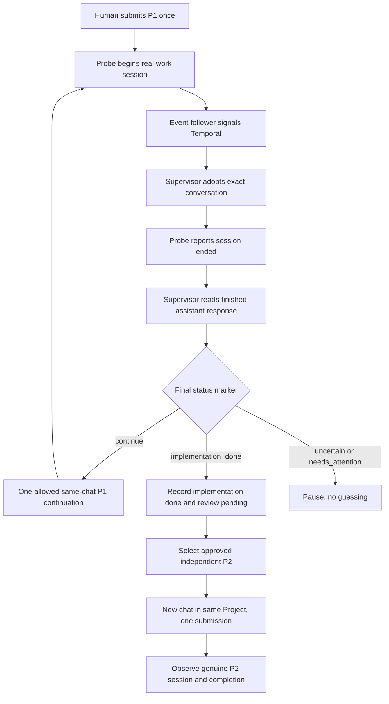

# Flowdeck: human runbook for MacBook / Helium Profile 4

**Prepared:** 2026-10-16. **Audience:** the human owner/operator. **Purpose:** inspect the tested app, manually exercise safe stages, then conduct ONE separately approved attended two-task demonstration.

**This document is instructions, not execution approval.** Writing or reading it does not start anything. Historical A/B recovery is excluded. Do not use recovery/resume commands for this pilot.

## 1. Where we are and the shortest route

The engineering report at `.state/verification-runs/pilot-budget-20261016-g9G9cz/RESULTS.md` records 361 passing tests, 3 skips, nine real-Temporal synthetic scenarios, fifteen replay passes, and a real browser 1 + 10 consecutive no-send campaign. These are recorded results, not checks rerun while this guide was written.

Remaining work:

1. Inspect the existing build and environment.
2. Obtain owner approval to provision the fresh worktree and its active plan.
3. Have the actual enrollment and event configuration prepared and reviewed.
4. Freeze the resulting runtime/configuration evidence.
5. Give separate approval for one bounded live execution.
6. Launch once, manually send P1 once, observe the automatic continuation and P2.
7. Stop, reconcile, and collect the hand-in evidence.

**Fast path:** reuse unchanged-build test evidence. Do not rerun every synthetic scenario or rebuild merely to demonstrate activity. Optional exercises below let you understand the app; they are not all prerequisites to repeat.

**Current readiness is not live completion.** The fresh worktree/approval was absent in the engineering report. Check current reality; do not assume a later operator has or has not provisioned it.

## 2. What the app does



- **Temporal:** durable control flow. Its query/result is authoritative for this run.
- **Worker:** runs workflow code and browser/file activities. Starting a worker is not itself starting a workflow, but a worker can execute queued work.
- **Follower:** reads genuine connector events and signals the intended workflow. It writes an inbox/checkpoint; it is not read-only.
- **Probe RemoteMCP2:** executes work on the MacBook and emits work-session events. A finish event is an agent report, not independent acceptance.
- **Helium Profile 4:** authenticated browser used for the exact ChatGPT Project.
- **Dashboard:** optional projection; can be stale or unavailable. Never use a green dashboard as permission to send.
- **Send journal/claims:** evidence preventing unsafe repeated sends. Never delete them to get another attempt.

Budget: P1 owner prompt once; at most one automated P1 continuation; zero P2 continuations; at most one automated P1→P2 new-chat submission; at most two automated reservations. A reservation is not proof of message delivery. If P1 finishes immediately, P2 may advance, but the continuation acceptance criterion was not demonstrated.

## 3. Safety labels and rules

| Label | Meaning |
|---|---|
| READ | Reads local/service state; no intended browser submission or workflow start |
| LOCAL WRITE | Writes evidence, clipboard, build files, or configuration |
| SYNTHETIC | Starts isolated real Temporal workflows with fake activities; no real browser |
| NO-SEND BROWSER | Creates owned tabs, selects connector, types/clears test drafts; never Send |
| LIVE | Starts real automation and can submit approved messages |

Never:

- Delete `.state`, claims, inboxes, authorization slots, or original reports.
- Start a second sender, use another checkout to bypass claims, or change device identity to escape a lock.
- Relaunch with a new attempt name after an uncertain start.
- Manually submit P2, click Send on an automated draft, or repeat P1.
- Close P1's original tab until terminal reconciliation.
- Call begin/finish hooks yourself to manufacture successful events.
- Modify approval markers or task rows during the demonstration.
- Run historical `npm run worker/start/seed/verify` commands for this pilot.

If anything differs from the expected output, stop that stage. Do not improvise a bypass.

## 4. Open your terminal and create an evidence notebook

Open macOS Terminal. Use one tab for commands now. Later use tab A for the launcher and tab B for inspection.

**READ — run in every new terminal tab:**

```sh
cd /Users/test/Documents/work/temporal-harness-mvp
pwd
node --version
npm --version
command -v temporal
```

Expected `pwd`: `/Users/test/Documents/work/temporal-harness-mvp`. Do not run commands from the proposed Sashai worktree: that is the task workspace, not the supervisor runtime.

If Node/npm are unavailable, use the already configured development shell. Do not upgrade dependencies or install a new Temporal server just to make the demo run. The event follower requires a Node runtime supporting `node:sqlite`.

**LOCAL WRITE — create a new private evidence directory:**

```sh
umask 077
mktemp -d /Users/test/Documents/work/temporal-harness-mvp/.state/verification-runs/human-pilot-XXXXXXXX
```

Copy the printed absolute path into a note. Do not reuse an old evidence directory. This command does not create a workflow or authorization.

Start your notebook with:

```text
Human operator:
Date/time/time zone:
Evidence directory:
Runtime repository:
Pilot ID: sashai-fresh-attended-20261016-03
P1: sashai-fresh-attended-p1-20261016-03
P2: sashai-fresh-attended-p2-20261016-03
Worktree approval reference: NOT YET RECORDED
Execution approval reference: NOT YET RECORDED
Build manifest:
Final configuration manifest:
Workflow ID:
Exact Temporal run ID:
Observed manual submissions: 0
Observed automated submissions: 0
Uncertain submissions: 0
```

Keep logs private. They can contain conversation URLs, local paths, owner IDs, and task text. Redact screenshots before hand-in; do not publish browser cookies, CDP debugger URLs, or raw credential/configuration dumps.

## 5. Stage A — inspect the tested baseline

**READ:**

```sh
git --no-optional-locks status --short
git --no-pager log -1 --format=%H
shasum -a 256 -c .state/verification-runs/pilot-budget-20261016-g9G9cz/runtime-sha256-final.txt
node scripts/flowdeck-fresh-pilot-preflight.mjs \
  --root /Users/test/Documents/work/temporal-harness-mvp \
  --proposal /Users/test/Documents/work/temporal-harness-mvp/docs/FLOWDECK_FRESH_ATTENDED_PILOT_PROPOSAL_2026-10-16.json
```

Expected:

- Dirty/untracked files are normal for this repository. Do not reset or clean them.
- Each frozen manifest entry says `OK`. A mismatch requires identifying the exact change, not overwriting the file.
- Preparation preflight intentionally returns `readyForExecution:false`, `executionAuthorized:false`, `writes:false`.
- Before provisioning, expected blockers include `owner_approval_missing` and `worktree_not_provisioned`; exit code 2 is expected.

After approved enrollment changes, the old manifest's enrollment hash may legitimately differ. Preserve the old manifest; produce a new reviewed operational manifest explaining that delta. Do not call the old baseline unchanged in that case.

The preparation checker only accepts a prepared proposal. It is NOT a final launch gate and is not expected to become executable by flipping JSON booleans. After enrollment it can also report reused identities; inspect the actual enrolled configuration instead of trying to force this proposal checker green.

**Pass:** you know the tested code baseline and any changes since it. **Stop:** unexplained runtime/hash drift.

## 6. Stage B — inspect services and browser manually

### B1. Is Temporal reachable? READ

```sh
lsof -nP -iTCP:7233 -sTCP:LISTEN
```

A listener is only connectivity evidence, not proof of the correct namespace or healthy workflows. The SDK inspection in section 10 checks actual executions. If no listener exists, ask the maintainer to restore the established service and persistent state. Do not start a new empty server as a substitute for historical state.

### B2. Are senders already running? READ

```sh
ps -axo pid=,ppid=,command= | grep -E '[f]lowdeck-(launch|supervisor|work-events|resume-send)|[f]lowdeck.*smoke'
```

No output is a useful process check, not a complete safety guarantee. Unknown matching processes require investigation. Do not use `killall node`; other applications use Node. A passive watcher is not automatically a sender; identify it before acting.

### B3. Verify Helium Profile 4 by eye

1. Open the existing Helium application. Do not use a second user-data directory.
2. Select the established Profile 4 through the profile menu.
3. In that window open `chrome://version` and inspect **Profile Path**. It must end in `Profile 4`.
4. Confirm you are signed into the intended ChatGPT account.
5. Open the supported Project URL:

```text
https://chatgpt.com/g/g-p-6ab28bdd7fbc8191b581316ff09da79d/project
```

6. Confirm the Project, but do not create or submit the live P1 prompt yet.
7. Do not modify unrelated drafts or personal conversations.

The existing `scripts/open-helium-profile4.sh` opens the optional dashboard and requires it to be running; it is not a CDP repair script. Do not install a dashboard solely for this pilot.

### B4. Check local browser debug access. READ

```sh
curl --fail --silent --show-error --max-time 5 http://127.0.0.1:9222/json/version
```

Expected JSON describing the browser. This endpoint does not prove which profile a target belongs to: retain the manual Profile Path check and runtime identity checks. Do not share its debugger endpoint publicly. Keep CDP local to the Mac.

List only relevant target IDs without dumping unrelated tab contents:

```sh
node --input-type=module <<'NODE'
const response = await fetch('http://127.0.0.1:9222/json/list', {
  signal: AbortSignal.timeout(5000),
});
if (!response.ok) throw new Error(`CDP HTTP ${response.status}`);
const tabs = await response.json();
for (const tab of tabs) {
  const url = String(tab.url ?? '');
  if (url.includes('flowdeckAttempt') ||
      url.includes('g-p-6ab28bdd7fbc8191b581316ff09da79d')) {
    console.log(JSON.stringify({
      id: tab.id,
      type: tab.type,
      ownedTestTag: url.includes('flowdeckAttempt'),
      supportedProjectPath: url.includes('g-p-6ab28bdd7fbc8191b581316ff09da79d'),
    }));
  }
}
NODE
```

This is an inventory, not a destination authorization. If CDP is unavailable, stop and ask the maintainer to restore the established authenticated browser configuration. Do not kill Helium or remove profile locks: that can lose the exact predecessor tabs.

## 7. Stage C — optional no-send browser exercise

**Do not run while any live supervisor is active.** This stage changes owned browser tabs/drafts but never calls Send. The current-build campaign already passed; repeat only for learning, changed browser/runtime conditions, or a new required readiness gate.

Move hands away from the browser while the script operates. Do not press Return in the composer.

```sh
node scripts/flowdeck-browser-check.mjs --repeat 1
```

Expected output includes:

```json
{
  "check": "real_browser_connector_selection",
  "iteration": 1,
  "ok": true,
  "profile": "Profile 4",
  "connector": "Probe RemoteMCP2",
  "fullComposerMatched": true,
  "browserSubmissions": 0,
  "chatCreated": false
}
```

Additional fields are normal. You should see an owned Project tab open, the connector selected, the transport draft staged/cleared, and the tab close. Opening a tab is not a submitted ChatGPT conversation.

If a full campaign is required and the single check passed:

```sh
node scripts/flowdeck-browser-check.mjs --repeat 10
```

Expected final summary:

```json
{"check":"repeated_immediate_staging","requested":10,"passed":10,"browserSubmissions":0}
```

Also expect ten cleanup messages. Each attempt is bounded by a 50-second outer timer. A hard process timeout can bypass normal cleanup, so inspect owned tabs even if the process exits.

**Stop on first failure.** Preserve its output. Do not combine successful attempts from multiple failed campaigns. If an owned tab remains, identify that exact tab from the log; do not clear any other draft. Leave ambiguous drafts untouched for reconciliation. `connector_missing`, URL hydration errors, full-payload mismatch, and cleanup failures are real failed checks.

## 8. Stage D — optional synthetic exercises

These start real Temporal test workflows on unique queues but use fake activities. They do not demonstrate a real ChatGPT submission. Do not run them during the live demonstration.

```sh
node scripts/flowdeck-pilot-budget-smoke.mjs happy
node scripts/flowdeck-pilot-budget-smoke.mjs second-continuation
node scripts/flowdeck-pilot-budget-smoke.mjs p2-unfinished
```

Expected: happy schedules one continuation and one next-chat activity; second-continuation pauses after one continuation; p2-unfinished sends P2 once but never continues P2.

Other verified scenario names, if investigating a regression:

```sh
node scripts/flowdeck-pilot-budget-smoke.mjs p1-immediate
node scripts/flowdeck-pilot-budget-smoke.mjs publisher-offline
node scripts/flowdeck-pilot-budget-smoke.mjs continuation-failure
node scripts/flowdeck-pilot-budget-smoke.mjs next-failure
node scripts/flowdeck-pilot-budget-smoke.mjs recovery-blocked
node scripts/flowdeck-pilot-budget-smoke.mjs missing-policy
```

Use one at a time and retain each exact workflow/run ID. A paused business result can be the expected PASS of a negative test. A timeout or failed assertion is not a pass. These scripts create server history and synthetic workers, so they are not read-only.

If you changed source and need regression validation:

```sh
npm run build
npm run test:portable
npm test
git diff --check
```

Build writes `dist`; suites can use local services and are not fully hermetic. Do not rebuild a frozen live runtime during a run. Changed workflow bytes require appropriate historical/new replay validation before deployment, not just unit tests. For the unchanged validated build, reuse the existing replay report.

## 9. Stage E — provision the approved worktree and actual configuration

**OWNER PREPARATION APPROVAL REQUIRED. Still no live execution.**

Proposed workspace:

```text
/Users/test/Documents/work/sashai-flowdeck-fresh-attended-20261016-03
```

The source repository/base revision and installed connector ledger paths are not specified by this human runbook. They must be established locally. A guessed `git worktree add` command or guessed owner/device is unsafe. This is the one setup handoff you should require from the maintainer before proceeding.

Give the maintainer this checklist:

```text
Prepare the fresh disposable pilot only, using my separately recorded preparation approval.
1. Confirm the source repository, approved base revision, and AGENTS.md requirements.
2. Create the disposable worktree without altering unrelated worktrees or historical artifacts.
3. Establish its approved active plan through the normal owner workflow.
4. Prepare exactly P1/P2 with the existing proposal instructions and hard budget.
5. Add a uniquely identified enrollment only after approval; preserve every existing enrollment.
6. Prepare a dedicated event-config file using the actual installed plugin repository,
   ledger, owner/device identity and a new private inbox directory.
7. Validate the production loader and read-only event-source access.
8. Supply exact final paths, hashes, owner-approval record, and the reviewed launch command.
Do not start a sender/follower or submit messages. Do not change historical A/B claims.
```

### E1. Understand the task-source files

The current loader requires `AGENTS.md`, `.ai/harness/active-plan`, and `.ai/harness/active-worktree` inside the task worktree. Do not fabricate these solely to satisfy a parser; they represent actual owner-approved routing.

Expected active-plan marker content:

```text
plans/plan-flowdeck-fresh-attended-20261016-03.md
```

Expected active-worktree marker resolves to the exact disposable worktree. An absolute path is supported. The plan needs exactly one `## Task Breakdown` section with these two unchecked titles:

```markdown
## Task Breakdown

- [ ] Fresh attended pilot P1: two-turn checkpoint
- [ ] Fresh attended pilot P2: independent glossary
```

Titles must exactly match enrollment. Do not check off either row during the live run: the send path reloads authority and changes can invalidate the configured snapshot. Record implementation completion separately; external review and plan maintenance happen later.

**READ — after provisioning:**

```sh
node --input-type=module <<'NODE'
import { inspectSashaiTaskSource } from './dist/sashai-task-source.js';
const result = await inspectSashaiTaskSource(
  '/Users/test/Documents/work/sashai-flowdeck-fresh-attended-20261016-03'
);
console.log(JSON.stringify(result, null, 2));
if (result.status !== 'approved_plan_has_pending_tasks' || result.pendingCount !== 2) {
  process.exitCode = 2;
}
NODE
```

Expected status `approved_plan_has_pending_tasks`, correct repository, two exact titles. `dispatchAllowed:false` is intentional: task-source inspection alone does not grant send permission.

### E2. Validate the actual enrollment, not just the proposal

Production enrollment lives at `.state/flowdeck-supervisor/projects.json`. The prepared proposal is deliberately not a substitute. Let the approved setup process merge the new entry; do not overwrite this file with an example.

Required budget in the new project entry:

```json
{
  "attendedPilotBudget": {
    "schema": "flowdeck.attended-pilot-budget/v1",
    "initialTaskId": "sashai-fresh-attended-p1-20261016-03",
    "nextTaskId": "sashai-fresh-attended-p2-20261016-03"
  }
}
```

The entry also requires `id`, actual `ownerId`/`deviceId`, `repo`, `projectUrl`, `initialTaskId`, and ordered P1/P2 tasks with exact titles and complete instructions. Neither task may depend on external review for this independent pilot.

**READ:**

```sh
node --input-type=module <<'NODE'
import { loadSupervisorProject } from './dist/flowdeck-projects.js';
const p = await loadSupervisorProject('sashai-fresh-attended-20261016-03');
console.log(JSON.stringify({
  id: p.id, repo: p.repo, projectUrl: p.projectUrl,
  initialTaskId: p.initialTaskId,
  tasks: p.tasks.map(t => ({id: t.id, title: t.title})),
  attendedPilotBudget: p.attendedPilotBudget,
}, null, 2));
NODE
```

Stop if missing, malformed, wrong worktree, wrong policy, or different task text. Loading successfully validates source routing but is not independent authentication of owner approval.

### E3. Event configuration

Ask the maintainer to provide this dedicated file at the following proposed runbook path, or revise every subsequent command to the actual reviewed path:

```text
/Users/test/Documents/work/temporal-harness-mvp/.state/flowdeck-human-pilot-events.json
```

**Schema example only — NOT executable configuration:**

```json
{
  "plugin-repo": "REPLACE_WITH_VERIFIED_ABSOLUTE_INSTALLED_PLUGIN_REPO",
  "db": "REPLACE_WITH_VERIFIED_ABSOLUTE_PLUGIN_LEDGER_PATH",
  "owner": "REPLACE_WITH_VERIFIED_OWNER_ID",
  "device": "REPLACE_WITH_VERIFIED_DEVICE_ID",
  "project-id": "sashai-fresh-attended-20261016-03",
  "workflow-id": "flowdeck-supervisor-sashai-fresh-attended-20261016-03",
  "directory": "REPLACE_WITH_APPROVED_NEW_PRIVATE_ABSOLUTE_INBOX_DIRECTORY",
  "address": "127.0.0.1:7233",
  "namespace": "default"
}
```

Values must match real enrollment/installation. Do not discover them by copying credentials, inventing a device, or selecting a random SQLite file. Inbox must be private, separate from the source ledger and other writers. Do not reuse the historical inbox. No password/API key belongs in this example.

**READ — only once that real file exists:**

```sh
node scripts/flowdeck-work-events.mjs status \
  --config /Users/test/Documents/work/temporal-harness-mvp/.state/flowdeck-human-pilot-events.json
node scripts/flowdeck-work-events.mjs once \
  --config /Users/test/Documents/work/temporal-harness-mvp/.state/flowdeck-human-pilot-events.json
```

`status` reads the inbox. `once` reads the installed source head/startup snapshots; it does not signal Temporal. An old snapshot is not a new live session. Neither command proves a new genuine P1 event pair has occurred.

## 10. Stage F — final operational preflight and approval

### F1. Check scope ownership. READ

```sh
node --input-type=module <<'NODE'
import { loadSupervisorProject } from './dist/flowdeck-projects.js';
import { inspectAttemptScope } from './scripts/flowdeck-attempt-scope.mjs';
const project = await loadSupervisorProject('sashai-fresh-attended-20261016-03');
const scope = await inspectAttemptScope(process.cwd(), project);
console.log(JSON.stringify(scope, null, 2));
if (scope.occupied) process.exitCode = 2;
NODE
```

Occupied means STOP and reconcile, not delete. Scope protection is checkout-local; separately check that nobody runs another checkout/device identity against this browser.

### F2. List running Flowdeck workflows and inspect the planned identity. READ

```sh
node --input-type=module <<'NODE'
import { Connection, Client } from '@temporalio/client';
const connection = await Connection.connect({
  address: '127.0.0.1:7233', connectTimeout: '5s',
});
try {
  const client = new Client({ connection, namespace: 'default' });
  await connection.withDeadline(Date.now() + 10000, async () => {
    let matches = 0;
    for await (const w of client.workflow.list({
      query: "ExecutionStatus = 'Running'",
    })) {
      if (w.workflowId.startsWith('flowdeck-')) {
        matches++;
        console.log(JSON.stringify({workflowId: w.workflowId, runId: w.runId}));
      }
    }
    console.log(JSON.stringify({runningFlowdeckExecutions: matches}));
    if (matches) process.exitCode = 2;
  });
} finally { await connection.close(); }
NODE

node scripts/flowdeck-supervisor.mjs workflow-status sashai-fresh-attended-20261016-03
```

Expected planned workflow: `exists:false`. A completed old execution with the same ID also blocks launch. Do not add `--attempt` to evade it. A listing failure/timeout means unverified, not zero.

### F3. Freeze final inputs

The maintainer should supply a final manifest covering unchanged runtime plus the actual enrollment, event config, approved plan, routing markers, and instructions. The old 103-file manifest includes the old enrollment; preserve it as historical baseline. Record legitimate new state deltas without claiming the whole production-state digest remained unchanged after enrollment.

Manual checklist:

- [ ] Correct Profile 4/account/Project, local CDP healthy.
- [ ] Exact tested runtime, or reviewed/revalidated changes.
- [ ] Worktree and active plan genuinely approved.
- [ ] P1/P2 artifacts absent; no reuse of old task outputs.
- [ ] Policy loaded and tasks match exactly.
- [ ] Event source owner/device/schema verified.
- [ ] No competing sender/claim/workflow.
- [ ] Historical A/B records untouched.
- [ ] Laptop plugged in, lid stays open, network stable; no browser upgrades/restarts during run.
- [ ] Human remains present throughout.

### F4. Record separate execution approval

Example wording for the actual owner to decide and record, AFTER the checklist and manifest exist:

> I approve one attended execution of pilot sashai-fresh-attended-20261016-03 using the exact final manifest identified in this approval, the approved disposable worktree, the supported Sashai Project, Helium Profile 4 and Probe RemoteMCP2. Permit one owner P1 prompt, at most one automated same-chat P1 continuation and one automated P2 new-chat submission. No P2 continuation, extra task, automatic retry/recovery, historical A/B changes, or new generation is authorized. Stop on uncertainty.

Replace the reference to the manifest with its actual recorded identity. A template, this document, or a proposed phrase is not approval. Retain who approved, when, through which established owner channel, and the scope. The CLI is not an owner-authentication system; human authorization remains an operational control.

## 11. Stage G — launch ONCE, then submit P1 ONCE

**LIVE SECTION. Do not execute until section 10 is complete.**

### G1. Terminal A: start coordinated launcher

Do not separately start worker/start/follow commands alongside it. The launcher owns these components. It uses the production `flowdeck-supervisor` queue, so the no-conflicting-execution check is essential.

```sh
cd /Users/test/Documents/work/temporal-harness-mvp
node scripts/flowdeck-launch.mjs \
  sashai-fresh-attended-20261016-03 \
  /Users/test/Documents/work/temporal-harness-mvp/.state/flowdeck-human-pilot-events.json
```

This writes claims/inbox state, starts a durable workflow and real worker/follower, and can lead to messages after events. It is not a dry run. Uses existing `dist`; does not rebuild.

Wait for the exact final line:

```text
ALL COMPONENTS READY MANUAL START NOW
```

An earlier worker `READY:` line alone is insufficient. Startup has a 30-second bound. If startup fails or times out, **do not rerun**: a workflow/claim may already exist. Inspect from terminal B and reconcile.

### G2. Terminal B: inspect authoritative status

```sh
cd /Users/test/Documents/work/temporal-harness-mvp
node scripts/flowdeck-supervisor.mjs workflow-status sashai-fresh-attended-20261016-03
```

Expected: Temporal `RUNNING`, phase `waiting_for_manual_start`, correct project and P1. If not, do not submit anything.

### G3. Copy P1 from the loaded approved enrollment

**LOCAL WRITE: clipboard only.** Run only after confirming you intend to replace the clipboard:

```sh
node --input-type=module <<'NODE'
import { loadSupervisorProject } from './dist/flowdeck-projects.js';
import { spawnSync } from 'node:child_process';
const p = await loadSupervisorProject('sashai-fresh-attended-20261016-03');
const t = p.tasks.find(t => t.id === p.initialTaskId);
if (!t || t.id !== 'sashai-fresh-attended-p1-20261016-03') {
  throw new Error('Unexpected initial task');
}
const copied = spawnSync('/usr/bin/pbcopy', [], {
  input: t.instruction, encoding: 'utf8',
});
if (copied.error) throw copied.error;
if (copied.status !== 0) throw new Error('Clipboard copy failed');
console.log('Copied approved P1 instruction. Nothing submitted.');
NODE
```

This copies actual approved text, not a paraphrase from this guide. If it differs from the frozen instructions, stop.

### G4. Human browser actions

1. In Profile 4 open the exact supported Project.
2. Choose a NEW chat inside that Project, not a global unrelated new chat.
3. Select **Probe RemoteMCP2** and visually verify selection.
4. Paste P1 with Command-V. Do not press Return yet.
5. Read the full staged text: P1 ID, approved worktree, first-turn checkpoint, one continuation instruction, genuine begin/finish hooks, final markers.
6. Confirm this is not an old A/B conversation or a no-send transport tab.
7. Submit P1 once using the Send button.
8. Record time and conversation URL. Leave the tab open.
9. Do not click Send again if it seems slow. Inspect and reconcile instead.

Do not open P2 manually. Do not send a greeting, clarification or extra test message: that changes the bound conversation and send budget.

## 12. Stage H — observe each live checkpoint

You can repeat the read-only workflow-status command manually in terminal B. Do not interact with the composer while automation is operating. Some phases are too brief to catch in a query; history/log evidence should establish them.

### H1. Initial P1 adoption

Expected:

- P1 prompt appears once.
- Probe begins a genuine new work session.
- State moves through adoption/working for the correct task/chat/tab.
- No supervisor copy of the initial prompt appears.

Potential phases include `pending_adoption`, `working`, and `waiting_for_chat_response`. Missing events are not fixed by injecting signals or manually invoking hooks.

### H2. P1 deliberately unfinished

P1 should create only its checkpoint artifact, call finish_work for its workId with partial outcome, then end the assistant answer with:

```text
FLOWDECK_STATUS: continue
```

The supervisor must wait for a reconciled finished response, not advance on the session-end event alone. If the report arrived but the answer is still streaming, waiting is correct.

### H3. One same-chat continuation

Expected:

- One new supervisor message in the SAME conversation and tab.
- Correct connector still selected.
- A new work session with a new workId.
- P1 adds its Completion section.
- Final answer ends exactly with:

```text
FLOWDECK_STATUS: implementation_done
```

State records `implementation_done` and `review_pending`. It does not mean externally reviewed or accepted.

If P1 returns `continue` a second time, expected result is `needs_attention / paused`; do not help by typing another continuation.

### H4. New-chat P2

Expected:

- A NEW conversation in the SAME supported Project.
- Probe RemoteMCP2 selected.
- The full approved P2 prompt appears once.
- P2 has a genuine begin/finish pair and its own workId.
- Original P1 tab remains available.
- P2 writes its independent glossary and finishes with `FLOWDECK_STATUS: implementation_done`.

A new tab is not sufficient proof of correct Project membership; retain runtime destination checks and manually inspect the visible Project/conversation context. If P2 asks to continue, it must pause, not receive another automated message.

### H5. Final result

Expected normal final state: phase `approved_cycle_finished`, status `implementation_done_review_pending`; both tasks implementation done/review pending. Automated usage is one P1 continuation, one next-chat submission, two total reservations.

If P1 completed immediately, usage can be zero continuations/one next-chat. That is safe behavior, but report the intended continuation demonstration as NOT demonstrated. Do not force another send to make the test pass.

Important distinctions:

- `COMPLETED` is Temporal execution status and can contain a paused business result.
- `needs_attention / paused` is not evidence the workflow is still running.
- `RUNNING` does not mean a browser send is currently executing.
- Projection `degraded` does not itself invalidate a successfully completed business cycle.

## 13. Stage I — inspect artifacts without modifying them

**READ — only after provisioned/run:**

```sh
python3 - <<'PY'
from pathlib import Path
root = Path('/Users/test/Documents/work/sashai-flowdeck-fresh-attended-20261016-03')
for name in ('p1.md', 'p2.md'):
    path = root / 'docs/flowdeck-fresh-attended-2026-10-16' / name
    print('\nFILE:', path)
    print(path.read_text() if path.is_file() else 'ABSENT')
PY
```

Expected P1 structure (exact prose may follow approved instructions):

```markdown
# Fresh Attended Pilot P1

Task ID: sashai-fresh-attended-p1-20261016-03

## Checkpoint
Stage 1 complete; stage 2 pending.

## Remaining work
Append the Completion section during the authorized continuation.

## Completion
Stage 2 finished. External review is pending.
```

Expected P2 structure:

```markdown
# Fresh Attended Pilot P2

Task ID: sashai-fresh-attended-p2-20261016-03

## Glossary
- Work session ended: the work session ended; this is not task acceptance.
- implementation_done: implementation was reported complete.
- review_pending: external review has not yet approved the work.
```

Markers belong at the end of assistant responses; do not require them inside artifacts unless the approved instructions require that. Artifact existence alone does not prove correct dispatch or event correlation.

Inspect worktree changes:

```sh
git -C /Users/test/Documents/work/sashai-flowdeck-fresh-attended-20261016-03 --no-optional-locks status --short
git -C /Users/test/Documents/work/sashai-flowdeck-fresh-attended-20261016-03 --no-pager diff --stat
```

`git diff` excludes untracked files. Compare with the prepared worktree baseline, including any untracked pilot setup files. Unexpected code/Git/approval changes require investigation. This inspection is not an automated review/acceptance pipeline.

## 14. Stop, shutdown, and failures

### Normal shutdown

1. Capture final authoritative status/result before stopping components.
2. In terminal A press Control-C once.
3. Wait for launcher exit. It terminates worker/follower children; it may escalate child termination after two seconds.
4. Repeat process inspection and workflow-status in terminal B.
5. Record exact Temporal run ID and final status.
6. Reconcile send journal/receipts/bindings and genuine event IDs with the maintainer.
7. Only then close known pilot-owned tabs. Do not close unrelated tabs.
8. Leave durable claims/history intact.

**Stopping the launcher does NOT cancel the durable Temporal workflow.** If it still says RUNNING, record that and request an explicit audited cancellation/reconciliation decision. Do not start another worker to see what happens: it could pick up pending activities.

### Emergency/uncertain send

- Do not click or type into the composer.
- Record the time, visible tab and message state, and terminal error.
- Stop the launcher with Control-C to stop local components, while recognizing this is not an atomic browser abort.
- An already-running CDP request or already-submitted ChatGPT task may continue. Neither Temporal timeout nor Control-C proves no send occurred.
- Preserve evidence; inspect workflow/journal/browser state before further action.
- No retry, new attempt name, fresh authorization generation, claim deletion, or manual P2 send.

| Symptom | Action |
|---|---|
| Worker READY but no ALL COMPONENTS READY | Do not send P1; inspect follower/startup failure |
| Launch timeout | Inspect workflow/claims; never blindly rerun |
| `Project is not uniquely enrolled` | Stop; correct reviewed enrollment before a new approved launch decision |
| `owner_approval_missing` from proposal checker | Expected preparation boundary; not permission to remove it |
| Scope occupied | Preserve claim; audited reconciliation |
| `connector_missing` | Stop, preserve diagnostics; do not select another connector |
| `requireTab/tab_missing` | No silent replacement/rebind; stop |
| Prompt/identity mismatch | No edits to force matching; reconcile |
| No work event | Do not synthesize events; inspect real source/readiness |
| Second P1 continue or any P2 continue | Expected hard-budget pause |
| Dashboard stale/offline | Inspect authoritative Temporal state; no resend |
| Message may have been submitted | Treat as uncertain; no retry |
| Artifact absent after completed workflow | Inspect business result; COMPLETED may be paused |
| Runtime/plan changed during run | Stop and reconcile; do not hot-edit around authority checks |

## 15. Get the exact run ID for evidence

**READ:**

```sh
node --input-type=module <<'NODE'
import { Connection, Client } from '@temporalio/client';
const connection = await Connection.connect({address:'127.0.0.1:7233', connectTimeout:'5s'});
try {
  const client = new Client({connection, namespace:'default'});
  await connection.withDeadline(Date.now() + 10000, async () => {
    const d = await client.workflow.getHandle(
      'flowdeck-supervisor-sashai-fresh-attended-20261016-03'
    ).describe();
    console.log(JSON.stringify({workflowId:d.workflowId, runId:d.runId, status:d.status.name}, null, 2));
  });
} finally { await connection.close(); }
NODE
```

A not-found error is not an instruction to start again. Compare with launch output and the exact approved identity.

## 16. Human result sheet and hand-in

Fill this out with observations, not assumptions:

```text
RESULT: PASS / PARTIAL / BLOCKED
Owner approval reference:
Final manifest:
Workflow ID / exact run ID:

Initial manual P1 messages: observed __
Adoption without resend: YES / NO / UNVERIFIED
P1 first workId:
P1 continuation workId:
P2 workId:
P1 continuation in same chat: YES / NO / NOT EXERCISED
P2 new chat in same Project: YES / NO / UNVERIFIED
Connector verified on required turns: YES / NO
Observed automated message count:
Uncertain send count:
Budget reservations from authoritative state:
P1 implementation/review status:
P2 implementation/review status:
Artifacts inspected:
Unexpected modifications:
Final Temporal execution status:
Final business status/blocker:
Worker/follower stopped:
Residual pilot-owned tabs:
Historical A/B records preserved:
Known limitations:
```

Full attended pilot PASS requires adoption without resend, one correct same-chat continuation, P1 completion/review-pending, one correct new-project-chat P2 submission, P2 completion/review-pending, correlated genuine sessions, bounded sends, and reconciled shutdown. Do not label a no-send test, synthetic test, or budget pause as a full live product pass.

Hand-in package:

- Brief product explanation and architecture diagram.
- Exact tested runtime/configuration manifest and code inventory (HEAD alone is insufficient).
- Existing automated/replay/browser results, clearly labeled by test type.
- This human runbook.
- Live observation sheet, redacted screenshots/recording if available, workflow/run IDs, task artifacts.
- Limitations: external review, historical B still blocked, unattended in-flight cancellation not fully certified, at-most-one click intent rather than guaranteed exactly-once remote delivery.

If the live run fails, submit an honest partial result with the blocker. Do not spend the deadline inventing retries or redesigning the app. A fresh execution requires a new decision after reconciliation.

## 17. References and maintenance

- `docs/FLOWDECK_FRESH_ATTENDED_PILOT_PROPOSAL_2026-10-16.json`: full task instructions, not production enrollment.
- `docs/FLOWDECK_FRESH_ATTENDED_PILOT_RUNBOOK_2026-10-16.md`: engineering scope/approval boundaries.
- `.state/verification-runs/pilot-budget-20261016-g9G9cz/RESULTS.md`: completed budget/browser/replay evidence.
- `docs/FLOWDECK-WORK-EVENTS.md`: event source and follower semantics.
- `docs/FLOWDECK_NEW_ARCHITECT_HANDOFF_2026-10-15.md`: architecture/history and superseding status.

Commands in this guide were checked against current script source while writing. No live commands were executed to validate this document. If CLI behavior or configuration changes, stop and update/review the runbook before executing the LIVE section.
