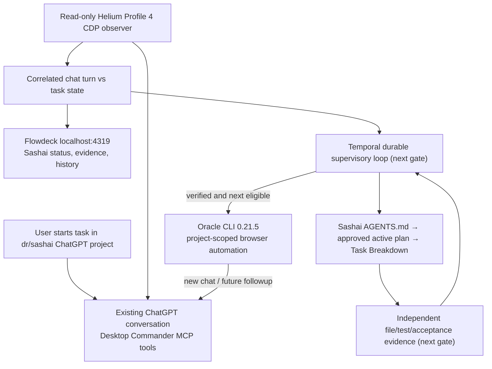

# Oracle-only Sashai Chat Supervisor — canonical execution plan

Date: 2026-10-14
Owner goal: Leave a manually started ChatGPT project task running; the supervisor watches the same conversation without duplicate prompts, understands its status, independently verifies the task, continues unfinished work in that chat, and creates a new **project-scoped Sashai chat with Desktop Commander** for the next approved item. **Repo Harness is excluded from this active chain.**

## Browser-origin Sashai chat and Desktop Commander — 2026-10-14

**Manual browser creation plus connector invocation:** A new project-scoped Sashai chat (`6acfca8f-34cc-83eb-aaa9-fbd1301247d4`) was created in a dedicated Helium Profile 4 window through the ChatGPT UI, not Oracle. The main browser process was reused. Remote Desktop Commander was selected from the composer app menu and one guarded, strictly read-only check of the MVP folder was submitted. ChatGPT's expanded activity independently showed **“Listed devices and retrieved file metadata”**. This proves tool invocation for a harmless check; it does **not** prove a real repository implementation task.

**Automatic passive adoption:** the existing 5-second watcher detected this chat while generating, logged `single_running_chat`, and adopted it without sending a duplicate prompt. A durable `SEND_ATTEMPTED` guard prevents replay of the test submission.

**Continuation without an Oracle parent session:** clean Oracle CLI 0.21.5 used `--browser-tab` with this **exact manually started conversation URL** and sent one harmless continuation. Session `sashai-manual-origin-v0215-followup` exited `completed`, returned the same conversation ID, and captured `SASHAI_BROWSER_ORIGIN_ORACLE_FOLLOWUP_OK`. CDP observed two user and two assistant turns in this same chat. An independent send guard prevents blind retries.

**Oracle correlation:** Flowdeck now finds relevant Sashai Oracle sessions dynamically, matches the locally saved native Oracle `## Answer` against the actual browser reply, and omits the private saved answer from the Oracle metadata JSON response. `taskState` remains `unverified`.

**Authoritative next-task gate:** `.ai/harness/active-plan` and `.ai/harness/active-worktree` are both absent from `/Users/test/Documents/work/sashai`. Its non-archived localization plan records W1–W7 complete and explicitly disclaims active execution selection. `src/sashai-task-source.ts` therefore returns `no_active_plan` and `dispatchAllowed=false`, refuses archived/external plans, and never promotes derived `tasks/current.md` or deferred `tasks/todos.md`.

**Important transport limitation (confirmed in Oracle 0.21.5 source, not live re-tested):** in `dist/src/browser/index.js`, `submitOnce()` unconditionally invokes `clearPromptComposer()` before inserting its prompt. The implementation clears the editable element, including the Remote Desktop Commander mention selected in ChatGPT's composer. Therefore **do not** preselect the plugin in a new chat and then let unmodified Oracle submit that turn, assuming the plugin will survive. For MCP-using turns, use the demonstrated guarded **browser UI plugin selection + UI submission** until a tested integration hook exists. For text-only continuation, `oracle --browser-tab <exact-conversation-url>` is proven. Any tool-using continuation requires its own validated connector-selection and one-shot dispatch, not an unconditional Oracle `--followup`. No real task dispatch is enabled.

**Remaining before unattended real tasks:** implement a guarded browser-UI tool-selected task dispatcher (or a fully tested Oracle connector-selection hook), bind an explicitly approved task and acceptance criteria, independently verify file/test outcomes, and implement durable Temporal idempotent decision/dispatch/verification. No real Sashai task has been executed by this test.

## Current implementation update — Oracle 0.21.5 proven (2026-10-14)

**Supersedes the 0.21.3 capture blocker below.** Oracle 0.21.5 is pinned as an unmodified npm release inside `.state/oracle-v0215`; global Homebrew 0.21.3 remains untouched. The isolated 0.21.3 compatibility patch was retired from active execution.

- **New chat inside Sashai**: `sashai-pristine-v0215-smoke` -> `completed` in 19.5s, response file `SASHAI_ORACLE_0215_OK`.
- **Same chat followup**: `sashai-pristine-v0215-followup` -> `completed` in 17.7s, response file `SASHAI_ORACLE_0215_FOLLOWUP_OK`; identical original/followup conversation ID `6acfc4f3-2cdc-83eb-8e4a-c8a955ce7fb0`. One submission per session, no replay.
- **Profile 4 and read-only observer**: extra separate window, same original Helium PID; post-hydration verified 2 user and 2 assistant turns. Flowdeck shows Oracle `completed` and `taskState=unverified`.
- **Background passive watcher**: `org.drunkod.oracle-sashai-passive-watcher`, user LaunchAgent running; 5-second polling. It can adopt only a uniquely active Sashai chat, without submitting prompts or executing code. If multiple tasks are running, it does nothing. Manage via `scripts/manage-sashai-watcher.sh start|stop|status`. This is not yet the durable Temporal task orchestrator.
- **Tests at this earlier milestone**: 19/19. Current browser-origin/plan-source integration has **26/26** passing; Sashai working tree untouched.

**Remaining acceptance gates:** implement guarded UI-origin Desktop Commander selection and submission for actual next-task dispatch, establish an approved active plan/task binding (currently absent), independently verify actual repository acceptance, and implement the durable Temporal loop. Browser-origin adoption and same-chat continuation are proven in the harmless smoke. No actual Sashai task has been claimed complete.

## Historical Oracle 0.21.3 commit-timeout diagnostic (2026-10-14)

Confirmed root cause: Oracle's old ChatGPT turn/assistant-role DOM selectors return zero nodes for Sashai, even though the authenticated Helium UI has the submitted user turn and assistant answer. The original error probe captured `composerCleared=true`, `turnsCount=0`, `userMatched=false`. A read-only CDP probe finds 2 turns using the current `h4.sr-only` headings, and 0 turns with the stock Oracle selector. This was a false negative in Oracle 0.21.3, **not** permission to replay the prompt. Oracle 0.21.5 resolves the fresh-session capture and normal followup cases tested above; manual-chat adoption remains a separate gate.

`node scripts/oracle-sashai.mjs diagnose <existing-slug>` saves privacy-safe local evidence. Future adapter runs now use Oracle `--verbose`, `--heartbeat 5`, and `--perf-trace-path` with logs saved in ignored `.state/` (use `ORACLE_DEBUG=0` to disable). Investigation and remaining acceptance criteria: [ORACLE-PROMPT-COMMIT-RCA.md](ORACLE-PROMPT-COMMIT-RCA.md). The debug investigations did not start new ChatGPT tasks.

## Execution architecture



## Verified on the MacBook, not merely proposed

| Capability | Result | Evidence and qualifications |
| --- | --- | --- |
| Oracle CLI installed | PASS | Isolated runtime is 0.21.5; global Homebrew remains 0.21.3 intentionally |
| Helium Profile 4 with current ChatGPT login | PASS | Existing Helium running with `--profile-directory=Profile 4 --remote-debugging-port=9222` |
| Dedicated project observation window | PASS | Helium main PID unchanged; new window opened with the target conversation URL; original window left alone |
| Direct CDP read-only attachment | PASS | CDP websocket responded and `Runtime.evaluate` returned 1 user turn, 1 assistant turn, no visible Stop button |
| Oracle creates a Sashai project conversation | PASS | Oracle session `flowdeck-sashai-oracle-live-cdp` recorded URL under `g-p-6ab28bdd7fbc8191b581316ff09da79d-dr-sashai/c/...` and `promptSubmitted=true` |
| Oracle prompt actually completed in ChatGPT | PASS BY INDEPENDENT OBSERVATION | Sashai chat showed exactly `ORACLE_SASHAI_SMOKE_OK`. The original Oracle session **still says error** |
| Oracle completion capture | **PASS on 0.21.5 smoke and followup** | Native Oracle 0.21.5 saved both exact answers, statuses `completed`; old 0.21.3 sessions remain failed historical evidence |
| Passive adoption of existing Sashai tab | **PASS for running browser-created chat** | `src/sashai-observer.ts`, `scripts/sashai-supervisor.mjs adopt` and `.state/oracle-sashai/adopted.json`; no prompt sent |
| Live generation state (Stop button present) | **PASS in a live harmless browser-created chat** | Watcher logged `single_running_chat`, then running, then completion; Stop heuristic also has synthetic tests |
| Flowdeck browser status | PASS | `GET /api/sashai/status` returns observed ChatGPT turn, separate Oracle status, response evidence, unverified task state. Homepage renders `public/sashai.html` |
| Legacy Repo Harness removed from active actions | PASS | `POST /api/start` returns 410. Old fixture code and history retained but **not callable through main dashboard** |
| Desktop Commander plugin selection and tool use in browser-created Sashai chat | **PASS for browser UI smoke; production dispatch still pending** | Composer selected Remote Desktop Commander; ChatGPT activity: “Listed devices and retrieved file metadata”. Oracle new-chat automatic connector selection still unimplemented |
| Oracle continuation of manually browser-created Sashai chat | **PASS using 0.21.5 --browser-tab** | Completed session `sashai-manual-origin-v0215-followup`, exact same conversation ID, captured response; original failed 0.21.3 sessions remain unsafe to replay |
| Identify next approved Sashai task | **BLOCKED: no active-plan marker** | Read-only `src/sashai-task-source.ts` confirms no active plan/worktree owner markers. All W1–W7 are complete; deferred goals and idle derived snapshot are not runnable task sources |
| Actual Desktop Commander autonomous work in Sashai | NOT STARTED | No project files changed by this prototype, no task completion asserted |

**Second live Oracle smoke:** `oracle-sashai-local-patched-smoke` created the project conversation ending in `/c/6acfbc18-4c98-83ed-b711-a5a8e9efb121`. The read-only CDP supervisor independently observed one user turn, one assistant turn and response `ORACLE_SASHAI_PATCH_OK_20261014B`. Oracle session status is still `error` and its failure concerns stable prior turns. **No second send/replay was attempted.**

The dashboard supports choosing exactly which open Sashai chat to adopt when multiple chats are present. Adoption is read-only and does not navigate the user's working tab.

**Existing user modifications in `/Users/test/Documents/work/sashai` were left untouched.**

## Source of truth, queues and next-decision rules

- `AGENTS.md` owns repository workflow instructions.
- The **approved active plan** and its `## Task Breakdown` provide eligible execution tasks.
- `tasks/current.md` is a read-only snapshot, not a mutex or an execution queue.
- `tasks/todos.md` holds deferred goals and cannot be promoted automatically.
- A finished ChatGPT assistant turn means `turn_finished`, **never** `task_verified` by itself.
- A screenshot, DOM heuristic, or Oracle `promptSubmitted` is not proof that Desktop Commander performed filesystem work.
- When Oracle exits with `prompt-commit-timeout`, independently inspect the exact conversation before deciding whether to retry. **No automatic replay on uncertain submission.**

## Implementation sequence and acceptance gates

1. **Done:** Direct Oracle + Helium Profile 4 route; independent URL/response observation.
2. **Done:** Adopt existing conversation read-only, detect idle/running/turn-finished and display its source evidence on browser dashboard.
3. **Done for Oracle-created and browser-created sessions:** clean pinned Oracle **0.21.5** passed new-chat and same-conversation followup, then independently continued a browser-started Sashai chat using `--browser-tab <exact-url>`; all captured responses matched live DOM. Old 0.21.3 sessions remain unsafe to replay.
4. **Partially done:** Desktop Commander was selected and invoked on a read-only browser-created Sashai test, and the watcher adopted its live session. **Next:** add a guarded UI-origin connector-selected sender to the durable task dispatcher; unmodified Oracle 0.21.5 clears composer mentions before submission, so preselecting then calling Oracle is unsafe. Verify invocation and idempotency before real repo work.
5. **Gate implemented; execution blocked by missing authority:** resolver reads only explicit `.ai/harness/active-plan` and `.ai/harness/active-worktree` markers and checks `## Task Breakdown`, refusing archive/foreign worktree and `tasks/current.md`/`tasks/todos.md` promotion. No approved plan currently exists. Next obtain deliberate active plan and bind its accepted tasks.
6. **Next:** Add Temporal loop to observe and resume unfinished work in the **same** chat, then independently verify accepted work and open next task in a new **Sashai** chat. Guard each submission with a persisted claim and reconcile before retry.
7. **Next:** Surface per-chat/task status in Flowdeck and optional summary in the actual ChatGPT conversation, but keep polling read-only.

## Final MVP evidence

- Codegraph reindexed the current Oracle-only MVP: **22 source files, 336 nodes, 589 edges**. Earlier 15/217/403 and 18/265/478 were historical counts.
- The test suite passed **26/26** after upgrading to clean Oracle 0.21.5, including real completed Oracle session/followup evidence, read-only Sashai adoption, ambiguous auto-adopt guards and duplicate-send prevention for a repeated adoption.
- After correcting the launcher process check, the Mac showed **three Helium windows instead of two**, with the SAME main Helium PID. The new foreground window contained Flowdeck; the Sashai conversation was left in its own window.
- Clean Oracle 0.21.5 captures and completes both the fresh project chat and its followup. Historical 0.21.3 sessions remain `error`: never replay them. The supervisor must NOT infer project-task completion from the chat response.

## Demo now

```bash
cd /Users/test/Documents/work/temporal-harness-mvp
npm test
node scripts/sashai-supervisor.mjs doctor
node scripts/sashai-supervisor.mjs status
node scripts/sashai-supervisor.mjs watch 5
scripts/open-helium-profile4.sh
```

Browser UI: **http://127.0.0.1:4319/**.

Only when exactly one Sashai conversation is already open in Helium:

```bash
node scripts/sashai-supervisor.mjs adopt
```

The above commands never send a ChatGPT prompt. Browser requests `GET /api/sashai/status` and `POST /api/sashai/adopt` read the selected tab and optionally persist its exact URL. Legacy fixture start is deliberately disabled.

For a NEW prompt via Oracle (potential browser UI side effect; never replay blindly), use `node scripts/oracle-sashai.mjs preview 'Your task'` first. Oracle 0.21.5 capture is proven for the two harmless Sashai test prompts. Real Desktop Commander task dispatch remains disabled pending separate connector selection and task-evidence gates.

Read-only background observer: `scripts/manage-sashai-watcher.sh status` (or `start|stop`); logs are ignored under `.state/oracle-sashai/`.

## Historical project note

`docs/CHATGPT-PROJECT-ORCHESTRATOR-PLAN.md` contains the earlier Repo Harness-based design and should no longer be used to choose runtime commands. `docs/SASHAI-SUPERVISOR-JOURNEY.md` records the agreed end-user behavior, now implemented only through its read-only adoption/observation stages.
