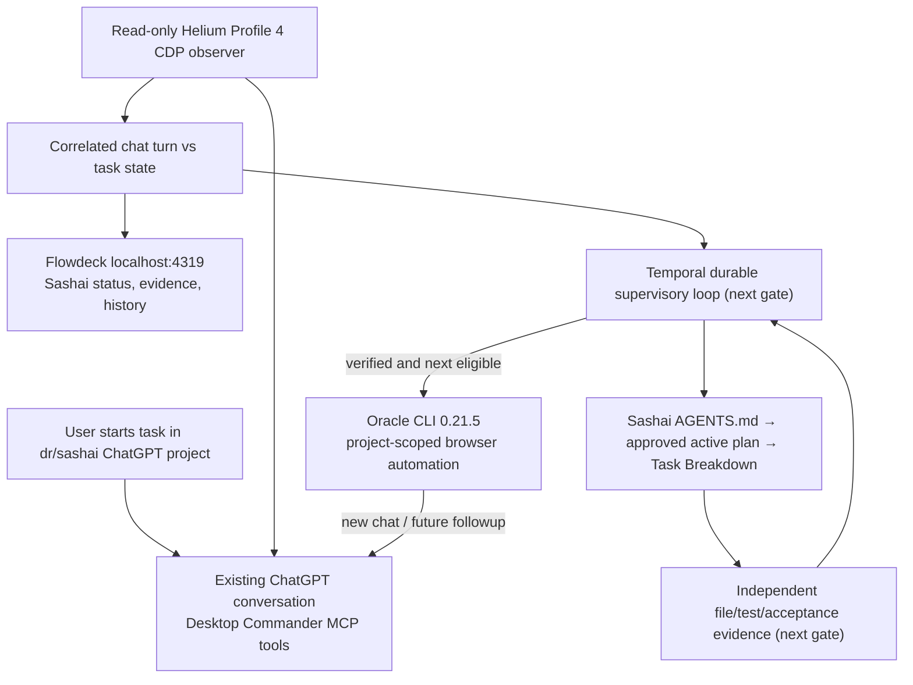

# Oracle-only Sashai Chat Supervisor — canonical execution plan

Date: 2026-10-14
Owner goal: Leave a manually started ChatGPT project task running; the supervisor watches the same conversation without duplicate prompts, understands its status, independently verifies the task, continues unfinished work in that chat, and creates a new **project-scoped Sashai chat with Desktop Commander** for the next approved item. **Repo Harness is excluded from this active chain.**

## Current implementation update — Oracle 0.21.5 proven (2026-10-14)

**Supersedes the 0.21.3 capture blocker below.** Oracle 0.21.5 is pinned as an unmodified npm release inside `.state/oracle-v0215`; global Homebrew 0.21.3 remains untouched. The isolated 0.21.3 compatibility patch was retired from active execution.

- **New chat inside Sashai**: `sashai-pristine-v0215-smoke` -> `completed` in 19.5s, response file `SASHAI_ORACLE_0215_OK`.
- **Same chat followup**: `sashai-pristine-v0215-followup` -> `completed` in 17.7s, response file `SASHAI_ORACLE_0215_FOLLOWUP_OK`; identical original/followup conversation ID `6acfc4f3-2cdc-83eb-8e4a-c8a955ce7fb0`. One submission per session, no replay.
- **Profile 4 and read-only observer**: extra separate window, same original Helium PID; post-hydration verified 2 user and 2 assistant turns. Flowdeck shows Oracle `completed` and `taskState=unverified`.
- **Background passive watcher**: `org.drunkod.oracle-sashai-passive-watcher`, user LaunchAgent running; 5-second polling. It can adopt only a uniquely active Sashai chat, without submitting prompts or executing code. If multiple tasks are running, it does nothing. Manage via `scripts/manage-sashai-watcher.sh start|stop|status`. This is not yet the durable Temporal task orchestrator.
- **Tests**: 19/19 passing (including verified completed fresh/followup Oracle records); Sashai working tree untouched.

**Remaining acceptance gates:** choose Desktop Commander MCP in newly created project chat, prove safe followup for manually originated chats without Oracle parent sessions, resolve approved active plan and task acceptance checks, and implement the Temporal verify/next-task decision loop. No actual Sashai task has been claimed complete.

## Historical Oracle 0.21.3 commit-timeout diagnostic (2026-10-14)

Confirmed root cause: Oracle's old ChatGPT turn/assistant-role DOM selectors return zero nodes for Sashai, even though the authenticated Helium UI has the submitted user turn and assistant answer. The original error probe captured `composerCleared=true`, `turnsCount=0`, `userMatched=false`. A read-only CDP probe finds 2 turns using the current `h4.sr-only` headings, and 0 turns with the stock Oracle selector. This was a false negative in Oracle 0.21.3, **not** permission to replay the prompt. Oracle 0.21.5 resolves the fresh-session capture and normal followup cases tested above; manual-chat adoption remains a separate gate.

`node scripts/oracle-sashai.mjs diagnose <existing-slug>` saves privacy-safe local evidence. Future adapter runs now use Oracle `--verbose`, `--heartbeat 5`, and `--perf-trace-path` with logs saved in ignored `.state/` (use `ORACLE_DEBUG=0` to disable). Investigation and remaining acceptance criteria: [ORACLE-PROMPT-COMMIT-RCA.md](ORACLE-PROMPT-COMMIT-RCA.md). The debug investigations did not start new ChatGPT tasks.

## Execution architecture



## Verified on the MacBook, not merely proposed

| Capability | Result | Evidence and qualifications |
| --- | --- | --- |
| Oracle CLI installed | PASS | Isolated runtime is 0.21.5; global Homebrew remains 0.21.3 intentionally |
| Helium Profile 4 with current ChatGPT login | PASS | Existing Helium running with `--profile-directory=Profile 4 --remote-debugging-port=9222` |
| Dedicated project observation window | PASS | Helium main PID unchanged; new window opened with the target conversation URL; original window left alone |
| Direct CDP read-only attachment | PASS | CDP websocket responded and `Runtime.evaluate` returned 1 user turn, 1 assistant turn, no visible Stop button |
| Oracle creates a Sashai project conversation | PASS | Oracle session `flowdeck-sashai-oracle-live-cdp` recorded URL under `g-p-6ab28bdd7fbc8191b581316ff09da79d-dr-sashai/c/...` and `promptSubmitted=true` |
| Oracle prompt actually completed in ChatGPT | PASS BY INDEPENDENT OBSERVATION | Sashai chat showed exactly `ORACLE_SASHAI_SMOKE_OK`. The original Oracle session **still says error** |
| Oracle completion capture | **PASS on 0.21.5 smoke and followup** | Native Oracle 0.21.5 saved both exact answers, statuses `completed`; old 0.21.3 sessions remain failed historical evidence |
| Passive adoption of existing Sashai tab | PASS for both finished test chats | `src/sashai-observer.ts`, `scripts/sashai-supervisor.mjs adopt` and `.state/oracle-sashai/adopted.json`; no prompt sent |
| Live generation state (Stop button present) | TESTED SYNTHETIC ONLY | Branch covered by unit tests; real long running task not yet demonstrated |
| Flowdeck browser status | PASS | `GET /api/sashai/status` returns observed ChatGPT turn, separate Oracle status, response evidence, unverified task state. Homepage renders `public/sashai.html` |
| Legacy Repo Harness removed from active actions | PASS | `POST /api/start` returns 410. Old fixture code and history retained but **not callable through main dashboard** |
| Desktop Commander connector preselection in the new ChatGPT chat | NOT PROVEN | Oracle `--chatgpt-url` selects a project, not automatically the Desktop Commander connector |
| Oracle same-chat follow-up with this failed session | BLOCKED | Oracle saved `promptSubmitted=true`, but `oracle session --harvest` refused because it could not confirm the turn |
| Identify next approved Sashai task | BLOCKED BY AUTHORITATIVE STATE | `tasks/current.md` is idle derived snapshot; `tasks/todos.md` is deferred. Unarchived localization plan W1–W7 was completed but explicitly not selected as active in its own text. Do not schedule from it |
| Actual Desktop Commander autonomous work in Sashai | NOT STARTED | No project files changed by this prototype, no task completion asserted |

**Second live Oracle smoke:** `oracle-sashai-local-patched-smoke` created the project conversation ending in `/c/6acfbc18-4c98-83ed-b711-a5a8e9efb121`. The read-only CDP supervisor independently observed one user turn, one assistant turn and response `ORACLE_SASHAI_PATCH_OK_20261014B`. Oracle session status is still `error` and its failure concerns stable prior turns. **No second send/replay was attempted.**

The dashboard supports choosing exactly which open Sashai chat to adopt when multiple chats are present. Adoption is read-only and does not navigate the user's working tab.

**Existing user modifications in `/Users/test/Documents/work/sashai` were left untouched.**

## Source of truth, queues and next-decision rules

- `AGENTS.md` owns repository workflow instructions.
- The **approved active plan** and its `## Task Breakdown` provide eligible execution tasks.
- `tasks/current.md` is a read-only snapshot, not a mutex or an execution queue.
- `tasks/todos.md` holds deferred goals and cannot be promoted automatically.
- A finished ChatGPT assistant turn means `turn_finished`, **never** `task_verified` by itself.
- A screenshot, DOM heuristic, or Oracle `promptSubmitted` is not proof that Desktop Commander performed filesystem work.
- When Oracle exits with `prompt-commit-timeout`, independently inspect the exact conversation before deciding whether to retry. **No automatic replay on uncertain submission.**

## Implementation sequence and acceptance gates

1. **Done:** Direct Oracle + Helium Profile 4 route; independent URL/response observation.
2. **Done:** Adopt existing conversation read-only, detect idle/running/turn-finished and display its source evidence on browser dashboard.
3. **Done for Oracle-created sessions:** clean pinned Oracle **0.21.5** passed new-chat and same-conversation `--followup`, captured both responses and verified conversation identity. Old 0.21.3 monkey patch removed from the active binary path. Adopted-manual-chat continuation still needs independent proof.
4. **Next:** Prove selection of **Desktop Commander plugin** in the correct Sashai ChatGPT conversation, its tool invocation and start/finish evidence.
5. **Next:** Derive an **approved** active plan and acceptance checks without searching arbitrary TODOs, then add plan/task-to-chat binding.
6. **Next:** Add Temporal loop to observe and resume unfinished work in the **same** chat, then independently verify accepted work and open next task in a new **Sashai** chat. Guard each submission with a persisted claim and reconcile before retry.
7. **Next:** Surface per-chat/task status in Flowdeck and optional summary in the actual ChatGPT conversation, but keep polling read-only.

## Final MVP evidence

- Codegraph reindexed the current Oracle-only MVP: 18 source files, 265 nodes, 478 edges. (Earlier 15/217/403 were historical counts.)
- The test suite passed **19/19** after upgrading to clean Oracle 0.21.5, including real completed Oracle session/followup evidence, read-only Sashai adoption, ambiguous auto-adopt guards and duplicate-send prevention for a repeated adoption.
- After correcting the launcher process check, the Mac showed **three Helium windows instead of two**, with the SAME main Helium PID. The new foreground window contained Flowdeck; the Sashai conversation was left in its own window.
- Clean Oracle 0.21.5 captures and completes both the fresh project chat and its followup. Historical 0.21.3 sessions remain `error`: never replay them. The supervisor must NOT infer project-task completion from the chat response.

## Demo now

```bash
cd /Users/test/Documents/work/temporal-harness-mvp
npm test
node scripts/sashai-supervisor.mjs doctor
node scripts/sashai-supervisor.mjs status
node scripts/sashai-supervisor.mjs watch 5
scripts/open-helium-profile4.sh
```

Browser UI: **http://127.0.0.1:4319/**.

Only when exactly one Sashai conversation is already open in Helium:

```bash
node scripts/sashai-supervisor.mjs adopt
```

The above commands never send a ChatGPT prompt. Browser requests `GET /api/sashai/status` and `POST /api/sashai/adopt` read the selected tab and optionally persist its exact URL. Legacy fixture start is deliberately disabled.

For a NEW prompt via Oracle (potential browser UI side effect; never replay blindly), use `node scripts/oracle-sashai.mjs preview 'Your task'` first. Oracle 0.21.5 capture is proven for the two harmless Sashai test prompts. Real Desktop Commander task dispatch remains disabled pending separate connector selection and task-evidence gates.

Read-only background observer: `scripts/manage-sashai-watcher.sh status` (or `start|stop`); logs are ignored under `.state/oracle-sashai/`.

## Historical project note

`docs/CHATGPT-PROJECT-ORCHESTRATOR-PLAN.md` contains the earlier Repo Harness-based design and should no longer be used to choose runtime commands. `docs/SASHAI-SUPERVISOR-JOURNEY.md` records the agreed end-user behavior, now implemented only through its read-only adoption/observation stages.
