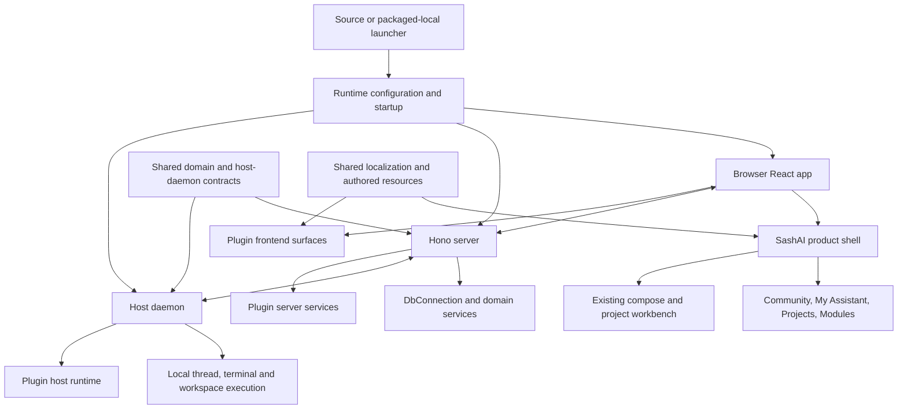
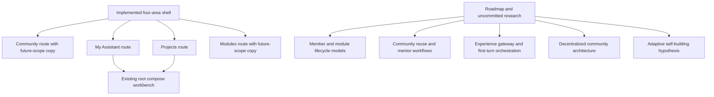

# Sashai architecture and current-work review

Date: 2026-10-15
Scope: read-only repository and history review; report artifacts written only in temporal-harness-mvp/docs.
Repository: /Users/test/Documents/work/sashai
Reviewed HEAD: 7d2cc6818afe837119e0c171928506b1c4967269
Method: Git history/status, repository guide/policy inspection and Codegraph exploration of the Sashai source.

This is an independently prepared reference review, not evidence that the ChatGPT/Desktop Commander supervisor executed a development task. No Sashai files, active-plan markers, services, commits or browser conversations were changed.

## Executive Summary

Sashai is a BB-derived local-first personal-assistant monorepo. The currently delivered product is not a finished community/module platform: it is the inherited browser/server/host-daemon workbench plus SashAI identity/localization and a thin four-area product shell.

The last 12 inspected commits are dated 2026-09-30. The current HEAD reconciles completion of the MVP-1 four-area shell. The working tree contains newer-looking research/roadmap material that is uncommitted; its implementation must not be inferred from document presence or priority headings.

The most important current-work facts:
- The four product routes/navigation are implemented in source.
- Community and Modules explicitly describe future capabilities, not implemented catalogue/install/publishing behavior.
- Existing workbench access is preserved through the assistant/projects shell actions.
- Localization workstreams W1–W7 are recorded complete in the top-level plan.
- No explicit active-plan or active-worktree marker is present, so there is no approved next execution item for automatic dispatch.
- The guide/spec/roadmap surfaces are not fully reconciled: MVP-0 specification labels coexist with a delivered MVP-1 shell and several new priority overrides.

## Evidence and Review Boundaries

Read:
- AGENTS.md, README.md, package.json, docs/spec.md.
- .ai/harness/policy.json, .ai/context/capabilities.json, .ai/context/context-map.json.
- docs/README.md; bounded portions/headings of architecture/roadmap/current-build-prompt documents.
- plans/plan-20260929-upstream-friendly-localization.md, including source and completion statements.
- HEAD version of plans/sprints/20260930-0438-mvp1-four-area-shell.sprint.md.
- Git status, last 12 commits, latest closeout/feature commit stats and tracked working-tree diff stats.

Codegraph traced:
- packages/scripts/src/commands/run-dev.ts and run-host-daemon.ts.
- apps/server/src/server.ts createApp and apps/server/src/types.ts ServerAppDeps.
- apps/app/src/lib/sashai-shell-routes.ts.
- apps/app/src/views/SashAiShellView.tsx and components/sidebar/SashAiProductNavigation.tsx.
- packages/host-daemon-contract/src/session.ts.
- plugins/concurrency-limit/server.ts, workflow-progress UI and plugin build entry points.

This is a bounded architectural checkpoint, not an exhaustive audit of the 5,453 indexed files. No Sashai build, test suite, application launch, provider invocation, upstream fetch or deployment was performed. Test success described in historical closeout artifacts was not independently rerun today.

## Where We Left Off — Commit History

| Commit | Date from Git | Meaning and qualification |
| --- | --- | --- |
| 7d2cc6818 | 2026-09-30 | Reconciles MVP-1 shell closeout; changes the sprint document |
| ccdb11551 | 2026-09-30 | Adds/closes four-area product shell: app routes, sidebar navigation, shell views, EN/RU messages, tests and workstream artifacts |
| 2f779098e | 2026-09-30 | Freezes MVP-1 shell plan |
| 6b7502bad | 2026-09-30 | Approves bounded MVP-1 shell work |
| fdb022489 / bbba3992e | 2026-09-30 | Reconciles/closes W7 operational localization handoff |
| e4de32fd4 / ba1b3a0de | 2026-09-30 | Freezes/approves W7 |
| 520164480 / 54aa1bcdf | 2026-09-30 | Reconciles/closes W6 upstream rehearsal |
| c6dd519b2 / 731595cf2 | 2026-09-30 | Freezes/approves W6 |

Local HEAD and the locally stored origin/main ref both point to 7d2cc6818. No remote fetch was performed; this is not a claim that the remote server has no newer commits.

The completed shell sprint explicitly stops before member/module data models. It lists no ModuleDefinition/ModuleInstallation/ModuleRecord implementation, concrete Daily Reflection/Recipe Helper, publishing/install/update lifecycle or distributed worker redesign as part of that slice.

## Current Working Tree — Not Yet Delivered Code

Git reports six modified tracked documentation files:
- docs/00-project-vision.md
- docs/03-architecture.md
- docs/05-reference-implementation-notes.md
- docs/06-project-roadmap.md
- docs/08-current-mvp-build-prompt.md
- docs/README.md

Tracked diff summary: 169 insertions, 13 deletions. Untracked files include research documents 10–20 and roadmap/UI audit directories and archives. They cover founder-assisted zero-config prototypes, mentor escalation, decentralized/local-first infrastructure, experience gateways/first-turn classification and adaptive self-building hypotheses.

These are valuable direction/research inputs. They are not proof of implementation. Their conflicts and priority need review before choosing an implementation task. Existing user changes were preserved.

## Diagram 1 — Source-Backed Runtime Topology

This is a component-level synthesis, not a claim that every edge was followed through a full runtime transaction. Startup is supported by run-dev.ts filtering @bb/app, @bb/server and @bb/host-daemon. Server services are represented in ServerAppDeps. The host contract contains watch, RPC, terminal and session messages. Plugin build machinery produces distinct app/server/host artifacts.

## Diagram 2 — Delivered Shell Versus Proposed Product

The lower proposed branch is not asserted implemented by this review. Source shell copy explicitly says publishing, module installation and dedicated product workspaces belong to later slices.

## Repository Guide and Task Authority

AGENTS.md establishes:
- docs/spec.md as product truth.
- Current execution in the active plan's Task Breakdown.
- tasks/current.md as derived state.
- tasks/todos.md as deferred goals.
- Durable workstreams/contracts/reviews/notes/handoffs for progress.

The policy specifies per-worktree explicit .ai/harness/active-plan and .ai/harness/active-worktree markers and English human-facing documentation. Both active markers are absent. The context registry currently has no capability entries and no discoverable scoped contexts; that is a routing observation, not a runtime execution capability claim.

The non-archived localization plan says W1–W7 are complete and expressly says it is not selected as the active execution plan. It must not be revived merely because it is the only top-level plan.

## Findings and Recommended Next Decisions

### 1. Medium — Product authority and progress labels need reconciliation

Evidence: docs/spec.md still identifies MVP-0 Foundation Preview, while HEAD's shell sprint is Done and source implements MVP-1 navigation. docs/README.md lists docs/08 as authoritative implementation prompt and docs/17 as current first implementation priority; roadmap headings also include multiple immediate-priority overrides.

Impact: an autonomous supervisor could select the wrong next item from inconsistent guidance.

Recommendation: the report should propose one current milestone and explicitly rank the research priorities. Do not edit or activate them automatically as part of this read-only review.

### 2. Medium — Research direction must not be confused with delivered architecture

Evidence: tracked modified docs and untracked research materials extend into decentralization, mentoring and experience classification. Delivered shell source is intentionally thin and retains the existing BB workbench.

Recommendation: maintain separate implemented/proposed diagrams and an explicit decision log. Every future implementation task needs a bounded scope and active-plan selection.

### 3. Blocking for automation — No active execution plan

Evidence: both explicit authority markers are absent; localization tasks are complete.

Recommendation: approve a new bounded architectural-review/report task rather than inventing product work. The owner's current instruction supplies the scope approval; selecting a live Sashai execution plan/worktree and connecting it to a task-capable browser dispatcher remains a separate explicit step.

### 4. Low — Public entry guide is still framed largely around MVP-0

Evidence: root README explains MVP-0 setup, rebrand/localization and Task 2 checks, while latest source/closeout now includes the four-area shell.

Recommendation: include a proposed guide reconciliation in the report. Do not change README or claim old validation commands passed today.

## Practical Task Proposal

The next approved work should be report-only:
1. Establish exact revision, dirty-working-tree inventory and recent commit timeline.
2. Resolve the repository guide/task authority and document where execution stopped.
3. Trace runtime and product-shell architecture with Codegraph and produce at least two Mermaid diagrams.
4. Write a concise report distinguishing delivered code, working-tree proposals, findings, missing evidence and recommended next decisions.

Acceptance contract and browser-task prompt are saved separately in SASHAI-ARCHITECTURE-REVIEW-TASK.md. This reference report already supplies an independent repository-tool checkpoint; it does not satisfy the separate browser-supervisor acceptance test.

## Validation Performed

- Read-only Git history/status and exact HEAD identification.
- Read-only guide/policy/task-source inspection.
- Three Codegraph explorations of Sashai startup, server/host contracts and current shell.
- No source edits or test/build execution in Sashai.
- No claim of new Desktop Commander work, automatic continuation or live task completion.
