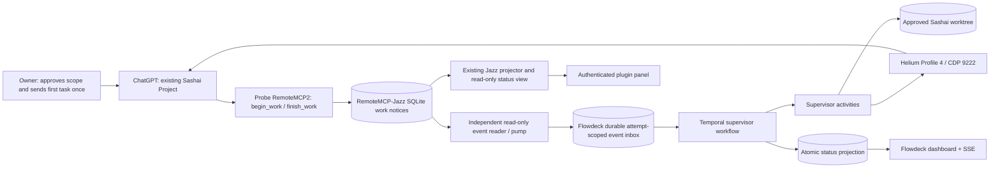
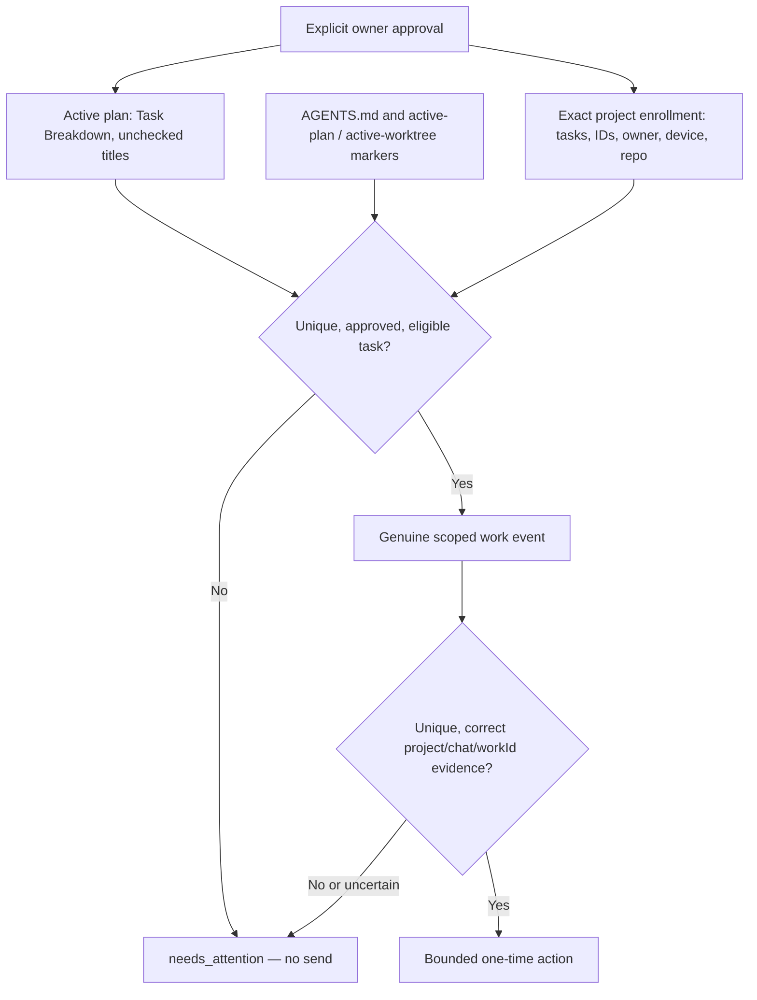
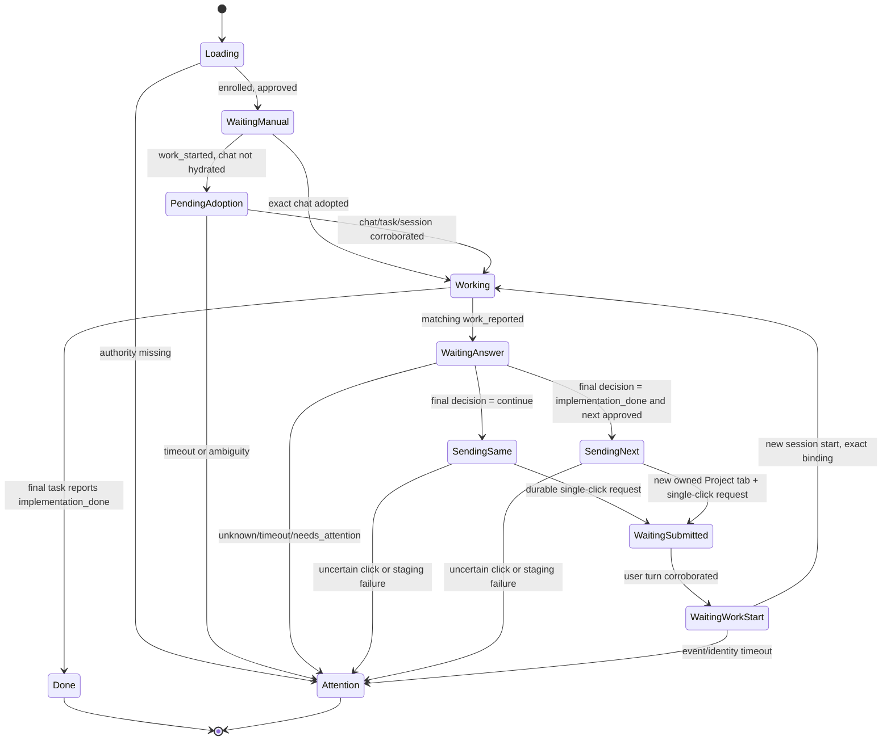
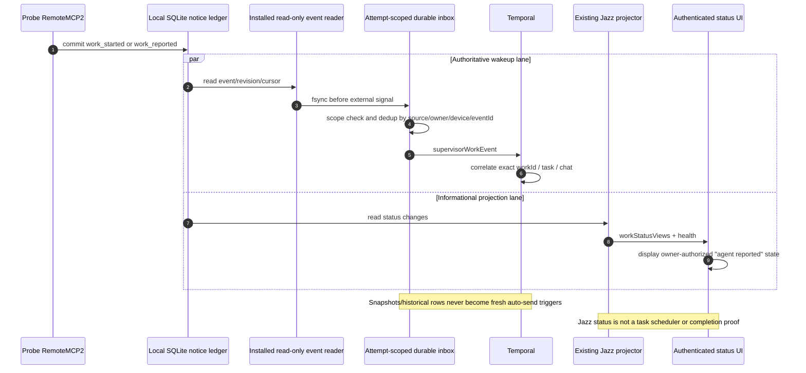
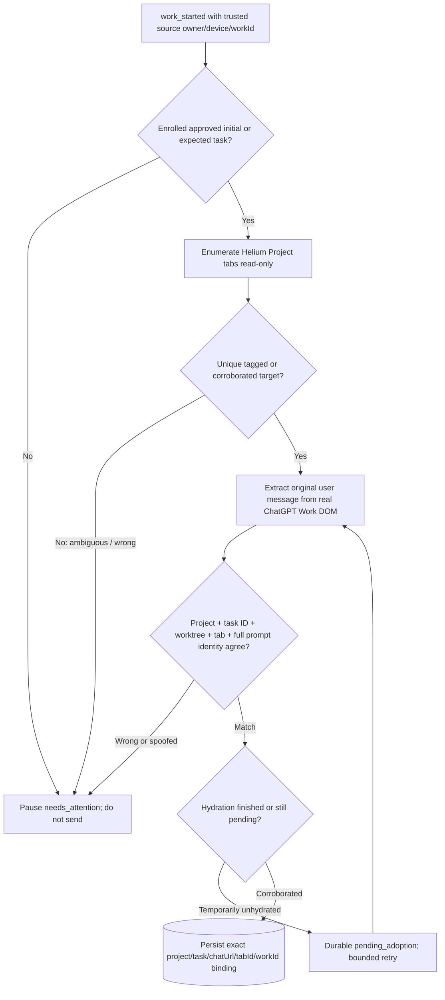
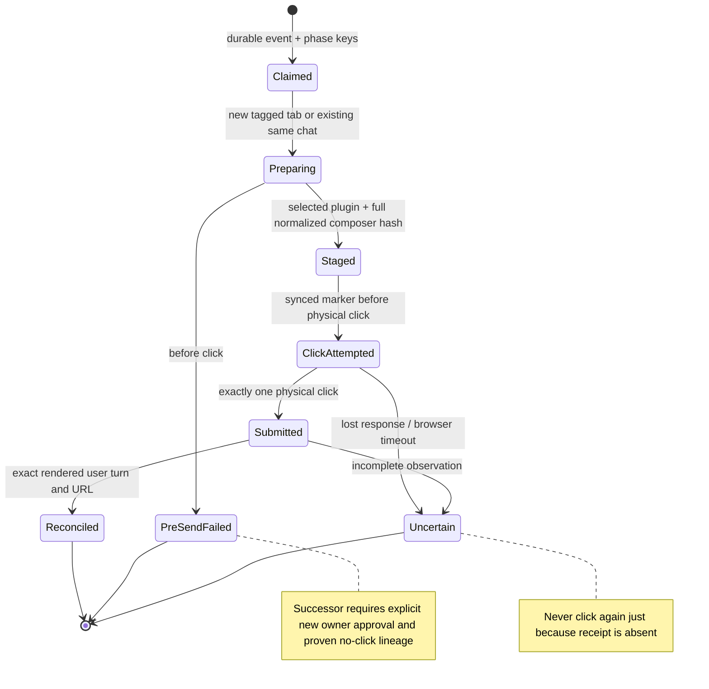
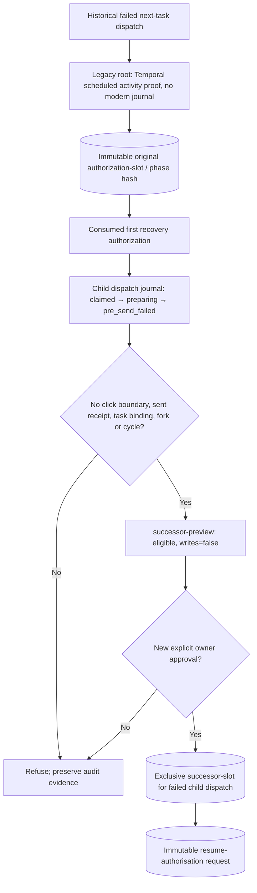
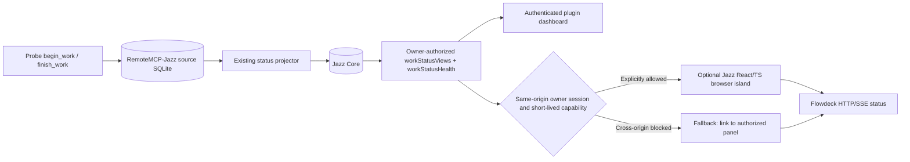
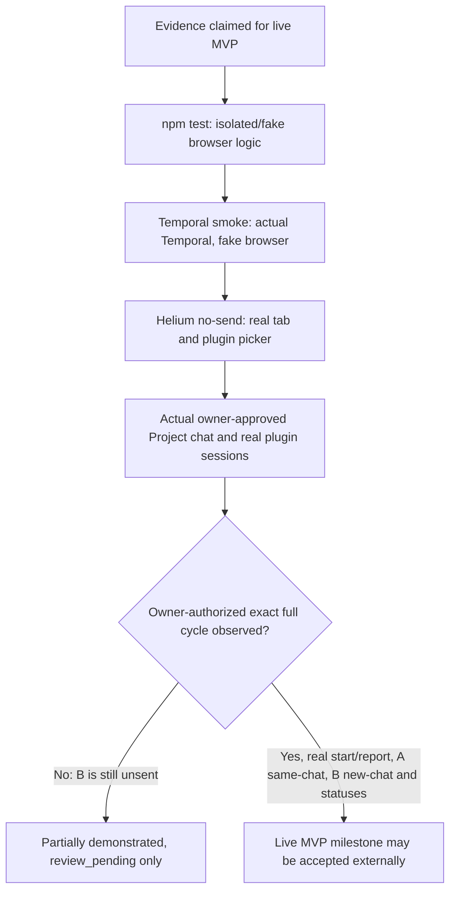

# Flowdeck / Autonomous ChatGPT Project Supervisor
## Incoming Architect: Comprehensive Technical & Operational Handoff

**As of:** historical base 2026-10-15; operational supersession verified 2026-10-16 (MacBook local time)  
**Document type:** onboarding / assignment, not a new task authority or permission to send  
**Principal repository:** /Users/test/Documents/work/temporal-harness-mvp  
**Plugin repository:** /Users/test/Documents/RemoteMCP-Jazz/repositories/RemoteMCP-Jazz  
**Live pilot worktree:** /Users/test/Documents/work/sashai-flowdeck-probe-pilot  
**State of project:** partial real pilot success, **no demonstrated fully autonomous live A→B cycle**  
**Current selected ChatGPT plugin:** **Probe RemoteMCP2**. Historical frozen master plans say Remote Desktop Commander; that is the historical name, not the connector currently selected in new Flowdeck sends.

> **Five-minute briefing.** Flowdeck is a minimal durable supervisor for existing ChatGPT Projects. The owner manually sends the first approved task once. RemoteMCP-Jazz records the real MacBook work-session start/report in SQLite. An independent Flowdeck event follower signals a Temporal workflow, which securely binds the workId to the exact project/chat/task, interprets a strict ChatGPT final marker, sends continuation in the *same* chat if needed, and starts the *next already approved* task once in a *new chat in the same Project*. Finishing an implementation means review pending, not accepted or independently verified. Jazz and the dashboard are optional observation channels, **not authorization or event-triggered dispatch**. Real Task A has completed its initial checkpoint and automatic same-chat continuation. Real Task B **has not been submitted**: a later issued successor workflow was released but stopped before Send, with original predecessor tab/evidence missing and the exclusive successor authorization slot occupied. Independent owner approval of that historical release is not established in the available record. Narrow browser fixes subsequently achieved **20 consecutive full no-send staging passes**, but those checks are not a B submission. **F4 has also completed actual history replay and real-Temporal synthetic-failure validation** (six replays and eleven scenarios). The immediate handoff is controlled F4 deployment readiness and a **separate audited owner decision** for any new product-validation path—not another B retry or a repeat of already completed F4 tests.

## SUPERSEDING OPERATIONAL STATUS — 2026-10-16 (F4 VERIFIED; B BLOCKED)

### F4 actual validation result — current engineering evidence

**F4 STATUS-PROJECTION ISOLATION: validated for scoped deployment, not a live B retry.** Following the attached F4 test task, the installed Temporal SDK successfully replayed **two exact legacy normal/recovery histories (zero patch markers)** and **four new synthetic patch-bearing histories** against the same workflow bundle. **Eleven** isolated real-Temporal scenarios passed (including publisher retry, persistent outage, late final-publication failure, exhausted two-attempt timeout, missing authority, send/journal failure, recovery without readiness release and cancellation at both initial and later publication points). One synthetic expected-snapshot assertion was repaired during testing; its initial failure logs are preserved, and the final exhausted-timeout test passed with an actual terminal Temporal timeout event.

The final reproducible suites passed: `npm run test:portable` **193 passed, 0 failed, 1 skipped**; `npm test` **330 passed, 0 failed, 3 skipped**; build and whitespace checks passed. An intentionally nonexistent exact run ID failed closed. Worker/task queues for scenarios were uniquely synthetic; no production browser send or recovery action was invoked. Read `docs/FLOWDECK_F4_REPLAY_VALIDATION_2026-10-16.md` and its evidence packet at `.state/verification-runs/f4-replay-20261016T030603/RESULTS.md`.

**2026-10-16 handoff consistency verification (later than the F4 evidence above):** The reusable runner's CLI validation now has four explicit regression tests (`tests/flowdeck-replay-check.test.mjs`) for help, mandatory exact identities, rejection of `latest`/malformed IDs and bounded watchdog arguments. At the same workflow SHA-256 `7b9ab405f09ce9c772ce33856b43836c99ed69231cc7cae863dddd0cbcd68bae`, read-only exact replay passed again for the closed **normal** history (326 events, zero patch markers) and **B-successor recovery** history (41 events, zero markers), with no workflow starts/signals or browser actions. The expanded repository suites passed **197/198 portable (1 skipped)** and **334/337 full (3 skipped)**, both with zero failures. The validation decision and historic B block remain unchanged.

**Handoff to the new architect now:** preserve the F4 patch ID and legacy replay branch during controlled deployment/monitoring. The historical Task B successor remains **blocked** by predecessor tab and message-seal evidence plus occupied authorization lineage; this F4 validation does not grant owner approval, signal/release any live workflow, or make B complete. A **separate owner decision** must choose a narrowly audited B remedy or a fresh two-task pilot with new IDs. Older October 15 commands below remain historical.

---


> **This dated section overrides the older October 15 "Where we stand", critical path, B recovery sequence, single-file delegation note and completion criteria below.** Retain those sections and all Mermaid diagrams as historical architecture/incident context, **not** a current authorization or execution checklist.

### Updated product objective and next authorized work

The product goal remains owner-started approved ChatGPT Project work, exact same-chat continuation and next independent approved task in a new Project chat, with exactly-once send and **implementation_done / review_pending**, not automatic review. **F4 replay and isolated Temporal failure validation are complete**, as verified in `docs/FLOWDECK_F4_REPLAY_VALIDATION_2026-10-16.md` and the local evidence packet. **Next engineering work** is controlled rollout preparation: preserve the version marker and legacy replay branch, verify Temporal-query-driven operational monitoring, and independently certify any remaining in-flight CDP cancellation/heartbeat behavior before unattended sends. **Next owner-authorized product action**, separate from engineering, is a documented choice between an audited resolution of the historical B incident and a fresh two-task pilot with new IDs. This document alone authorizes neither.

The new F4 workflow calls `patched('flowdeck-status-projection-isolation-v1')` once at entry. New executions use a bounded publication activity (start-to-close 5s; schedule-to-close 15s; up to two attempts); failed optional status updates mark authoritative Temporal health as degraded but should not prevent business processing. Legacy histories without the marker retain old publication semantics. All other actions—including authority checks, send/journal safety and recovery release—must still fail closed. Cancellation must remain cancellation, not a suppressed publication error. The F4 workflow-shim tests and **actual SDK history replay**, retry, deadline, publication failure and cancellation scenarios have passed. Six representative histories (two legacy without marker, four marker-bearing) replayed on the installed SDK, while eleven isolated Temporal scenarios were verified. These are engineering proofs with fake browser activities, not a real B completion.

### Current evidence, replacing outdated October 15 claims

| Subject | Correct later milestone | Still unverified / restriction |
| --- | --- | --- |
| Browser no-send staging | **20 consecutive** real Helium Profile 4 create → stage → full-match passes documented in `docs/FLOWDECK_P0_BROWSER_READINESS_VERIFICATION_2026-10-16.md` | No proof of a successful live B send; no need to retune browser for F4 |
| Real Task A | Both Stage 1 and same-chat Stage 2 executed; implementation_done / review_pending | Review remains external; do not resend A |
| Historical B recovery | A B successor authorization was **issued** and its exclusive slot remains occupied; a later B successor run was released but stopped **before Send** | No reusable authorization or permitted blind retry |
| Production B successor preview | `lineageEligible=false`; `predecessorTabPresent=false`; `predecessorEvidenceVerified=false`; `readyForExecution=false`; `writes=false` | Missing original predecessor CDP tab, absent historical message seal, and occupied successor slot. Fresh verified owner approval/rebind policy needed for any audited remedy |
| F4 isolation | Versioned workflow branch; six successful exact-run Temporal replays; eleven isolated real-Temporal synthetic fault scenarios; retry/timeout/cancellation evidence; regression suites green | **Scoped deployment may be evaluated** with controlled rollout and legacy branch preservation; no real B send or unattended CDP cancellation certification follows from this |
| Status visibility / Jazz | Separate read-only status projection; widget has pinned Jazz dependency and tested build | A status UI never authorizes task advancement, nor does bundling prove authenticated embedding |

These are documented results in the 2026-10-16 engineering evidence, not authorization for the live B recovery: `docs/FLOWDECK_STATUS_PROJECTION_ISOLATION_2026-10-16.md`, `docs/FLOWDECK_PREDECESSOR_READINESS_PRODUCTION_GATE_2026-10-16.md`, `docs/FLOWDECK_FORWARD_SEAL_HANDOFF_2026-10-16.md`, `docs/FLOWDECK_B_ONLY_ATTENDED_DEMO_2026-10-16.md` and `docs/FLOWDECK_P0_BROWSER_READINESS_VERIFICATION_2026-10-16.md`.

### Completed F4 verification checklist (historical engineering work; not new instructions)

1. **Completed:** recorded Git HEAD, byte hashes of untracked source/build/test files and lockfile, a restricted evidence directory, Temporal `127.0.0.1:7233` / namespace `default`, and unique synthetic task queues.
2. **Completed:** implemented `scripts/flowdeck-replay-check.mjs` with mandatory exact workflow/run IDs, `Worker.runReplayHistory()`, build SHA-256, finite watchdog, and closed connections. It contains no workflow start, signal, production polling, browser or recovery side effects.
3. **Completed:** replayed the exact pre-F4 normal and B-only recovery histories (zero patch markers), plus four marker-bearing synthetic histories, including publication failures. All six passed; the missing exact-ID check failed closed rather than falling back to another run.
4. **Completed:** eleven real-Temporal synthetic scenarios covered healthy, transient/persistent publication outages, real retries/timeouts, final publication failure, fake send failure, failed enrollment, absent recovery release, and cancellation at initial and later publication points. Actual attempt numbers, terminal failures and cleanup are recorded in `activity-history-evidence.json`.
5. **Completed for the validated F4 build:** build passed, portable suite passed 193/194 (one skipped), full suite passed 330/333 (three skipped), source/build manifests were captured, and `docs/FLOWDECK_F4_REPLAY_VALIDATION_2026-10-16.md` records **scoped deployment validated**. A later CLI-contract test extends this proof without changing the workflow. **Neither verdict permits historical B execution.**

### F4 verification acceptance and continuing prohibitions

**F4 scoped-deployment engineering gate is passed**: six old/new history replays were deterministic, eleven synthetic real-Temporal fault paths completed with expected behavior, and the prior full test suite reported 330 passes / 3 skips (zero failures); consult its exact build manifest and the validation report before deployment. This remains a component-level gate, not live A→B acceptance or proof of unattended in-flight CDP cancellation. Preserve the full code and original state (much source remains untracked relative to Git HEAD). **Forbidden without fresh separate owner authority:** issue or reuse historical B authorizations, rebind predecessor chats, retry Task A/B, launch or release the historical successor, mutate production `.state/flowdeck-supervisor`, or treat any dashboard snapshot as execution authority.

### After F4 only: separate owner-authorized product-validation decision

Either design an **audited** remedy for the historical B incident (missing predecessor tab/message seal and occupied authorization lineage), or request approval of a genuinely **new two-task pilot with fresh identities**. Do not present the historical B recovery steps later in this file as currently actionable. Keep the one-send invariant and the distinction between work-session reports, task implementation status and external review.

---

## HISTORICAL OCTOBER 15 ASSIGNMENT — superseded by F4 status above

## URGENT OBJECTIVE — Deliver the working MVP ASAP

**Assignment to the incoming architect: make the real, owner-authorized autonomous ChatGPT Project supervisor work from end to end as soon as practically possible.** Do not expand the architecture, add research projects, or optimize the status dashboard first. The immediate finish line is **one demonstrably correct B-only successor completion** after the previously demonstrated real Task A two-turn cycle, giving us proof of the desired owner-starts-A-once → same-chat continuation → new-chat approved-B sequence. This is the shortest path to the MVP, not permission to restart or resend Task A.

**What must work for the user:** after an initial approved task is manually submitted once, Flowdeck autonomously adopts its real ChatGPT Project conversation, receives genuine Probe RemoteMCP2 start/report events, performs an unfinished continuation **once in the same chat**, and on an exact implementation_done marker starts the **next approved task once in a separate chat in that same Project**. Both tasks become `implementation_done / review_pending`; independent review remains outside Flowdeck. If the task, chat, approval, browser click or event binding is uncertain, Flowdeck must fail closed and retain recoverable evidence rather than guessing or duplicating a send.

**Where we stand:** real Task A already completed Stage 1 and the automatic Stage 2 continuation; do **not** repeat it. Task B remains approved/not_started and has **never been submitted**. A carefully scoped legacy→child→successor recovery path exists and currently passes read-only eligibility, but the actual Helium new-tab staging is intermittently unreliable: **7/10 real no-send attempts passed, 3/10 timed out** (one at composer readiness, two at connector readiness). The proposed successor Temporal workflow does not exist, and no successor authorization has been issued. **Solving that P0 is the immediate objective.**

### The critical path — in priority order

1. **P0 browser investigation and narrow patch.** Inspect actual Helium Profile 4 / CDP owned-tab identity and live ChatGPT Project DOM as a single create→stage transition. Reproduce and diagnose the composer and Probe RemoteMCP2 picker readiness timeouts using bounded, redacted diagnostics; fix their cause or bounded pre-click waiting, without relaxing tab ID, ownership tag, project URL, complete payload-hash checks or exactly-once click semantics.
2. **Proof of stable pre-send staging.** Run the normal `npm test` suite and real-Temporal fake-browser smoke. Then perform **at least ten consecutive** independent, real Helium Profile 4 **no-send** checks (twenty preferable if quick), all choosing Probe RemoteMCP2 and matching the complete staged draft; show logs and count any failures. A failure resets the consecutive-pass count rather than being masked by a later pass. No physical Send is permitted during this stage.
3. **Read-only B recovery recheck.** Using the exact preserved failed child dispatch, show `successor-preview eligible=true, writes=false`; prove there is still no B receipt, binding or artifact and that no prior click-attempted/submitted marker exists in the recovery lineage.
4. **Obtain a *fresh, explicit owner approval* for one successor generation.** This document does **not** grant send or recovery authorization. Only after approval, issue the exclusive successor authorization and immutable resume request; start one new named Temporal workflow/worker; establish an isolated follower ready with pending=0 and blocked=0; release the exact run once.
5. **Observe real Task B completion, or stop with evidence.** Verify correct new Project chat, Probe RemoteMCP2, real begin_work / finish_work event pair, full user-message identity, strict final status, independent Task B glossary file, Temporal `implementation_done / review_pending`, preserved Task A and unmodified historical claims. If any click is uncertain, do not retry; give the owner an exact blocker and evidence.

**Definition of done (demonstrable, not inferred):**

| Acceptance gate | Required evidence |
| --- | --- |
| Approval and routing | Approved task ID/title, correct active plan/worktree, exact Sashai Project and pinned new tab |
| Exactly-once behavior | Task A never repeated; one authorized B send intent/click; no duplicate when uncertain |
| Real work session | Genuine Probe RemoteMCP2 `work_started` and `work_reported` matched to B workId |
| Real ChatGPT outcome | One finished B response with the required exact final `FLOWDECK_STATUS: implementation_done` |
| Artifact/status | Task B glossary exists in approved worktree; Temporal marks B `implementation_done / review_pending` |
| Safety and reproducibility | Durable send journal, existing histories/claims unchanged, clear diagnostics and test logs |
| Scope | No automatic review, unauthorized task selection, Jazz dispatch, or modifications to original dirty Sashai tree |

**Urgency constraint:** target the smallest reliable live MVP **as soon as possible**; prioritize the first proven, safe A→B run over broader automation, UI features, deep research, or another architectural rewrite. No arbitrary promised deadline replaces evidence. If stabilization cannot be proven quickly, report the exact cause and bounded alternative instead of running unbounded trials or issuing extra authorizations.

### Single-file delegation note (forward this Markdown as the complete assignment)

> **To the incoming Flowdeck architect:** You are taking over the Autonomous ChatGPT Project Supervisor MVP. This one file contains the objective, architecture, ownership boundaries, current code/process map, eleven Mermaid diagrams, live incident chronology, recovery safety model, exact safe preview command, and priority work plan. Start with CodeGraph and the P0 real-browser staging failures; repair the narrow pre-click hydration/connector issue without weakening identity or one-click guarantees. Return exact modified files, diagnostic evidence, default test outcomes, a real ten-consecutive-pass no-send trace, and a reviewable B-only successor readiness report. Do **not** repeat Task A, reset approvals/claims, issue a successor token, release a workflow, or send Task B before the owner explicitly approves that one new generation. Once authorized, demonstrate the real B handoff and record the result. Synthetic smoke, a green build, or Jazz status alone do not constitute completion.

---

### 1. Product contract: required behavior and exclusions

The owner should be able to walk away after *one* manual submission of Task A in an existing ChatGPT Project. Flowdeck consumes trusted work-session notices, **adopts rather than repeats** the initial message, waits for ChatGPT, and applies one of three exact finished-turn decisions:

- FLOWDECK_STATUS: continue → exactly one continuation in the same chat, same task, with Probe RemoteMCP2 selected; repeat with a budget.
- FLOWDECK_STATUS: implementation_done → mark the task implementation_done / review_pending; choose the *next already approved* independent task, create a distinct in-project chat, send it once.
- FLOWDECK_STATUS: needs_attention, missing, contradictory or ambiguous → stop safely and require operator reconciliation.

An installed plugin's finish_work(success) is an **agent-reported session outcome**. It is not a code-review verdict, task acceptance, proof of execution, nor permission to advance without checking the ChatGPT finished-turn decision and existing authority.

**Out of scope:** building an independent code-review pipeline, auto-approving plans, reading arbitrary tabs, generating unapproved tasks, broad Repo Harness restructuring, adding a second Jazz publisher, rewriting RemoteMCP-Jazz, introducing general agent frameworks or resetting durable send state merely to make a demo pass.

### 2. Runtime topology and ownership (Diagram 1/11)



**Three explicit architectural boundaries:**
1. **Control / authorization:** owner approval + Sashai active-plan/worktree markers + explicit Flowdeck enrollment. Work events are wakeups only; neither SQLite nor Jazz can authorize a new task.
2. **Execution / orchestration:** the Temporal event-driven loop, independent inbox and narrow CDP activities. Only validated activities can stage/click in the *exact* ChatGPT Project with pinned tab ownership.
3. **Observation / UX:** Flowdeck HTTP/SSE projection and optional, separately authorized Jazz status subscription. No dependency of sends on the Jazz UI or plugin-panel availability.

### 3. File and process map

| Responsibility | Code / configuration | Key contract |
| --- | --- | --- |
| Task enrollment and plan validation | src/flowdeck-projects.ts ; .state/flowdeck-supervisor/projects.json ; worktree AGENTS.md and .ai/harness/active-* | Unique approved unchecked plan row; exact task ID/title/worktree/owner/device; no inferred task |
| Deterministic workflow and B-only recovery | src/flowdeck-supervisor-workflow.ts | flowdeckSupervisor, flowdeckRecoverSend; Temporal signals/query; fail-closed states |
| Binding, answer observation, browser dispatch | src/flowdeck-supervisor-activities.ts | adoptStartedWork, observeWorkResult, sendContinuationOnce, startNextTaskOnce, recoverPreSendOnce, reconcileSubmittedTurn |
| Helium owned-tab and connector adapter | src/sashai-live-browser.ts ; src/sashai-observer.ts ; src/sashai-dispatch-evidence.ts | CDP exact identity, Work-layout DOM observation, Probe RemoteMCP2, full composer hash, one click |
| Plugin source event contract / durable inbox | src/flowdeck-work-events.ts ; scripts/flowdeck-work-events.mjs | WorkEventV1 start/report; snapshot vs live; fsync/dedup; target_closed |
| Recovery claims, authorization and lineage | src/flowdeck-send-recovery.ts | Root/successor slots; claimed→preparing→staged→click_attempted→submitted→reconciled and pre_send_failed |
| CLI lifecycle | scripts/flowdeck-supervisor.mjs ; scripts/flowdeck-launch.mjs | Worker, fresh workflow, named attempts; no blind restarts |
| Preview/apply and B-only release | scripts/flowdeck-reconcile-events.mjs ; scripts/flowdeck-reconcile-send.mjs ; scripts/flowdeck-resume-send.mjs | Preview first, explicit apply, immutable resume request, follower ready, single release |
| Independent synthetic smoke and browser probe | scripts/flowdeck-supervisor-smoke.mjs ; scripts/flowdeck-browser-check.mjs | Real Temporal with fake browser; real Helium no-send respectively |
| Live status / optional Jazz | src/dashboard-server.ts ; public/sashai.html ; public/supervisor-status.js ; widgets/jazz-status/* | Atomic SSE projection; authorized plugin status link or read-only Jazz client; **no dispatch** |

**Important physical paths:** main repo /Users/test/Documents/work/temporal-harness-mvp; upstream Jazz plugin /Users/test/Documents/RemoteMCP-Jazz/repositories/RemoteMCP-Jazz; **original Sashai repository is dirty/protected** at /Users/test/Documents/work/sashai; old detached pilot at /Users/test/Documents/work/sashai-flowdeck-pilot; new detached pilot at /Users/test/Documents/work/sashai-flowdeck-probe-pilot. Do not clean/reset/commit an existing dirty tree or overwrite the original Sashai repo. Most Flowdeck modules are still untracked relative to main git HEAD; git diff alone does not describe the implemented working tree.

### 4. Plan and dispatch authority (Diagram 2/11)



Enrollment is not a task generator. Each exact task title must correspond to one unique unchecked entry in the active approved plan; active worktree markers must resolve to the enrolled repo. The loader revalidates approval **before** any browser send. Optional dependencies/review gates must not be circumvented. Do not take task candidates from deferred TODOs, arbitrary snapshots, stale UI rows or an archived plan. Current pilot: project ID **sashai-probe-pilot** and approved Task A/B IDs ending **probe-a-20261015** and **probe-b-20261015**.

### 5. Happy-path live sequence (Diagram 3/11)

```mermaid
sequenceDiagram
    autonumber
    actor Owner
    participant Chat as ChatGPT Sashai Project
    participant Plugin as Probe RemoteMCP2
    participant E as SQLite + Flowdeck event follower
    participant T as Temporal supervisor
    participant B as Helium Profile 4
    participant Files as Approved worktree
    Owner->>Chat: Submit approved A once (manual)
    Chat->>Plugin: begin_work(A, new work session)
    Plugin->>E: work_started(A workId)
    E->>T: durable scoped signal
    T->>B: read-only bind exact A chat and original prompt
    Chat->>Files: Stage 1 checkpoint
    Chat->>Plugin: finish_work(partial)
    Plugin->>E: work_reported(A workId)
    E->>T: durable scoped signal
    T->>Chat: observe final FLOWDECK_STATUS: continue
    T->>B: stage, full-match, click once in same chat
    Chat->>Plugin: begin_work(new workId, same task A)
    Plugin->>E: new start/report pair
    E->>T: scoped signals
    Chat->>Files: Stage 2 completion
    T->>Chat: observe FLOWDECK_STATUS: implementation_done
    T->>T: A = implementation_done / review_pending
    T->>B: create tagged Project tab; stage approved B
    B->>Chat: click once in new chat
    Chat->>Plugin: begin_work B and finish_work
    Plugin->>E: B start/report
    E->>T: scoped signals
    T->>T: B = implementation_done / review_pending
    Note over Owner,T: Last B send/finish step remains unproven in the real pilot
```

### 6. Temporal workflow and waiting points (Diagram 4/11)



**Selected source bounds (verify in code if changing):** activities use Temporal startToCloseTimeout 2 minutes and retry maximumAttempts=1; initial and report observation have durable bounded waits (pending adoption up to around 10 minutes; final-answer polling around 3 minutes); continuation budget six; waiting for new work event up to 30 minutes; recovery readiness gate 10 minutes. On pause the current workflow **returns and completes in Temporal** with state needs_attention; do not assume it is still alive just because UI says paused. New named attempts must be separately approved and use separate inbox/checkpoint.

### 7. Event ingestion and the Jazz split (Diagram 5/11)



Actual installed event kind is **work_reported** (the frozen plan's "work_finished" is historical terminology), with origin event vs snapshot and revision 1/2. The installer-provided work-events reader is read-only; do not lease the plugin's notice queue or change its source schema. Flowdeck durable inbox records include pending, historical, delivered and terminal target_closed. A finish event may arrive ahead of start and is buffered. A follower started after a genuine start can see a report but miss that earlier start: **historical event reconciliation must be explicitly scoped and previewed; never turn all old ledger rows into actionable signals.** 


### 8. Exact chat adoption: never infer from a plausible tab (Diagram 6/11)



The actual ChatGPT Work-style UI does not necessarily expose standard [data-message-author-role] nodes; the observer supports role headings such as “You said:” and “ChatGPT said:”. The visible “... Show more” and “Is this conversation helpful so far?” controls can pollute innerText; code strips only tightly scoped UI decorations, not arbitrary content. A 400-character status preview is **not** the final-decision source; supervisorAnswerExpression reads the full final response before the strict marker parser.

A uniquely running tab alone is *not* sufficient; the original user message must prove exact approved task identity. For legacy late adoption, a finished chat may be recovered only through stronger recorded source/binding corroboration, not by loosening general finished-chat protection. Wrong task, duplicate candidate chats, foreign project or inconsistent workId must fail closed.

### 9. Single-send transaction and failure classification (Diagram 7/11)



**Why this matters:** click() is a non-transactional browser side effect; an activity exception after click can mean a message was actually submitted. Durable send-event/send-phase claims and the ordered send journal are persisted before actions; click_attempted is durable **before** the physical click. Once click-attempted or later is possible, *never* auto-retry. The follow-up verification must match full connector-plus-prompt content, exact tab/chat URL and user-turn identity; a count alone is insufficient. The next named execution does **not** erase any old claims.

**Current browser staging contract:** create a brand-new tagged owned tab **inside** the Sashai Project via Helium Profile 4 CDP on localhost:9222; retain its immutable CDP ID and ownership tag; wait only for bounded *pre-send* route, composer and connector hydration; select **Probe RemoteMCP2**; stage exactly the approved prompt; verify normalized full payload hash; write click_attempted intent; click Send once. Never use another user's tab, switch to the main Sashai repo, select the historical plugin name or click again after an uncertain result.

### 10. Scoped recovery, including legacy history (Diagram 8/11)



The original Task B was created by an older legacy send path that had a Temporal activity failure **before click** but no modern root journal. Do **not** fabricate a root journal. The new validator permits that root only with an existing consumed authorization, unchanged root slot, matching recorded Temporal proof and exact scope; children must have the ordered explicit pre-send phases. It rejects changed hashes, sibling successors, missing/cyclic ancestry, wrong recorded attempt label or any click/submitted/reconciled evidence.

The successor is authorized once per failed child dispatch via a new exclusive **successor-slot-<failedDispatchId>.json**. The old authorization-slot-<phaseHash>.json is never deleted or rewritten. The real sender now invokes consumeSuccessor() for this variant; standard consume() remains for normal recovery. The issuing CLI now creates an immutable resume-<authorizationId>.json and its loader revalidates it before start.

**Identity glossary:**
- projectId/taskId = approved enrollment and intended B task.
- workId = real plugin work-session UUID, not Temporal run ID.
- eventId = source-ledger notice identity; eventHash/phaseHash = deterministic logical send keys.
- oldDispatchId/failedDispatchId = immutable generation ID (here the previously failed child).
- recordedAttemptId = label stored in that child’s claimed journal (here the older **indent-recovery** workflow ID, **not** the later failed B-only attempt).
- authorizationId = one approved recovery token; successor.newDispatchId = new generation.
- --attempt = *future* named Temporal execution; its actual runId is returned by Temporal. Never substitute these for the recorded audit label.

### 11. Operator-approved B-only resume sequence (Diagram 9/11)

```mermaid
sequenceDiagram
    autonumber
    actor Operator
    participant CLI as Reconciliation / resume CLIs
    participant Store as Send recovery store
    participant W as Temporal worker / B-only workflow
    participant F as Fresh event follower
    participant H as Helium Profile 4
    Operator->>CLI: preview exact failed B child
    CLI->>Store: read-only lineage and scope validation
    Store-->>Operator: eligible=true; writes=false
    Note over Operator,Store: STOP; explicit distinct successor approval required
    Operator->>CLI: apply successor (approved)
    CLI->>Store: exclusive successor authorization + immutable resume request
    Operator->>W: start worker and new named workflow
    W-->>Operator: waiting_for_manual_start; new runId
    Operator->>F: start attempt-specific follower
    F-->>Operator: ready, pending=0, blocked=0
    Operator->>CLI: release exactly this workflowId/runId once
    CLI->>Store: exclusive durable release intent
    CLI->>W: supervisorRecoveryReady signal
    W->>Store: consumeSuccessor exactly once
    W->>H: new tab → stage → full-match → click once
    H-->>W: B turn observable, or explicit pre-click / uncertain failure
    Note over W,H: Never repeat release or click after uncertain outcome
```

**Safe read-only preview now (no authorization issuance):**

```sh
cd /Users/test/Documents/work/temporal-harness-mvp
npm run build
node scripts/flowdeck-reconcile-send.mjs \
  --project sashai-probe-pilot \
  --task sashai-flowdeck-probe-b-20261015 \
  --send-event-hash 08076302136d096ac07686d3ceeca0b8814a6561cff7a629789198ba4618cc1d \
  --phase-hash 55f4be3428230a279420ead41d818447dde3d2f8d50b6c72bafbb661c2aae998 \
  --recorded-attempt-id flowdeck-supervisor-sashai-probe-pilot--indent-recovery-20261015 \
  --old-dispatch-id 007175b7-99b6-4c66-9e73-2726f49986b4 \
  --successor-recovery
```

The documented *future* named workflow is **flowdeck-supervisor-sashai-probe-pilot--probe-b-successor-20261015-02**, verified **not started** in the most recent check. **Do not append --apply / --approve-successor-recovery, start worker, create follower, or release without fresh separate owner approval** and a readiness review. The *actual* apply/start/release commands, gates and required runId are in docs/FLOWDECK-SUCCESSOR-INTEGRATION-FIX-2026-10-15.md; do not invent request paths or run IDs.

### 12. Jazz and operational visibility: deliberately separate (Diagram 10/11)



Flowdeck dashboard is served locally (historically http://127.0.0.1:4319/) with atomic supervisor projection and SSE; the existing plugin dashboard remains the authenticated owner-scoped source for Jazz work statuses. **Jazz is a read-only optional view** of reported sessions; it never drives workflow signals or ChatGPT sends. The plugin issues a 120-second owner-scoped browser capability from its own authenticated origin; Flowdeck's localhost origin cannot simply forward cookies or assume CORS. The approved fallback is a link to the authorized plugin panel, not insecure embedding.

Exact widget lockfile pins **jazz-tools@2.0.0-alpha.53** (also React and toolchain versions), and local widget build is independent of the plugin checkout. Newest docs may describe incompatible Jazz versions; consult the installed alpha.53 API. The isolated widget can be typechecked and bundled with npm ci --prefix widgets/jazz-status and npm run jazz:build, but **successful build is not proof of authenticated cross-origin embedding**.

### 13. Pilot chronology, evidence and what actually worked

1. **Original 2026-10-16-labeled pilot:** A Stage 1 work started, created a checkpoint, reported continue, but initial Work-layout hydration prevented timely task/chat adoption. Old Temporal execution closed needs_attention. Subsequent changes introduced durable pending adoption, original-turn identity checks and late corroboration; no blind resend of Stage 1.
2. **Recovery and Probe-labelled fresh pilot:** Task A was manually started once in the isolated Sashai worktree, then the same chat received an automated Stage 2 continuation; docs/flowdeck-probe-pilot-2026-10-15/task-a.md contains Checkpoint and Completion sections. Real plugin finish and strict final status indicated implementation_done. Temporal eventually classified A **implementation_done / review_pending**, not review approved.
3. **First Task B new-chat send attempt:** Activity startNextTaskOnce failed during stage() with "Original owned ChatGPT tab changed"; no B receipt or binding; durable pre-send claims blocked unsafe blind retry.
4. **First authorized B-only recovery:** exact failure was validated; new attempt started with follower ready, released once; it again failed before click with "Original owned ChatGPT tab changed". Its child generation UUID was **007175b7-99b6-4c66-9e73-2726f49986b4**. Durable journal: **claimed → preparing → pre_send_failed**, not click_attempted/submitted. New tab later showed correct Sashai Project URL with empty composer. The one-use root recovery authorization is consumed; parent and child records remain intact.
5. **Successor integration:** added legacy-root proof verification, parent/child lineage, successor exclusive slot, real consumeSuccessor() sender integration, immutable resume request and one-time readiness release. **Read-only preview for real failed child now returns eligible=true, receiptPresent=false, taskBindingPresent=false, writes=false**. No successor authorization has yet been issued.
6. **Latest verified automated state:** macOS temporary alias test canonicalization fixed; default npm test passes **269/0/2**. Jazz lockfile setup and npm run jazz:build pass. Three independent full suite cycles all passed (269 passes each, 807 passing executions total); real Temporal two-task fake-browser smoke passed. **Actual ten-run Helium Profile 4 no-send stress had 7 passes, 3 failures.** Failures were one composer readiness timeout and two connector readiness timeouts despite a reported correct CDP tab. Every test had zero sends and closed the temporary check tab.

**Important contradiction in older docs:** frozen and editable source plans sometimes describe pre-enrollment or a connector named Remote Desktop Commander; these are historical snapshots. The current accepted pilot enrollment, selected connector **Probe RemoteMCP2** and real failure record are authoritative for current operations. Older "green smoke" entries refer to simulated browser activity and are not evidence of full live A→B completion.

### 14. Architecture risk / evidence matrix (Diagram 11/11)



**Latest live blocker P0:** sporadic pre-send browser readiness timeouts at stage.composer and stage.connector despite correct CDP target. The 10-attempt no-send run (results folder .state/verification-runs/repeated-20261015T233749/) recorded **7 successes and 3 failures**. This does **not** prove a wrong tab or actual send and does **not** justify weakening identity verification. Suspect SPA hydration, temporary DOM invisibility or timing around connector picker; treat each as a hypothesis requiring redacted DOM/CDP diagnostics, not a confirmed root cause. A failed trial must not cause a second click.

### 15. Incoming architect's priority-ordered assignment

**P0 — stabilize browser pre-send staging, not Temporal rewrite.**
- Use CodeGraph to inspect src/sashai-live-browser.ts stage(), requireTab(), stagingTarget(), browserEvaluate() and the picker/composer selectors, together with scripts/flowdeck-browser-check.mjs.
- Read recorded diagnostics in .state/verification-runs/repeated-20261015T233749/RESULTS.md and attempt logs. Determine why stage.composer / stage.connector report cdp_target_ready while the DOM/picker fail to reach a verified stage.
- Add **read-only, redacted, bounded** diagnostics that separate missing composer, wrong project path, unreadable DOM, picker timing, connector selection mismatch and target enumeration loss. Keep source timestamps, CDP ID, expected route/ownership tag. Do not print private ChatGPT prompts, tokens or browser cookies.
- Patch only actual transient pre-click waiting/DOM selectors; preserve strict pinned ID/project/ownership, normal prompt-hash checks, approval gates, click intent and no-retry rule.
- Rerun normal test suite, real Temporal smoke and at least 10 consecutive no-send immediate-staging checks, preferably 20 to reduce chance of a false pass. Report failures honestly rather than replacing them with passing retries.

**P1 — make one approved real B successor demonstration.**
- Show the owner the read-only exact B preview and latest failure evidence. Await **fresh explicit successor authorization**; this onboarding request is not such approval.
- Under approval only: issue one successor authorization and immutable request, start a *new* named Temporal run + worker, start isolated event follower, prove pending=0/blocked=0 and the intended workflow is RUNNING/waiting_for_manual_start, then release exactly once.
- Verify real *new* ChatGPT B conversation, same Project, Probe RemoteMCP2 selected, true begin_work/work_reported notices, task-b.md glossary artifact and implementation_done/review_pending. Preserve A and prior audit artifacts. If any click might have happened, **stop**, inspect journal and chat and never resend.
- Document real chat URL, Temporal run ID, event IDs and final review status; do not equate agent-reported success with independent acceptance.

**P2 — only after actual two-task live proof:** improve operator diagnostics and recovery ergonomics; broaden project coverage, reporting, Jazz authorized client embedding, repeated pilot cycles and nonessential test/observability hardening. Do not add a new actor framework, status store, producer or acceptance lane for MVP.

### 16. Reproducible commands for read-only onboarding

```sh
cd /Users/test/Documents/work/temporal-harness-mvp
git status --short
codegraph explore 'flowdeck supervisor adoption browser staged send recovery' --max-files 4
npm test
npm run supervisor:smoke
node scripts/flowdeck-browser-check.mjs --repeat 10
npm ci --prefix widgets/jazz-status --ignore-scripts --no-audit --no-fund
npm run jazz:build
node scripts/flowdeck-supervisor.mjs workflow-status sashai-probe-pilot --attempt probe-b-recovery-20261015
node scripts/flowdeck-supervisor.mjs workflow-status sashai-probe-pilot --attempt probe-b-successor-20261015-02
```

**Cautions:** the Helium no-send check creates and closes *only its owned test tabs* and will stop after first failure; if planning a ten-attempt sample, use a bounded independent rerun harness, not infinite retry. npm test may run real Temporal fixture tests but does not send to ChatGPT. The plugin begin_work/finish_work tools themselves write genuine work-session events; don't call them while a live follower is ambiguously attached. Never run recovery --apply or resume release as a diagnostic probe.

### 17. Reading order / source of truth

1. **Frozen goal:** docs/SUPERVISOR_MASTER_PLAN_FROZEN_V1_2_EN (1).md — immutable target; historically names Desktop Commander.
2. **Current implementation orientation:** docs/FLOWDECK-MVP-ROADMAP.md and docs/FLOWDECK-SUPERVISOR-RUNBOOK.md — editable; some historical sections are superseded.
3. **Exact live B-only recovery sequence:** docs/FLOWDECK-SUCCESSOR-INTEGRATION-FIX-2026-10-15.md — **read-only preview first, distinct approval for apply**.
4. **Live P0 evidence:** docs/FLOWDECK_B_ONLY_RECOVERY_PRECLICK_FAILURE_2026-10-15_EN.md and docs/FLOWDECK_PROBE_LIVE_P0_HANDOFF_2026-10-15_EN.md.
5. **Latest stress evidence:** .state/verification-runs/repeated-20261015T233749/RESULTS.md, RESULTS.json, full-suite-1..3.log and browser-independent-*.log.
6. **Plugin/Jazz boundary:** docs/FLOWDECK_JAZZ_READ_ONLY_CLIENT_IMPLEMENTATION_PLAN_FAST_TRACK_2026-10-15_EN.md and docs/FLOWDECK-TEST-SETUP-FIX-2026-10-15.md.
7. **Authoritative implementation:** src/flowdeck-supervisor-workflow.ts, src/flowdeck-supervisor-activities.ts, src/flowdeck-send-recovery.ts, src/sashai-live-browser.ts, src/flowdeck-work-events.ts and the corresponding tests. Inspect real code, not only these notes.

### 18. Handoff completion definition

The new architect can explain all eleven diagrams; reproduce the current read-only eligible B preview; identify exactly which evidence is session-report vs task-status vs review outcome; demonstrate a fully green normal npm test and at least ten **consecutive** Helium no-send checks; and propose a narrowly scoped patch for observed stage.composer/stage.connector flakiness without relaxing exactly-once sends.

**Only after fresh explicit owner authorization** may they perform a named B-only recovery and verify the full live two-task cycle. The success criterion is *not* “the CLI returned eligible,” “the widget built,” or “Temporal smoke passed”; it is independently witnessed, correct in-Project ChatGPT A continuation and B new-chat submission with real plugin event pairs and each task **implementation_done / review_pending**.

**Protected state reminder:** do not reset existing git trees; do not rewrite existing plans/checklists; do not clear send-event/send-phase/dispatch/authorization-slot files; do not replay historical events or send an already executed A prompt; do not confuse external Jazz status projection with workflow authority. Preserve the named old workflows even if Temporal says COMPLETED/needs_attention.

---
**Prepared for a new architect.** Written documentation and diagrams only; no code patch, approval, workflow release, ChatGPT send, plugin configuration change or project enrollment change is authorized by this document.
