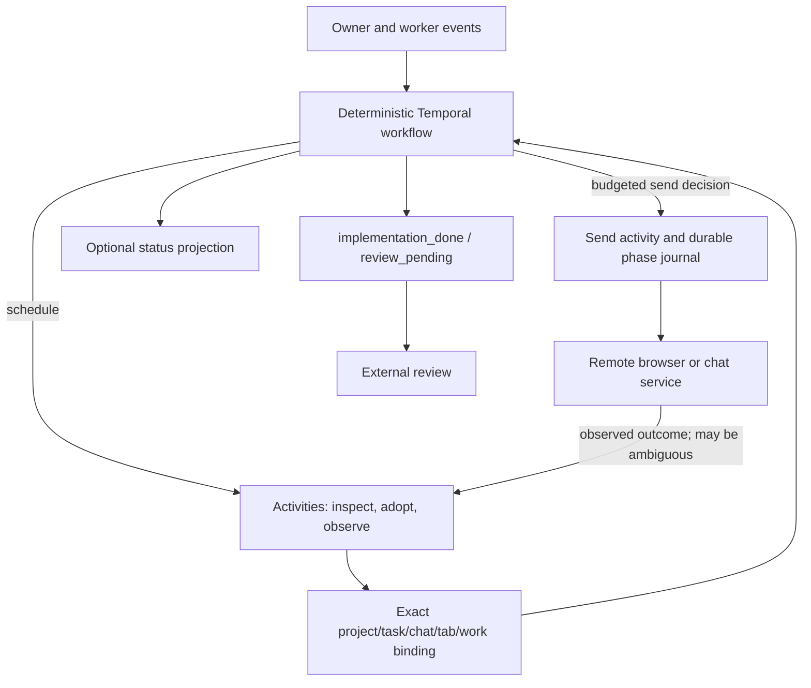

# Architecture overview

## Active Flowdeck supervisor

The active Flowdeck loop is **implementation supervision**, not code-review or artifact acceptance. It observes owner/worker events, adopts the exact task/chat binding, tracks task progress, and reports implementation completion as `implementation_done` with review pending (`review_pending`). External review remains a separate step. Historical report-verifier documents elsewhere describe a different bounded Sashai/report workflow and must not be read as the active supervisor's acceptance lane.

Temporal workflow code is deterministic orchestration: it processes durable signals/state, makes policy decisions, and schedules activities. Activities perform side effects such as reading project/task authority, inspecting browser state, submitting messages, recording send journals, reconciling events, and publishing optional status projections. Activity retries are constrained in the workflow configuration, but a remote browser/chat action can have an indeterminate outcome. Local journals and exact identity binding improve safe reconciliation; they cannot provide an exactly-once guarantee at the remote service.

The supervisor binds work to project, task, chat URL, tab, work ID, and observed prompt/event identity. Durable send/recovery records use scoped keys and append send phases, so retries/recovery must reconcile the same intended dispatch instead of assuming a remote click did or did not happen. The attended-pilot budget is a separate deterministic workflow-level reservation limit for configured continuation/next-chat sends; it is neither task approval nor proof of successful delivery. Status projection is optional and isolated: its publication health is surfaced separately and must not be confused with workflow progress or external review.

## Source map

- Workflow state machine and projection isolation: [`src/flowdeck-supervisor-workflow.ts`](../../src/flowdeck-supervisor-workflow.ts)
- Activity boundaries and identity adoption/observation: [`src/flowdeck-supervisor-activities.ts`](../../src/flowdeck-supervisor-activities.ts)
- Approved project/task model: [`src/flowdeck-projects.ts`](../../src/flowdeck-projects.ts)
- Send-budget policy and reservations: [`src/flowdeck-pilot-budget.ts`](../../src/flowdeck-pilot-budget.ts)
- Scoped send/recovery journal and authorization: [`src/flowdeck-send-recovery.ts`](../../src/flowdeck-send-recovery.ts)
- Event contract: [`src/flowdeck-work-events.ts`](../../src/flowdeck-work-events.ts)
- Browser identity and observation helpers: [`src/sashai-observer.ts`](../../src/sashai-observer.ts)
- Next implementation work: [single MVP plan](../plans/FLOWDECK_AUTONOMOUS_MVP_PROGRAMMER_GUIDE.md)

The repository also contains synthetic lifecycle tests and historical pilot evidence. They establish only the bounded behaviors they test. A later attended P1 → continuation → P2 pilot **completed successfully** with two bounded automated sends, three source work sessions and both implementations reported done; its operational claim was subsequently archived. External review is still pending, and this is not proof of unattended reliability. Earlier P2-reconciliation pauses remain historical; the rendering/observation dependency and limitations are described in the [controlled diagnostic guide](../operations/browser-observation-diagnostics.md). See the [sanitized attended-MVP hand-in](../FLOWDECK_ATTENDED_MVP_HANDIN_2026-10-18.md).

For operational use, follow [manual Mac testing](../operations/manual-mac-testing/README.md) and the [documentation index](../README.md). Use current configured runtime state, not historical pilot identifiers. The autonomous runtime has additional controller/cursor/process/evidence modules, but its complete live composition remains an integration milestone, not demonstrated unattended operation.
