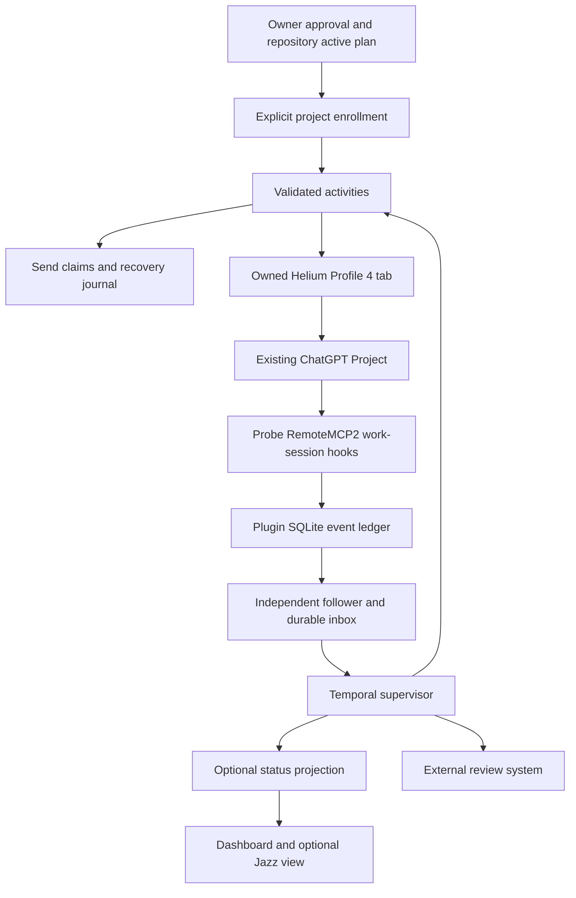

# Flowdeck architecture review and implementation handoff

**Date:** 2026-10-16  
**Scope:** Repository-wide architectural review of the current working tree, against Master Plan v1.2 and the October 15 architect handoff.  
**Authority:** Recommendations only. This review does not approve a browser submission, successor generation, workflow start/release, event replay, or enrollment change.  
**Deliverable status:** Architecture review complete; operational handoff acceptance and live MVP completion remain unverified.

## 1. Executive decision

**Keep the existing architecture. Finish the browser adapter; do not rebuild the supervisor.**

Temporal is a good fit for durable waits, session events and bounded continuation. The browser is the non-transactional boundary, and its staging reliability is the immediate delivery bottleneck. Another orchestration framework, database migration, dashboard rewrite or Jazz integration will not solve that bottleneck.

The fastest credible MVP is:

1. One explicitly enrolled project, one active supervisor attempt and one browser worker on this Mac.
2. Genuine plugin start/report events through the independent durable inbox.
3. Exact chat/task identity, same-chat continuation, then one approved independent task in a new project chat.
4. Strictly conservative send claims and reconciliation; no automatic retry of uncertain clicks.
5. Implementation reported complete / review pending; external review stays external.
6. CLI/Temporal status sufficient for operation; dashboard and Jazz optional.

Do not restart Task A. The supplied handoff reports its real initial turn and automatic continuation already completed. It reports Task B still unsent, with failed pre-click staging. These are historical observations, not a fresh live-state certification by this review.

## 2. Evidence and review limits

### Inspected

- Active Flowdeck workflow, project authority, activities, event inbox/reconciliation, send recovery, launcher/follower/recovery interfaces and corresponding tests.
- Helium/CDP browser adapter, observer and dispatch evidence, no-send check and recorded staging results.
- Original fixture workflow/activities/CLI/worker, Sashai report/binding/live-report/synthetic lanes, task-source/preview, dashboard/public assets and Jazz widget tooling.
- Root build configuration, dependency versions, README and operational/architect handoff documents.
- Review was divided across independent source reviewers; consequential findings were checked against the source. This is an architectural review, not an exhaustive security audit or line-by-line verification of every test and historical artifact.

### Fresh validation

- `npm test` was run by the review agent: TypeScript build passed; **271 tests, 268 passed, 0 failed, 3 skipped**. The captured summary did not preserve an exact mapping of the three skips; do not infer which integration proofs ran from the total.
- Default tests are not hermetic: they can inspect local evidence, contact existing dashboard/CDP/Temporal services, and exercise guarded legacy entrypoints. This was not a live acceptance demonstration.
- `npm ls @temporalio/client @temporalio/worker @temporalio/workflow @temporalio/activity --depth=0`: all four installed packages are **1.24.0**.
- No new live-browser staging campaign, real-Temporal smoke command, B recovery preview, successor authorization, workflow release or live task dispatch was performed for this review. No worker was deliberately launched outside the test suite.

### Historical evidence, not rerun here

`.state/verification-runs/repeated-20261015T233749/RESULTS.md` records:

- Three test cycles: 269 passed / 0 failed / 2 skipped each.
- Real Temporal smoke with fake browser activities passed.
- Ten real no-send browser attempts: **7 passed, 3 failed**; failures were one composer timeout and two connector timeouts.
- Zero browser submissions in those attempts.

The difference in current test/skip counts is not evidence that browser readiness improved. The exact live cause of the recorded failures remains unconfirmed.

## 3. Architecture to retain



The projection arrow describes the desired non-authoritative boundary; current publication is awaited by the workflow and can fail it (finding F4).

### Ownership and sources of truth

| Concern | Authority | Not authority |
|---|---|---|
| What may execute | Owner-approved enrollment plus active plan/worktree | Jazz status, deferred ideas, browser suggestions |
| Workflow progress and buffered signals | Temporal history and workflow state | Dashboard JSON |
| Source work-session reports | Plugin event ledger, scoped inbox delivery | OS notification banner, finish text alone |
| Whether another click is permissible | Durable claims/journal and scoped reconciliation | Missing receipt, activity timeout, empty UI |
| Actual destination/content | Pinned tab/project/chat and full submitted-message evidence | Tab title, a plausible URL, user-turn count alone |
| Implementation status | Bound finished response interpreted by supervisor | Plugin `success` alone |
| Review/merge/release | Separate review system | `implementation_done` |

Keep the plugin's source SQLite and Flowdeck's existing local JSON state. They have different ownership; there is no justification for a new shared database on the MVP critical path.

### Existing implementation map

| Layer | Files / lanes | Disposition |
|---|---|---|
| Authority | `src/flowdeck-projects.ts`, `src/sashai-task-source.ts` | Keep; exact plan and worktree checks |
| Durable orchestration | `src/flowdeck-supervisor-workflow.ts` | Keep; no direct browser/file I/O |
| Application operations | `src/flowdeck-supervisor-activities.ts` | Keep public activity names/signatures; extract internals only when useful |
| Browser transport and DOM | `src/sashai-live-browser.ts`, `src/sashai-observer.ts`, `src/sashai-dispatch-evidence.ts` | Immediate focused work |
| Events | `src/flowdeck-work-events.ts`, `src/flowdeck-event-reconciliation.ts`, `scripts/flowdeck-work-events.mjs` | Keep wakeup/authorization separation |
| Recovery | `src/flowdeck-send-recovery.ts`, reconcile/resume scripts | Preserve immutable lineage and explicit approval |
| Operations | `scripts/flowdeck-supervisor.mjs`, `scripts/flowdeck-launch.mjs` | Add narrow exclusivity/readiness improvements |
| Optional visibility | `src/dashboard-server.ts`, `public/*`, `widgets/jazz-status/*` | No new feature work before live proof |
| Historical fixture | `src/{activities,cli,protocol,workflows,worker,seed,verify}.ts` | Retain as explicitly historical, not the product entrypoint |
| Historical report proofs | Sashai report/binding/synthetic/live-report modules and scripts | Preserve evidence and replay compatibility; no parallel product engine |

## 4. Prioritized findings

### F1 — P0: staging readiness is unreliable; current diagnostics conceal which predicate failed

**Confirmed evidence:** recorded 7/10 live no-send passes. `src/sashai-live-browser.ts:127–184` implements composer, picker and connector staging; diagnostics often finish at `cdp_target_ready`, which describes target enumeration rather than DOM readiness.

**Concrete code observations:**

- Composer selection uses the first matching contenteditable textbox (`:105`), then checks visibility. A hidden first match could mask a visible composer; this is a testable hypothesis, not an observed root cause.
- One five-second `pickerDeadline` is created before opening the picker and reused for connector selection (`:145–165`). Slow opening can leave little or no selection budget.
- After clicking a connector, the code immediately checks the selected label and inserts the prompt (`:183`), without a separate bounded wait for selection hydration.
- Each `Runtime.evaluate` opens a new WebSocket and can take nine seconds (`:32–45`); target-list requests allow 4.5 seconds (`:27–30`). Nested awaited calls can overrun a nominal polling deadline.
- Transport failures, missing DOM elements, duplicate matches and route hydration are not consistently represented as distinct readiness results.

**Smallest change:** introduce a small internal readiness helper with an absolute overall deadline, bounded per-call budgets and typed failure reasons. Capture target/route identity, visible composer count, busy/draft flags, picker visibility, exact connector-match count and selected-label readiness. Do not log chat text, prompt bodies, cookies or credentials. Re-read the same pinned target before mutations; never substitute another tab.

Give picker opening and selection explicit budgets within the overall cap; wait for the selected connector state before inserting text. Only retry known pre-click transient reads. Fail closed on drafts, ownership drift, wrong project, duplicate candidates or ambiguous connector identity. Do not change selectors on speculation: use real redacted observations to justify the patch.

**Acceptance:** unit fixtures for delayed/missing/duplicate DOM and transport failure, then at least ten consecutive independent real no-send create→stage→full-match checks. A failed attempt resets the consecutive count; retain every failure log. Ten passes are a readiness gate, not a statistical guarantee of production reliability.

### F2 — P1: timeout/cancellation is not explicitly connected to the supervisor send boundary

**Source:** all supervisor activities have a two-minute start-to-close timeout and one attempt (`src/flowdeck-supervisor-workflow.ts:7`). The supervisor calls `live.click(..., Date.now() + 10000)` without the available cancellation callback (`src/flowdeck-supervisor-activities.ts:369–370`). `LiveBrowser.click` supports a callback (`src/sashai-live-browser.ts:18,187`); the separate legacy live-report activity already checks `Context.current().cancellationSignal`.

**Risk, not a reproduced incident:** a Temporal timeout does not forcibly kill JavaScript activity code. A delayed activity may continue toward a click after the workflow has stopped waiting. The fresh ten-second deadline at click time is not a deadline for the whole activity.

**Recommendation:** derive a local total operation deadline at activity entry; propagate cancellation/abort and remaining budget through browser calls, and check before the click boundary. For longer activities, configure heartbeat/cancellation handling deliberately. Preserve the rule that any possible click remains uncertain; cancellation is not evidence of no send. Test cancellation during staging, target lookup and immediately before click. Never enable automatic send retries as a remedy.

### F3 — P1: attempt uniqueness is not project/device-wide exclusivity

**Source:** `scripts/flowdeck-supervisor.mjs:11,44–51` rejects an existing exact workflow ID, but distinct `--attempt` names yield distinct IDs. `scripts/flowdeck-launch.mjs:88–92` likewise checks only that named ID. Worker concurrency of one (`supervisor.mjs:30`) is per worker, not a distributed lock.

Signals are scoped by owner/device and workId, not project ID (`src/flowdeck-work-events.ts:6–16`; workflow `:97–115`). Multiple followers on the same owner/device stream can therefore wake competing attempts; unrelated starts can also pause an active workflow. Existing send claims reduce duplicate-send risk but do not make parallel attempts an intended supported mode.

**Fastest MVP policy:** one active supervisor/follower/browser-owner scope per owner/device/profile, with one enrolled project enabled for the pilot. Verify all old send-capable runs are terminal before authorizing another attempt.

**Implementation:** use an exclusive local scope record tied to workflow ID/run ID under the single-host constraint, with explicit stale-record reconciliation. A Temporal visibility query alone is not an atomic concurrency lock. Apply the gate consistently to normal launch and recovery; preserve named histories and old claims. Test two simultaneous launch requests. Multi-host or multi-project execution needs stronger routing/fencing later, not now.

### F4 — P1: optional status projection is on the critical workflow path

**Source:** workflow `publish()` awaits `publishSupervisorState` (`src/flowdeck-supervisor-workflow.ts:42–46`). That activity atomically replaces a single `status.json` (`src/flowdeck-supervisor-activities.ts:445–464`). Several publication calls are outside an error boundary, so a projection failure can fail the workflow instead of merely marking the dashboard stale. Multiple attempts also overwrite the same projection.

**Recommendation:** keep Temporal state/query authoritative. Give projection writes a bounded retry policy separate from sends, then record publication failure without granting or revoking send authority. Expose freshness/error explicitly; do not silently imply a stale dashboard is current. Do not swallow claim/journal persistence failures—those remain fatal to dispatch. Before multi-project support, key projections by project and attempt/run.

Changing workflow activity scheduling or retry options requires replay review/versioning; do not slip this into the browser-only P0 patch.

### F5 — P1: README operational instructions are stale and include an unsafe reset

**Source:** `README.md:5,38–42,74–86,118–125` describes older active lanes, recommends fixture worker/start commands and says to delete `.state` to repeat a demo. `.state` now contains durable send and recovery authority. Root `npm run worker` / `npm run start` still target the historical fixture, not Flowdeck (`package.json:8–12`).

**Recommendation:** make the README a short current entrypoint with explicit historical links. Remove the general `.state` deletion instruction from current operations; fixture reset instructions must require a separate disposable root. Label historical commands and disable/label the stale fixture-page start control, whose API returns 410. Preserve frozen plans unchanged.

This review did not edit the existing README, user changes or historical documents.

### F6 — P1: the stated strict-marker policy is stricter than the implementation

**Source:** `interpretSupervisorResult` (`src/flowdeck-supervisor-activities.ts:48–57`) requires one final marker when a marker is present, but also accepts a few exact plain-language completion/continuation sentences when no marker exists. The newer handoff says missing markers pause.

**Impact:** the current code may advance on one of those exact sentences without `FLOWDECK_STATUS`. This is not generic substring matching, but it is a real contract discrepancy.

**Recommendation:** select and test an explicit policy. For new supervised pilot turns use the strict final marker already required by the generated prompt. If old evidence needs compatibility, confine it to explicitly versioned legacy reconciliation; do not silently broaden the live policy. Preserve the master plan's distinction between reported implementation completion and review.

### F7 — P2: multi-project and dependency scheduling are deliberately not implemented

**Source:** `src/flowdeck-projects.ts:27–28` rejects projects other than Sashai; browser creation uses a fixed `PROJECT` (`src/sashai-live-browser.ts:6,112`). The workflow and send activity exclude every task with `dependsOn`, not just unresolved dependencies (`workflow:201–209`; activities `:317–322`). The workflow stops after the loaded approved list, a pause, or bounded waits; the CLI caps execution at four hours.

**Assessment:** acceptable constrained MVP, not the full repeat-across-projects product. Do not advertise generalized routing or review-unblocked dependent work.

**Next stage:** parameterize project identity throughout parser/observer/browser/enrollment together; define an explicit external review outcome contract before releasing dependent tasks. Implementation done alone must not satisfy a review-required dependency. For MVP, use two independent approved tasks and leave dependency-bearing work blocked.

### F8 — P2: evidence/test/deployment boundaries need consolidation

- `npm test` mixes hermetic fixtures, installed checkout/evidence assertions and existing localhost services. Split named test tiers; report skips and capabilities separately. Keep an aggregate command, but never call it proof of a live cycle.
- Much of the active implementation is currently untracked. The review covers those files, whereas `git diff` and a clean checkout of HEAD do not. Before a handoff/release, capture the reviewed implementation through the owner's normal commit process; do not commit `.state`, credentials or browser evidence wholesale.
- One shared task queue and on-demand `dist` workflow bundling mean replacement workers can pick up old histories. Record a build identifier and test representative captured histories offline before workflow changes. Use `patched()` or a new workflow type/compatible deployment when commands change; preserve old activity signatures.
- Local JSON is sufficient at this scale. Send phase files are exclusive, file-synced and directory-synced (`src/flowdeck-send-recovery.ts:70–85`); older activity claim/atomic helpers have weaker persistence semantics (`activities:143–152`). Test crash points and ordering before claiming universal power-loss durability. This is a hardening task, not proof of a duplicate-send defect.
- Dashboard startup unconditionally connects to Temporal for legacy routes (`src/dashboard-server.ts:17–18`). Lazy-connect those routes so read-only projection/UI service can survive a Temporal outage.

## 5. Temporal assessment: what should not be rewritten

- Workflow/activity separation and type-only imports are appropriate.
- Workflow-local queues, sets and maps are reconstructed by replay; they are not merely volatile application memory. `seen` and `handled` are retained across session transitions.
- `Date` and timers inside the Temporal TypeScript workflow sandbox are deterministic. Their presence is not a wall-clock nondeterminism bug.
- Short activity timeouts inside longer durable observation loops are normal. The real issue is bounding each external operation and preventing late side effects, not matching every timeout duration.
- `maximumAttempts: 1` is appropriate for current non-transactional sends. Separate retry-safe reads/projections from send activities later; do not apply a global retry increase.
- `needs_attention` is currently a returned result: Temporal can say COMPLETED while business status is paused. Operators must inspect the result, not assume there is a waiting execution to resume.
- Continue-as-new, inbox compaction and generalized fairness are not needed for the two-task pilot. Add them only for a longer-lived product, carrying necessary dedupe/binding state and retaining immutable send authority.

### Correct delivery guarantee

Do not promise exactly-once browser delivery. The achievable contract here is **one click attempt per authorized dispatch generation, durable intent before click, and no automatic resend when delivery is uncertain**.

A crash after intent but before click can produce zero submissions. A crash after click but before receipt can produce a submission with no receipt. Neither missing receipts nor activity failure proves that another click is safe. Retain the existing no-click-only, explicitly authorized successor path; never reset claims to make a demonstration pass.

## 6. Recommended code structure — incremental, not a prerequisite

Keep the flat files during the immediate patch. There is no delivery value in moving everything before the browser works. As new tests or changes require seams, extract behind existing exported activity names:

```text
src/
  supervisor/
    contracts.ts             # serializable domain types; no I/O
    policy.ts                # pure decision/eligibility functions
    workflow.ts              # deterministic orchestration
    activities.ts            # public activity composition
  browser/
    cdp.ts                   # bounded transport, abort, target identity
    project-chat.ts          # owned tab and readiness predicates
    conversation-reader.ts   # bounded identity/turn extraction
  events/
    contracts.ts
    inbox.ts
    reconciliation.ts
  persistence/
    send-journal.ts          # immutable claims, phases, recovery
  operations/
    enrollment.ts
    attempt-scope.ts         # single-host exclusivity and operator state
  status/
    projection.ts
    routes.ts
  legacy/                    # eventually, not during active-history repairs
```

This is a target grouping, not proposed new services or packages. Preserve compatibility re-exports and Temporal names if files move. Avoid a generic repository framework, abstract event bus, DI container or second scheduler. The existing injectable browser/project/read/wait seams already support focused testing.

## 7. Fastest delivery sequence

Estimates below are engineering timeboxes, not guarantees; live browser behavior and owner approval are external gates.

| Order | Work packet | Expected focus | Exit condition |
|---|---|---|---|
| 0 | Establish current truth and freeze scope | 30–60 min | Identify reviewed build, old run states and exact B lineage; no destructive reset; one approved project |
| 1 | Redacted browser diagnostics and one bounded reproduction | 1–2 h | Failure distinguishes transport, route, composer, picker and selected connector |
| 2 | Narrow cause-backed browser patch and deterministic regression tests | 1–3 h | No identity relaxation; no new send retry; deadline/cancellation tests included |
| 3 | Regression and no-send readiness | Bounded test campaign | Unit suite and isolated Temporal fake-browser smoke pass; at least 10 consecutive live no-send passes with all attempts retained |
| 4 | Read-only B recovery preview | 30–60 min | Exact failed lineage eligible; no click evidence, receipt/binding or B artifact; preview writes=false |
| 5 | Fresh owner-approved B-only successor | Approval-dependent | One named generation/run, follower ready with pending=0/blocked=0, release once; B real new-chat work/report/outcome evidence |
| 6 | Operational cleanup after proof | Next focused session | Current README, test tiers, projection policy and attempt exclusivity hardened |

The one-day target is plausible only if the staging defect is local and reproducible. If it is not, stop the timebox with an exact blocker. Do not turn repeated recovery generations into the debugging strategy.

### Work allocation

Use at most two parallel implementation streams initially:

- **Browser owner:** `sashai-live-browser.ts`, browser-check diagnostics and browser adapter tests. Own the real no-send investigation; nobody else manipulates the same profile during it.
- **Operations/test owner:** README/current runbook and test-tier/exclusivity design, with a disjoint write set. No launch/release authority implied.

A single integrator owns changes to supervisor activities, Temporal workflow signatures and recovery state. Concurrent edits across those three safety-sensitive boundaries cost more integration time than they save.

### Minimum test additions

1. Slow picker opening does not consume an undocumented selection budget; total deadline remains bounded.
2. Connector clicked but label/pill not hydrated yet; wait without inserting twice or sending.
3. Hidden/duplicate composer, missing/duplicate connector, route/tag drift and existing owner draft all fail closed appropriately.
4. Cancellation/deadline before click yields zero clicks; timeout after possible click stays uncertain.
5. Failures at journal writes, click return, receipt write and reconciliation preserve claims and refuse automatic resend.
6. Two attempt launches for one profile/device cannot both acquire authority.
7. Status publication failure has an explicit tested policy and never weakens send-journal persistence.
8. Missing/duplicate/non-final completion markers follow the selected strict live policy.
9. Event start/report reordering and signals arriving during send remain buffered and deduplicated through replay.

## 8. Approval and handoff gates

Before any B-only live operation, follow the preserved successor runbook, not commands invented from this review:

- `docs/FLOWDECK-SUCCESSOR-INTEGRATION-FIX-2026-10-15.md`
- Exact read-only preview in `docs/FLOWDECK_NEW_ARCHITECT_HANDOFF_2026-10-15.md`, section 11.

Revalidate the historical IDs and state; a dated document is not proof that the current live workflow is absent or a token is unused. Preview eligibility does not authorize apply. Obtain fresh explicit approval for one successor generation. Never repeat A, clear claims, modify the original dirty Sashai tree, replay all historical notices, or treat Jazz as dispatch authority.

The evidence packet for the final demonstration should contain:

- Reviewed build identity and test results with skips.
- Complete consecutive no-send attempt record and redacted stage diagnostics.
- Read-only eligibility result and separately recorded owner approval.
- Exact workflow/run, dispatch generation, event/work IDs and intended project/chat identity.
- One B click intent, subsequent submitted-turn reconciliation, real start/report pair and final implementation marker.
- B artifact evidence and A preservation check, without turning the supervisor into an artifact-review system.
- `implementation_done / review_pending` for both tasks; no claim of code-review approval.

## 9. Final recommendation

**Spend the next engineering session on browser staging and its evidence, not another architecture.** The durable loop and safety boundaries are substantially present. The largest immediate risks are unreliable pre-send readiness, operational ambiguity across old/new entrypoints, and overstating what synthetic tests prove.

Ship the smallest single-project, single-owner-scope cycle first. Then make recovery ergonomic, make visibility genuinely optional, and only then generalize project routing and external-review-aware scheduling.
