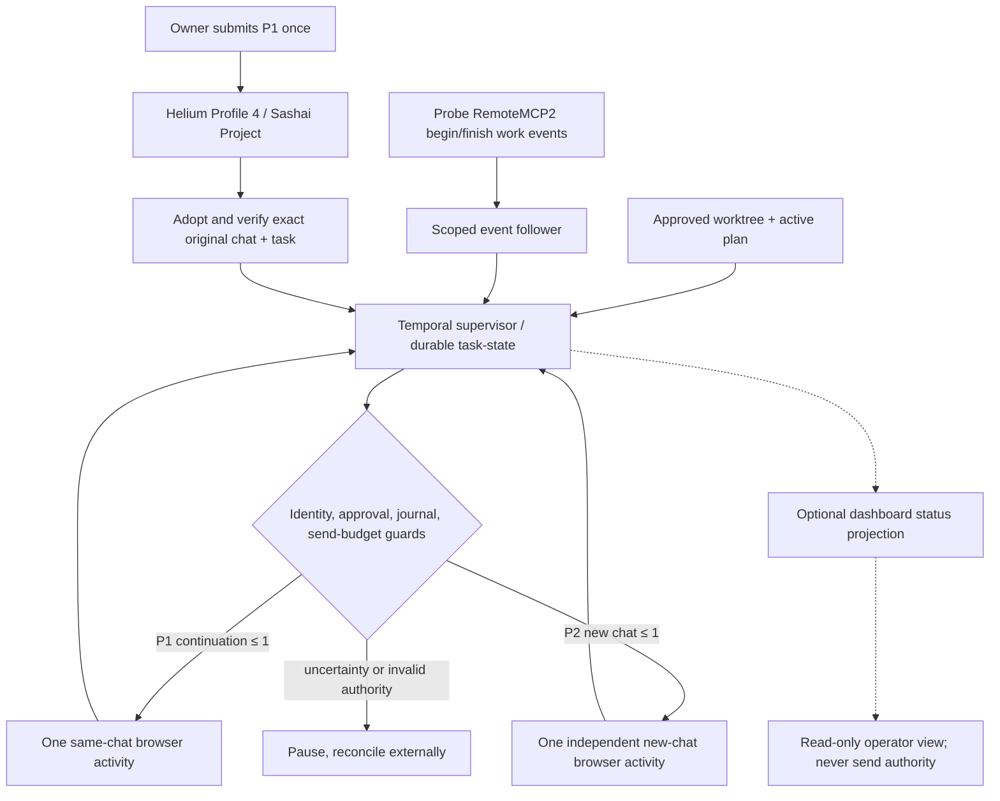

# Flowdeck MVP — hand-in overview (2026-10-16)

## What the implementation does

Flowdeck supervises **owner-started** tasks in an explicitly selected ChatGPT Project. The project is not a generic prompt scheduler: approved tasks come from one bound repository/worktree and a selected active plan. The supervisor observes genuine work-session events and finished ChatGPT turns before deciding whether to (a) continue **in the same chat**, (b) start the next independently approved task **in a new Project chat**, or (c) stop for human attention. Reported implementation completion is **review pending**, not code review approval.

The bounded attended-pilot policy enforces **at most one automated P1 continuation, zero P2 continuations, and one P1→P2 new-chat send**. Reservations are consumed before send activities; they are not receipts and are never refunded after failure or uncertainty. The original P1 submission remains manual.

## Architecture

The recovery path for **historical Task B** is separate, blocked, and not reused for the fresh pilot.

## Validated engineering evidence

| Gate | Exact observed result | Local evidence |
| --- | --- | --- |
| TypeScript build and portable regression | 224 passed, 0 failed, 1 skipped | [Portable test log](../../.state/verification-runs/pilot-budget-20261016-g9G9cz/portable-final.log) |
| Full repository regression | **361 passed, 0 failed, 3 skipped** | [Full test log](../../.state/verification-runs/pilot-budget-20261016-g9G9cz/full-final.log) |
| Real-Temporal isolated synthetic flows | **9/9 passed** with actual server-side send-activity scheduling assertions | [Real-Temporal test report](../../.state/verification-runs/pilot-budget-20261016-g9G9cz/RESULTS.md) |
| Exact-run history compatibility | **15/15 passed**: 2 legacy, 4 F4, 9 bounded-pilot runs | [Exact replay report](../../.state/verification-runs/pilot-budget-20261016-g9G9cz/RESULTS.md) |
| Real Helium connector/draft staging without Send | **1/1 + 10/10** consecutive full matches, zero submissions, 11 owned tabs closed | [Browser gate report](../../.state/verification-runs/pilot-budget-20261016-g9G9cz/RESULTS.md) |
| 103-file runtime/build manifest | SHA-256 verified, workflow build `544c2aa1d8496484b2177f74566a17b0f09139ad5595a766c4ddab12ba87e076` | [Runtime manifest](../../.state/verification-runs/pilot-budget-20261016-g9G9cz/runtime-sha256-final.txt) |
| Protected historical recovery evidence | Recursive digest `31aac9fd409fbfa6a5fba847812f535ef7ed76dde49c34b4b94f2a03d449d70f`, unchanged | [Protected-state digest](../../.state/verification-runs/pilot-budget-20261016-g9G9cz/protected-state-after.sha256) |

The preceding **failed** browser attempt-7 campaign is retained in `.state/verification-runs/fresh-attended-prep-20261016-v64rKF`; it was not silently counted as a passing attempt.

## Live attended demonstration

**NOT YET RUN; NOT APPROVED FOR SEND.** A fresh disposable worktree now exists at `/Users/test/Documents/work/sashai-flowdeck-fresh-attended-20261016-03` on Sashai `main` commit `7d2cc6818afe837119e0c171928506b1c4967269`. Its exact P1/P2 plan is a **Draft**; the `.ai/harness/active-plan` execution marker is intentionally absent. A complete pilot candidate enrollment is staged in a restricted preparation evidence directory and **not** installed in the production config.

The remaining gates are distinct:

1. Owner approves the **exact two-task draft plan** and worktree. Only then install the active-plan marker and separately review/stage the new enrollment.
2. Freeze and inspect the final task-source/enrollment/runtime manifest and verify the genuine connector event source, browser owner scope and original P1 tab.
3. Owner separately authorizes **one** attended attempt. Prepare worker/follower before owner manually submits P1 once; allow no more than one verified P1 continuation and one P2 new-chat submission. Retain the original P1 tab until reconciliation.
4. Capture Temporal workflow/run identity, independent work IDs, exact send reservations and receipts, P1/P2 artifacts, final state, and worker/follower shutdown. Stop at the first identity mismatch or uncertainty; never retry an uncertain click.

## Known limitations

- No live two-task A→B success evidence yet; synthetic completion and browser no-send staging are **different** proof levels.
- Historical Task B recovery is blocked by predecessor/authorization evidence and must not be reused.
- Independent external artifact/code review is not implemented in this supervisor; `implementation_done` implies **review pending**.
- A browser's uncertain CDP send is not an external exactly-once delivery receipt. Unattended cancellation during an already in-flight browser operation is not fully certified.
- Local runtime source includes untracked working files; Git HEAD alone is not a source manifest. Preserve SHA-256 evidence and untracked files until the hand-in is safely backed up.

**Accurate submission claim today:** tested Flowdeck workflow, guarded send budget, replay compatibility, synthetic fault isolation and browser no-send readiness are demonstrated. The full real attended end-to-end cycle is still pending separate approval and execution.
