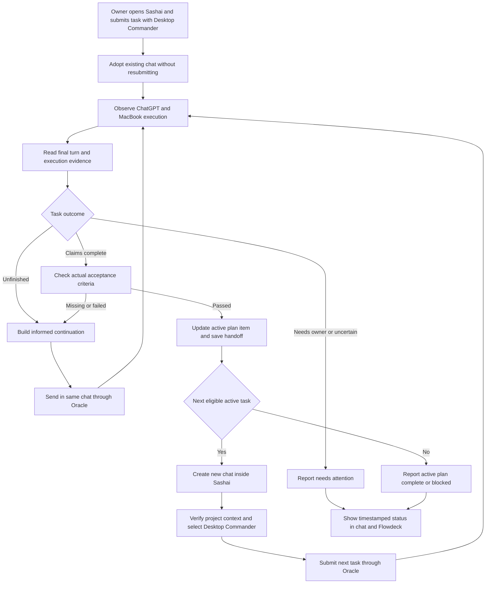

# Sashai — autonomous ChatGPT project supervisor journey

Date: 2026-10-14
Status: target journey. **Oracle 0.21.5 creates new Sashai chats and continues an Oracle-created chat successfully; CDP passive observation and guarded automatic adoption are implemented.** One browser-originated manual-chat smoke was adopted while active, invoked Desktop Commander and was successfully continued by Oracle 0.21.5. Production connector preselection in an Oracle-created next-task chat, task verification and autonomous next-task dispatch remain unimplemented.
Current implementation plan: [../plans/ORACLE-SASHAI-SUPERVISOR-PLAN.md](../plans/ORACLE-SASHAI-SUPERVISOR-PLAN.md).

## 1. What the owner does

One-time setup: enroll the Sashai ChatGPT project, bind it to /Users/test/Documents/work/sashai, identify its task-routing contract, enable supervision and choose small continuation/time budgets. Supply the initial chat URL for the pilot if automatic detection is unavailable. No duplicate manual task queue is required.

Normal daily use:
1. Open ChatGPT.com -> Sashai -> a chat.
2. Select Desktop Commander MCP.
3. Write the task and ask it to use the MacBook.
4. Press Enter and leave.
5. Return to a report of finished tasks, ongoing work, new task chats, changed files/tests and decisions requiring attention.

The owner does not have to press Continue after each response or manually copy the next task from the plan. Sashai is the persistent project workspace; a chat is a work session for a task.

## 2. What happens while the owner is away

### A. Adopt, do not restart

The supervisor identifies the existing project/chat and records its baseline user message, assistant turn, task and repository binding. It observes the already-started work without submitting another task. A manually started chat may have no Oracle session yet; that absence does not mean there is no active work.

Non-submitting capture/import is a required capability to prove in the Oracle-only browser integration. Oracle consult submits a prompt, so it must not be misrepresented as passive adoption. The new CDP observer has independently proved passive adoption of a finished turn. If adoption cannot observe the current turn, report unsupported/unknown rather than interrupting or replaying it.

If the owner adds another instruction while supervision is active, refresh the baseline and reconcile changed task scope before dispatching a continuation. Do not compete with the owner for the same chat.

### B. Observe actual execution

ChatGPT invokes Desktop Commander, which inspects/changes files or runs commands on the MacBook. The supervisor shows Working from actual available evidence and waits while the turn or known command is active. A finished browser animation or idle composer alone does not prove external command completion.

### C. Read the result and decide

| Evidence/outcome | Action |
| --- | --- |
| Response or known execution still active | Observe; no new message |
| Implementation unfinished with a clear checkpoint | Continue the SAME task in the SAME chat |
| Assistant claims completion but acceptance checks missing | Ask same chat to verify/finish; keep task unverified |
| Files/tests and acceptance criteria confirm completion | Update authoritative task item and prepare next task |
| Owner input/approval needed | Needs your attention; pause affected project |
| Capture missing, contradictory evidence or unknown submission | Reconcile; do not blindly resend |
| Active plan exhausted | Report active plan complete; do not silently promote deferred goals |
| Dependencies blocked | Report blocked, not project complete |

### D. Continue intelligently

A continuation is derived from the actual last response, the source task, project instructions, missing acceptance criteria and durable checkpoint. It is not an unconditional “continue” loop.

Proposed instruction shape:

> Continue the existing Sashai task using Desktop Commander on my MacBook. Follow AGENTS.md and the resolved active plan's Task Breakdown. Resume from the recorded checkpoint. Finish these specific remaining steps and run the missing acceptance checks. Do not start an unrelated task. Return current task, work completed, verification evidence, remaining work and blockers.

**Verified:** unmodified Oracle 0.21.5 completed `--followup` on an Oracle-created Sashai chat **and** used `--browser-tab` to attach to and continue a browser-created Sashai chat with the original conversation ID preserved. The earlier 0.21.3 prompt-commit-timeout sessions still must not be replayed. Production orchestration of many arbitrary manually started chats remains gated by task authority, tool selection and idempotent execution. Each attempt is journaled; same-chat concurrent submissions and duplicate continuation are prevented. Small turn/time budgets and no-progress detection pause runaway work.

**Transport ownership:** A Desktop Commander app selection is a composer token. Oracle 0.21.5 clears the composer before its own prompt insertion, so preselecting the app and then sending via unmodified Oracle may discard the connector. The harmless browser smoke used ChatGPT's tool selection and send UI with a one-shot guard. Oracle then successfully continued a later text-only turn via `--browser-tab`. Automated tool-using continuations must use a separately verified connector-selection/dispatch adapter, not assume Oracle preserves preselected mentions.

### E. Verify and update the right task source

Check the actual agreed file/test/command outcome independently. Captured assistant prose and a task receipt are evidence claims, not independent proof. Preserve failed tests and unresolved checks.

Once verified, use the working chat/Desktop Commander to update the correct execution item and durable handoff, then read back/reconcile it. Avoid overwriting concurrent source changes. The supervisor stores a projection, not a second authoritative task ledger.

### F. Create the next work session inside Sashai

1. Read the resolved active plan's next eligible Task Breakdown item.
2. Check dependencies, scope and blockers.
3. Claim the next task/chat-creation attempt.
4. Create a NEW chat inside the SAME Sashai ChatGPT project.
5. Verify resulting conversation URL and project membership/context.
6. Select the actual Desktop Commander MCP connector.
7. Send the next task with repo path, project/task identity, plan reference, acceptance criteria and prior handoff.
8. Observe, continue and verify this task using the same loop.

Do not reuse the finished task's chat by default, create a generic outside-project conversation, or assume typing “Sashai” provides project membership. If a chat is created but task submission is uncertain, recover that same chat/attempt instead of creating another one.

Project-scoped chat creation and connector selection are acceptance gates, not proven features of --chatgpt-url. Inspect Oracle-only support and extend that integration if necessary; no invented CLI flags.

## 3. Verified Sashai task-routing rules

Read-only repository inspection confirmed:

| File/source | Meaning |
| --- | --- |
| AGENTS.md | Root routing/workflow instructions |
| docs/spec.md | Product truth, as declared by AGENTS.md |
| Active plan's `## Task Breakdown` | Authoritative current execution tasks |
| tasks/current.md | Derived local snapshot; inspected value is Idle/bootstrap; explicitly not a lock, board or implementation gate |
| tasks/todos.md | Deferred-goal ledger, not current execution checklist; inspected file has no recorded deferred goal |

The actual active plan and its tasks have NOT been identified in this update. docs/spec.md, context capabilities/map and documentation-language policy contents have not been inspected. Discover those through the repo's routing rules before selecting work. Do not choose the newest arbitrary Markdown file or assume tasks/todos.md is the backlog to execute now.

No eligible active tasks means active plan complete or currently blocked, depending on evidence. It does not mean every deferred or future product goal is finished. Deferred-goal promotion requires the project's intended workflow.

## 4. Journey diagram

## 5. What the returning owner sees

Project: Sashai
- Current task and its source plan item.
- Current state: Working, Continuing, Verifying, Needs your attention, Active plan complete or Blocked.
- Completed tasks and their chat links.
- Current chat and automatically created subsequent chats.
- Files changed, verification results and evidence timestamps.
- Next eligible action and why it was selected.
- Any question/blocker requiring the owner.

Prefer status blocks in normal chat responses. A designated control conversation may aggregate projects; Flowdeck mirrors this history. Status publication must not recursively trigger work or repeated status prompts. Oracle does not establish native sidebar badges or an embedded live dashboard.

## 6. Implemented versus required

Implemented in the existing MVP: Temporal fixture loop, Flowdeck local progress, Jev advisory, Repo Harness dry-run persistence and deterministic Git fixture verification.

Required/unproven: compatible live provider, exact Helium Profile 4/window routing, non-submitting adoption of manual work, project-scoped chat creation, source-plan resolution, informed autonomous continuation, source checklist update/readback and next-task handoff.

Direct Oracle 0.21.3 browser attachment to Helium Profile 4 and project-scoped chat creation were verified. The original Oracle session experienced prompt-commit-timeout despite an independently observed answer. Connector selection and task verification remain unproven.

## 7. First complete acceptance demonstration

Prove ONE complete Sashai vertical slice before expanding the portfolio:
- Owner submits task normally and leaves.
- Supervisor adopts without duplicate submission.
- An unfinished outcome causes automatic same-chat continuation.
- Result passes independent verification.
- Correct source Task Breakdown item is completed and read back.
- New Sashai project chat is created with Desktop Commander.
- Next eligible task starts automatically with its handoff.
- Owner can retrieve accurate project/current-task status.

If either manual-chat adoption or project-scoped creation is unsupported, the required journey is not complete. Document the blocker instead of replacing it with a fixture-only demo or manual Continue clicks.
