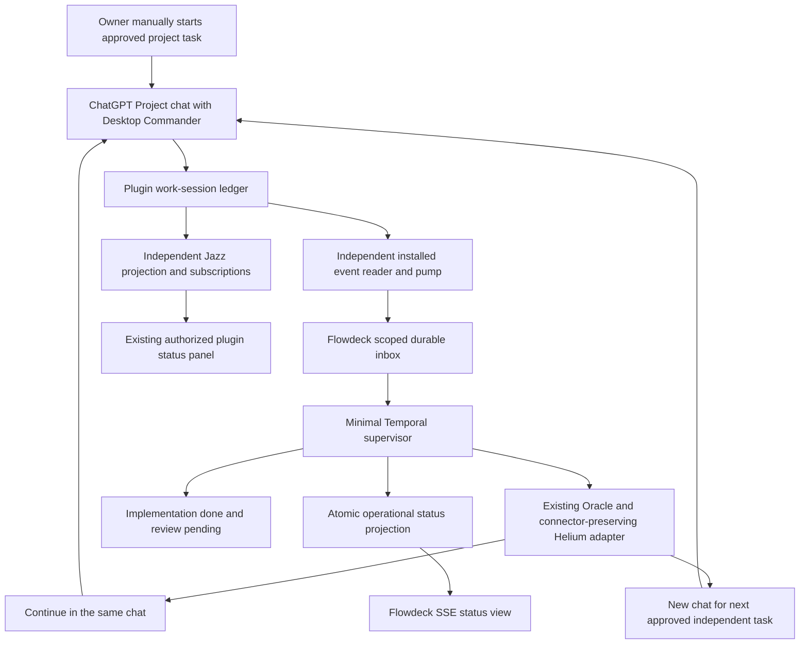

# Flowdeck MVP — editable execution roadmap

## Latest successor integration correction

The exact real failed B dispatch now returns eligible=true in read-only successor preview; the supervisor state-tree hash is unchanged. Legacy-root proof, actual sender successor consumption, immutable resume requests and single readiness release are integrated. Full suite: **269 passed, 0 failed, 2 skipped**; immediate real Helium Profile 4 staging: **3/3 no-send passes**. [Final preview-first sequence](../history/FLOWDECK-SUCCESSOR-INTEGRATION-FIX-2026-10-15.md). No live successor authorization or B send was issued. A remains complete/review-pending. Owner review and separate successor approval remain required; earlier entries below are historical.

## Latest Probe pilot P0 patch

Task A has completed both real turns and is implementation_done/review_pending. Task B failed during pre-send staging and was not submitted. [The focused recovery patch](../history/FLOWDECK-PROBE-P0-RECOVERY-PATCH.md) adds exact historical-event reconciliation, durable send phases, one-use pre-click recovery, actual error diagnostics, and a B-only named workflow gated on follower readiness. The real legacy B preview is eligible; no apply or live recovery was run. Latest validation: **261 passed, 2 skipped, 0 failed**, with a passing real Probe RemoteMCP2 no-send check. Next action is explicit operational approval for the scoped B recovery—not replay of A. Earlier milestone entries below are historical.

Updated: 2026-10-15. This is the editable roadmap, not a replacement for any frozen plan.

## Current launch-reliability milestone

The first real pilot created Task A's Stage 1 checkpoint with actual lifecycle hooks and `continue`, but delayed browser hydration closed the old workflow before adoption. Enrollment is now present for the approved isolated pilot worktree. The P0 patch adds durable adoption/submission waiting, original-user identity checks for the actual Work layout, closed-target delivery handling, and named attempt isolation. **Recovery remains unexecuted and requires explicit owner authorization; never resend Stage 1.**

See [P0 evidence, bounds and recovery](../history/FLOWDECK-P0-HYDRATION-RECOVERY.md). Final patch regression: **244 passed, 2 skipped, 0 failed**, plus real no-send browser checks. Earlier milestone entries below are historical baseline evidence, not a claim that enrollment is still missing today.

## Fixed outcome

Owner starts one Remote Desktop Commander task in a ChatGPT Project once. The supervisor adopts it without resending, waits for work-session reports and the actual ChatGPT response, continues unfinished work in that same chat, records finished implementation as `implementation_done / review_pending`, and sends the next already approved independent task once in a new chat in that same project. External systems own review.

Preserved sources:
- [Frozen master v1.2](../history/SUPERVISOR_MASTER_PLAN_FROZEN_V1_2_EN%20%281%29.md)
- [One-day execution schedule](../history/SUPERVISOR_ONE_DAY_MVP_EXECUTION_2026-10-15_EN%20%281%29.md)
- [Read-only Jazz fast track](FLOWDECK_JAZZ_READ_ONLY_CLIENT_IMPLEMENTATION_PLAN_FAST_TRACK_2026-10-15_EN.md)
- [Consolidated directive](ARCHITECT_DIRECTIVE_CONSOLIDATED_PATHS_JAZZ_FAST_MVP_2026-10-15_EN.md)

## Milestone ledger

| Milestone | Working functionality / evidence | Status and next action |
|---|---|---|
| Minimal durable loop | `src/flowdeck-supervisor-workflow.ts`, `src/flowdeck-supervisor-activities.ts`, `src/flowdeck-projects.ts`; adoption, final-answer polling, same-chat continuation, approved independent successor, bounded pauses, implementation/review separation | Implemented and fixture-tested. First adapter is Sashai-only; not general multi-project routing. |
| Event integration | `src/flowdeck-work-events.ts`, `scripts/flowdeck-work-events.mjs`; installed reader/pump/checkpoint, independent durable inbox, scope/dedup, Temporal signal | Read-only `once` succeeded against the actual installed ledger. No live follower started; no source writes or notification leases. |
| Event ordering | Start/report reordering retained until adoption; events received during sends remain queued; pending target is not an active work binding | Regression-tested. Uncertain sends pause without replay. Fast-finished chats can still require reconciliation because adoption requires a visibly running chat. |
| Temporal integration | `scripts/flowdeck-supervisor-smoke.mjs` executes real Temporal with fake browser activities | Passed: six signals, three adoptions, one same-chat continuation and one different-chat successor, both tasks review-pending. Not a live connector/browser cycle. |
| Reactive visibility | `src/dashboard-server.ts`, `public/sashai.html`, `public/supervisor-status.js`: SSE projection, status endpoint, fixed widget asset routes | Deployed by restarting only Flowdeck LaunchAgent; API/assets/SSE HTTP 200. Browser displays waiting for enrollment without manual refresh. Isolated SSE test verifies atomic status changes over one connection. |
| Jazz display | `widgets/jazz-status/**`, `src/jazz-status-config.ts`, `public/jazz-status-loader.js`; exact installed alpha.53 schema/version, memory-only browser island | Built/typechecked. Localhost remains link-only due to existing plugin-origin auth. Authorized plugin panel observed showing scoped work rows and a fresh projector signal after reloading a stale tab. No auth/access-control change. |
| Real autonomous cycle | Owner initial send → adoption → continuation → finished implementation → next approved in-project chat | **Blocked / not demonstrated.** No approved active Sashai two-task execution source, no supervisor enrollment, and no fresh Sashai chat. |

## Codegraph-derived implementation map

Derived from exploration of the actual workflow, activities, event bridge and plugin status panel. Solid execution edges are implemented; this is not a claim of live browser acceptance.

Jazz never dispatches MCP work or drives Temporal. Repo Harness remains outside the new runtime; historical demo/report lanes are preserved but are not prerequisites.

## Observed integration details

- Actual installed finish event: `work_reported`, not a separate `work_finished` event.
- `success` means agent-reported session outcome, not completed task or reviewed code.
- Installed source: `/Users/test/Documents/RemoteMCP-Jazz/repositories/RemoteMCP-Jazz/control-plane/.data/remote-control.sqlite` (read-only reader verified; opened by current local control-plane process).
- Owner/device scope matched authenticated Jazz rows after reload. The stale tab initially showed an older device, so enrollment must use the current scope, not cached UI.
- Flowdeck: `http://127.0.0.1:4319/`, reopened in a new Helium Profile 4 window through the existing browser process.
- Authorized status fallback: `https://tests-macbook-air.tail70b8a.ts.net/dashboard/devices`.
- Historical active-declared Jazz rows are not evidence that work is still executing. Fresh projector health confirms transport, not process liveness.
- No project authority markers, enrollment, connector work, or live prompts were created in this implementation milestone.

## Next actions — shortest path to the real cycle

1. Owner approves the exact two documentation tasks and isolated worktree setup in [live pilot approval](../history/FLOWDECK-LIVE-PILOT-APPROVAL.md). Until approval, do not create the worktree/authority markers or enroll these tasks. The original Sashai worktree remains untouched.
2. Enroll those exact unchecked titles/instructions plus initial task ID and current owner/device in `.state/flowdeck-supervisor/projects.json`, using `examples/flowdeck-supervisor.example.json`. Empty examples cannot dispatch. Never store credentials there.
3. Confirm the fresh chat will be exclusive to this run and that its prompt requests a final `FLOWDECK_STATUS` marker and real begin/finish work hooks. The first prompt remains owner-submitted.
4. Start the dedicated worker/workflow and independent event follower **before** that manual start. See [runbook](../FLOWDECK-SUPERVISOR-RUNBOOK.md). Historical/snapshot events never trigger sends.
5. Observe the real continuation and successor, then record exact URLs, counts and review-pending outcomes. Pause without replay if a send is uncertain or adoption is ambiguous.
6. Only after that observation mark the live-cycle milestone complete. Do not equate fixture or Temporal-smoke completion with live ChatGPT operation.

## Validation and evidence

- Latest launch-readiness `npm test`: **228 passed, 3 skipped, 0 failed**, including hook-prompt, bounded-adoption and readiness tests. `git diff --check` also passed.
- Bounded real-browser check: new owned Sashai Project window in Profile 4; Remote Desktop Commander selected; full composer match; zero submissions; owned check tab closed. Run with `npm run build && node scripts/flowdeck-browser-check.mjs`. Does not prove a real new-chat send or MCP execution.
- Added `scripts/flowdeck-launch.mjs`: one foreground startup sequence, 30-second startup deadline, worker/workflow/follower readiness, no automatic restart. Not launched against real enrollment yet.
- Both original research reports are archived unchanged with hashes in [research records](../research/README.md). Their broader implementation remains deferred.
- Widget reuse build: typecheck and browser bundle passed with `jazz-tools@2.0.0-alpha.53`; no dependencies installed or plugin files edited.
- New supervisor workflow bundled successfully with the Temporal bundler.
- Real Temporal smoke workflow: `flowdeck-smoke-df47dcd8-b5c6-4224-ab6f-daf57f92a643`, run `01a13f6e-4634-724d-9796-57fe06429899`, COMPLETED, 161 history events, six signals. Worker and both connections closed.
- All browser sends in this milestone's cycle tests were fake. No new ChatGPT prompt was submitted.

## Deferred work

See [deferred research backlog](DEFERRED-RESEARCH-BACKLOG.md). No new review platform, journal migration, agent framework, production observability project, or broad hardening program is part of this day-one implementation.
