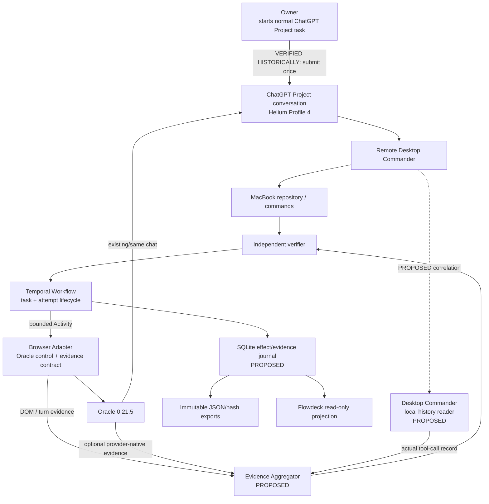
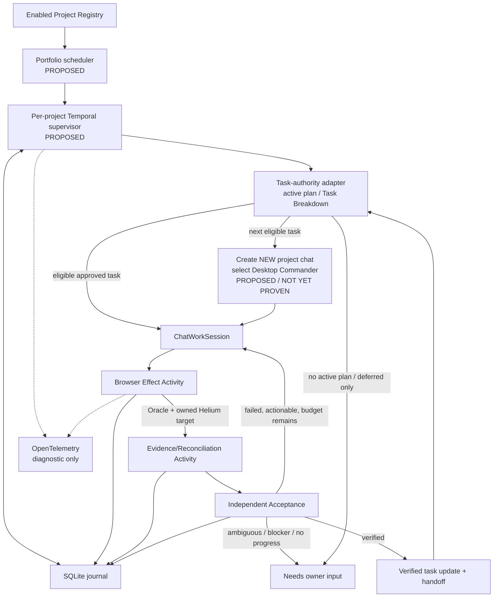

# Research Report: Durable Autonomous Supervision of Existing ChatGPT Project Conversations

## Executive findings

The existing MVP should be **extended, not rewritten**. Its architectural centre is already correct: Temporal owns durable orchestration; Oracle owns the proven ChatGPT browser-control path; Helium Profile 4 remains the authenticated browser; Desktop Commander performs MacBook work; independent verifiers determine whether a project task is actually complete; and Flowdeck remains a projection rather than a source of truth. The handoff itself correctly distinguishes historical live proof, synthetic Temporal proof, fixture-tested new code, and the still-missing fresh live Temporal execution. fileciteturn0file0L37-L54

The two immediate gaps are exactly the ones identified in the research brief:

1. **A trustworthy browser/connector evidence contract.** The new adapter deliberately requires exact submitted-turn identity and structured attributable connector evidence, but those assumptions have not yet been demonstrated against the current ChatGPT DOM. That is the correct fail-closed posture. fileciteturn0file0L56-L59
2. **A fresh Temporal-controlled live lifecycle.** The repository has strong synthetic and historical recovery coverage, but the new workflow has not yet demonstrated Temporal → connector-preserving real send → independent rejection → same-chat correction → independent acceptance. fileciteturn0file0L47-L54

The most important research finding is that **Desktop Commander's own local tool-history surface is potentially a stronger source of connector evidence than ChatGPT's rendered activity UI**. Its official project documents a persistent local tool history containing tool name, arguments, duration and returned result, including remote calls routed through the local MCP server. That can potentially answer the distinction your current adapter cares about—*connector selected* versus *tool actually invoked* versus *tool result observed*—without pretending that a connector chip or an assistant claim proves execution. The missing part is correlation: its documented records do not establish a shared ChatGPT message/turn ID, so a bounded live experiment must determine whether an attempt nonce, exact artifact path and temporal/operation boundaries can attribute a Desktop Commander record to one ChatGPT turn without false matches. citeturn7search0turn22search4

The second major finding is that Oracle has itself moved towards better conversation evidence. Its current browser documentation describes optional **provider-native conversation capture** that binds an assistant message ID to exact UTF-8 answer text and returns `unknown` when the necessary provider identity cannot be established. That is useful corroboration, but Oracle explicitly says it obtains this information from an **undocumented authenticated ChatGPT conversation endpoint**. It therefore must not become your only evidence source or be mistaken for a supported OpenAI Projects API. citeturn23search2

Finally, Temporal gives you durable workflow execution but **cannot make a browser click exactly once**. Temporal Activities are an at-least-once execution abstraction unless the external effect itself is idempotent; a worker can lose its Activity result after the external provider has already accepted the operation, after which an automatic Activity retry can repeat that operation. The right semantics for ChatGPT sends are therefore: **one claimed attempt, one physical send opportunity, and explicit reconciliation of uncertain outcome**—not “exactly once”. citeturn17search2turn18search2

Your exported snapshot is unusually useful for this research because it includes the current uncommitted live adapter rather than only committed HEAD `203092cbc35d70d6aee8fd4580298635a0e44890`; the handoff also explicitly forbids interpreting the fixture tests as fresh browser proof. fileciteturn0file7L5-L13 The working tree identifies the live browser, activities, workflow and tests as the new working-copy layer. fileciteturn0file2L1-L10

### Recommended direction in one sentence

**Keep Temporal + Oracle + Helium + Desktop Commander; add a versioned Browser Evidence Adapter and Desktop Commander evidence reader; move mutable effect state from loose JSON files to a small SQLite transactional journal; validate the current ChatGPT evidence surface; then run the already-bounded fresh live Temporal test before implementing general autonomous task advancement.**

## Ranked technology shortlist

The ranking below is based on the exact missing seams, not framework popularity.

| Rank | Project / package | Current evidence and licence | Exact seam | Verdict |
|---|---|---|---|---|
| **1** | **Temporal TypeScript SDK + `@temporalio/testing`** | Your project already targets `@temporalio/*` 1.24.x. Temporal's TypeScript SDK supports Node 20/22/24 and is MIT-licensed; 1.24.0 is the current line represented in the researched material. The testing package exposes local and time-skipping test environments, and Worker APIs support history replay. citeturn3search1turn3search2turn20view0turn20view1 | Durable task lifecycle, crash recovery, timers, signals/queries, bounded retries, replay and fault testing. | **Adopt/keep now.** No replacement workflow engine. |
| **2** | **`@steipete/oracle` 0.21.5** | MIT; Node 24+. Oracle's changelog records 0.21.5 on 11 October 2026, with continued browser recovery/cleanup work. Browser mode supports attachment to running Chromium, existing-tab targeting/follow-up and optional provider-native evidence. citeturn23search1turn23search3turn23search2 | Proven ChatGPT navigation/conversation continuation and browser lifecycle. | **Keep and extend behind your adapter.** Do not replace it merely to gain another browser abstraction. |
| **3** | **Desktop Commander / `@wonderwhy-er/desktop-commander`** | MIT. npm research showed the package at 0.3.0 with active publication around this research date. Its official implementation documents local persistent tool-call history for local and remote MCP calls. citeturn22search6turn7search0turn22search4 | Independent evidence that a Desktop Commander tool was actually invoked and returned something. | **Adopt as a new read-only evidence source**, after a correlation experiment. |
| **4** | **Playwright 1.63** | Apache-2.0. Current documentation exposes `chromium.connectOverCDP()`. Recent API versions have a `noDefaults` attachment option specifically useful for attaching to a user's daily-driver browser without imposing ordinary Playwright context defaults. Playwright warns that CDP attachment has lower fidelity than its native protocol. citeturn10search0turn12search0 | Robust DOM/accessibility extraction, sanitized DOM fixture capture and browser contract testing. | **Adopt first as a test/evidence utility; investigate for live read-only observation.** Do not make it a second competing sender yet. |
| **5** | **Puppeteer / `puppeteer-core` 25.x** | Apache-2.0. The researched npm release was 25.13.0, while the current API documentation had advanced to 25.14.0. `connect()` supports existing browsers, browser URL/WebSocket endpoints, target filtering and CDP protocol configuration. citeturn8search0turn23search4 | Alternative low-level/high-level bridge for an existing Chromium with explicit target filtering and clean disconnection. | **Investigate as fallback**, especially if Playwright attachment changes or interferes with Helium. Do not ship both as production controllers. |
| **6** | **Zod 4.6.x** | MIT, zero-runtime-dependency TypeScript schema library; the researched package was 4.6.5. citeturn16search2 | Validate observations, receipts, DB records and owner configuration at process boundaries. | **Adopt now**, but version persisted schemas and avoid letting schema evolution alter old Temporal Workflow decisions during replay. |
| **7** | **Node `node:sqlite`** | Built into Node 24, so it introduces no extra npm runtime dependency. In the Node 24 documentation it is available with `DatabaseSync`, prepared statements and transactions; the module is still classified as release-candidate stability rather than fully stable. citeturn14search0 | Atomic local attempt/effect/receipt journal; uniqueness constraints; concurrent dashboard reads. | **Adopt behind a persistence interface after a short spike.** Keep JSON as exported evidence, not mutable coordination state. |
| **8** | **OpenTelemetry JS / `@opentelemetry/sdk-node`** | Apache-2.0; researched `sdk-node` version 0.223.0. The JS SDK supports maintained Node versions but the Node SDK package is still described as experimental and can change. Temporal also provides OpenTelemetry interceptors. citeturn16search3turn16search0turn19search21 | Correlate Temporal workflow/run, attempt, browser target and evidence activity operationally. | **Investigate after Gate 2.** Useful diagnostics, never authoritative acceptance evidence. |

### Browser-library conclusion

There is no evidence-based reason to replace Oracle wholesale.

Oracle already solves several difficult problems you have live-tested: signed-in ChatGPT interaction, session lineage, same-conversation follow-up and preservation/recovery of owned browser targets. Its current release history also shows active work on target ownership, attach-running recovery and conversation-evidence fidelity. citeturn23search0turn23search1turn23search2

The better division is:

**Oracle = browser control and ChatGPT conversation lifecycle**

**Evidence adapter = cross-check identity/evidence from multiple surfaces**

**Playwright = browser contract testing and, if necessary, read-only DOM inspection**

**Puppeteer-core = fallback existing-browser observer if its target/disconnect semantics fit Helium better**

**raw `chrome-remote-interface` = escape hatch, not the main abstraction**

`chrome-remote-interface` remains maintained enough to be viable—a raw Node CDP binding with target discovery and direct protocol access—but its own positioning is low-level, and it gives you more protocol bookkeeping rather than stronger semantics. Because Oracle already speaks CDP, adding CRI directly should require a specific protocol event that Oracle, Playwright and Puppeteer cannot expose satisfactorily. citeturn13search4turn13search9

### Why Desktop Commander evidence changes the design

The official Desktop Commander implementation documents two relevant local stores: a simple tool-call log and a richer JSONL history containing tool name, arguments, duration and returned result. Remote MCP calls still execute through the local MCP server and enter that local history; the vendor's remote routing database is described as temporary rather than a permanent audit system. citeturn7search0turn22search4

That suggests this evidence ladder:

| Evidence | What it can prove |
|---|---|
| Connector/App visible in composer | Desktop Commander was **selected for that message**, assuming the UI identity is correctly captured. |
| ChatGPT activity/tool card | ChatGPT **rendered an apparent tool invocation/result** for the bound turn. Useful, but DOM-dependent. |
| Desktop Commander local history record | Desktop Commander's local server **actually received and executed a named tool call and returned a result**. |
| Independent filesystem/Git verifier | The expected repository state **actually exists after execution**. |
| Assistant final answer | What ChatGPT **claims happened**; useful narrative, not execution proof. |

OpenAI's current MCP-app documentation makes the first distinction especially important: app selection applies to the **message where it is used**, and a later message needing the same app may need that app selected/mentioned again. A selected connector is therefore not safely inheritable merely because an earlier message in the conversation used it. citeturn21search0turn21search1

This supports your existing decision to stage and validate the complete composer—including the connector state—immediately before every guarded continuation send.

## Architecture and evidence model

### Minimal MVP architecture

Solid-labelled edges below correspond to behaviour already present or historically demonstrated in your bundle; `PROPOSED` edges are the narrow additions recommended by this research. The handoff explicitly states that the live adapter is fixture-tested rather than freshly live-proven. fileciteturn0file7L9-L13



Oracle's provider-native capture is valuable here but cannot be the root of trust: Oracle says it calls an undocumented ChatGPT page endpoint, and evidence can legitimately be `unknown` when message identity or content form cannot be established. citeturn23search2

The evidence aggregator should therefore never collapse its observations into one premature boolean. A useful core representation is:

```ts
type EvidenceConfidence =
  | "observed"
  | "corroborated"
  | "unknown"
  | "conflict";

interface BrowserTurnEvidence {
  projectId: string;
  chatSessionId: string;
  attemptId: string;

  ownedTargetId: string;
  conversationUrl: string;

  internalTurnId: string;
  externalMessageId: string | null;

  promptSha256: string;
  assistantSha256: string | null;

  connector: {
    selected: EvidenceConfidence;
    invoked: EvidenceConfidence;
    resultObserved: EvidenceConfidence;
  };

  sources: readonly EvidenceReference[];
}
```

Crucially, **your own `internalTurnId` is authoritative for lineage; any ChatGPT/DOM/provider message ID remains nullable external evidence**. Oracle's current provider capture is evidence that external message IDs are obtainable in some current ChatGPT conversations, but because the endpoint is undocumented, persisting that ID as the sole durable primary key would turn a fragile provider implementation detail into your data model. citeturn23search2

### Robust follow-on architecture

Only after the fresh lifecycle passes should the architecture expand to the complete user journey.



No public OpenAI surface found in the reviewed official material provides the equivalent of “create a new ChatGPT.com Project conversation, preserve that Project's UI context, select this MCP app and submit a website message”. OpenAI documents Projects and MCP/app behaviour, including project context and per-message app use, but that does not amount to a supported website-automation API. The browser adapter therefore remains necessary for your exact user journey. citeturn21search0turn21search11

### State boundaries

Do not merge these states.

**Project** owns project identity, project URL, repository, task-authority contract, enable/pause state and budgets.

**Task** owns the authoritative source item, source revision, dependencies, approval scope, acceptance criteria and logical state. A task is not complete merely because a ChatGPT turn ended.

**ChatSession** owns conversation identity, Project membership evidence, manual-versus-supervisor origin and currently bound task.

**Attempt** is one approved bounded execution try: task ID, chat, contract hash, source revision, prompt hash, approval, deadlines and one or more browser turns.

**BrowserTurn** is one submitted user message plus its assistant response evidence. It has its own send state independently of Task state.

**ConnectorInvocation** is evidence that Desktop Commander executed a particular operation. It belongs to the Attempt/BrowserTurn but must allow `unknown` when attribution cannot be proved.

**Approval** defines what may happen—not what did happen. It should include scope, maximum turns/corrections, destination repository/output, expiry/time budget and permitted side effects.

**AcceptanceReceipt** is an immutable verdict over a specific Attempt, source revision, artifact and evidence set. It never means “the entire project is complete”.

This directly matches the research brief's requirement to keep workflow, chat-turn, connector and task-verification states independent. fileciteturn0file0L61-L68

### Reuse, replace, keep

| Current component | Recommendation | Reason |
|---|---|---|
| Temporal workflows/activities/signals/queries | **Keep and extend** | Already the correct durable coordinator. |
| Oracle 0.21.5 | **Keep pinned for current live work** | Proven locally; current upstream has additional relevant evidence/recovery work. Upgrade only through the same live compatibility gates. citeturn23search1 |
| Current CDP/Helium observer | **Keep behind `BrowserAdapter`** | Historical adoption is valuable; isolate ChatGPT DOM assumptions. |
| New live browser adapter | **Keep, but split extraction from transport** | Exact prompt and owned-target safeguards are good; the unproven part is live extraction of turn/tool evidence. |
| Desktop Commander | **Keep execution; add evidence reader** | Official local history can provide stronger invocation proof. citeturn7search0turn22search4 |
| Mutable JSON attempt/claim state | **Gradually replace with SQLite** | Atomic state transitions and uniqueness are easier to enforce transactionally. |
| Immutable JSON/SHA-256 receipts | **Keep** | Excellent human-readable/exportable audit artefacts. Generate from canonical DB state. |
| Independent report/repository verifier | **Keep and generalise** | Verification must remain independent of assistant text. |
| Flowdeck | **Keep read-only/auxiliary** | It should project state, never confer approval or trigger hidden work from GETs. |
| Current tests | **Keep and classify explicitly** | They already encode many important negative cases; add fresh Temporal/browser layers rather than discard them. |
| Repo Harness active runtime | **Keep excluded** | Owner decision and current handoff contract. fileciteturn0file0L24-L35 |
| XState | **Defer** | It would duplicate Temporal's durable state machine unless limited to a UI-only projection. |
| Stagehand/browser-use/LangGraph-style agent frameworks | **Reject for this milestone** | They do not solve trustworthy connector attribution or exactly-once-like external-effect reconciliation. |

## Durable side effects and persistence

### The correct guarantee

The target guarantee should not be named “exactly-once browser submission”.

It should be:

> **At most one automatically authorised physical send attempt per effect claim; after uncertainty, reconcile instead of replaying.**

Temporal Workflow replay is deterministic reconstruction of workflow decisions. Previously completed Activities are represented by History and are not rerun merely because the Workflow code replays. But Activity *execution itself* may be retried if Temporal never received/committed its completion after the external effect occurred. Official Temporal material uses precisely this sort of failure mode when explaining external API side effects. citeturn17search2turn18search1

For `sendChatTurn`, automatic Activity retry should therefore remain disabled or constrained to one attempt. Read-only activities such as `observeTurn`, `readDesktopCommanderHistory`, `getRepositoryState` and `verifyArtifact` can have ordinary bounded retries.

A safe progression is:

```text
approved
  ↓
claim_committed
  ↓
pre_click_revalidation
  ↓
click_attempted
  ├── confirmed_turn ──→ observe/result/verify
  └── outcome_unknown ─→ read-only reconciliation
                            ├── confirmed_sent
                            ├── confirmed_not_sent (rare; requires strong evidence)
                            └── unknown → stop / owner intervention
```

A timeout after the click must never be converted into “the Activity failed, therefore retry the Activity”.

### SQLite is now justified

The file journals have served the prototype well. For one report and one correction, SHA-256-bound files are transparent and testable. Generalising across projects introduces multi-record invariants that are awkward to make atomic with separate files:

- Attempt and EffectClaim must be created together.
- One effect key must not acquire two current claims.
- Acceptance must bind to the same Attempt/contract/source/chat.
- A correction must be conditional on a particular failed receipt and artifact hash.
- Dashboard reads must not observe half of a multi-file update.
- Scheduler leases and owner approvals will introduce concurrent readers/writers.

Node 24's built-in `node:sqlite` provides a small path to transactions without adding a database server or native npm dependency. It is still marked release-candidate stability, which is why the database should sit behind an interface rather than leak throughout the code. citeturn14search0

A suitable minimum schema is:

```text
projects
tasks
chat_sessions
attempts
browser_turns
effect_claims
connector_invocations
approvals
acceptance_receipts
evidence_records
schema_migrations
```

Keep large/raw browser or Desktop Commander captures out of ordinary relational columns. Store a reference, byte length and SHA-256, with the sensitive raw file retained locally under restrictive permissions when necessary.

One important design choice is to retain your current evidence exports:

```text
SQLite = canonical mutable coordination state
JSON receipt = immutable/exportable projection
raw evidence file = source material
SHA-256 = lineage binding between the three
Temporal History = orchestration history
```

No one store has to pretend it proves everything.

A transactional effect claim can remain simple:

```ts
import { DatabaseSync } from "node:sqlite";
import { randomUUID } from "node:crypto";

const db = new DatabaseSync("supervisor.sqlite", {
  timeout: 5_000,
});

db.exec(`
  CREATE TABLE IF NOT EXISTS effect_claim (
    claim_id TEXT PRIMARY KEY,
    attempt_id TEXT NOT NULL,
    effect_key TEXT NOT NULL UNIQUE,
    payload_sha256 TEXT NOT NULL,
    state TEXT NOT NULL,
    created_at TEXT NOT NULL
  )
`);

export function claimEffect(
  attemptId: string,
  effectKey: string,
  payloadSha256: string,
): string {
  const claimId = randomUUID();

  db.exec("BEGIN IMMEDIATE");
  try {
    db.prepare(`
      INSERT INTO effect_claim
        (claim_id, attempt_id, effect_key, payload_sha256, state, created_at)
      VALUES (?, ?, ?, ?, 'claimed', ?)
    `).run(
      claimId,
      attemptId,
      effectKey,
      payloadSha256,
      new Date().toISOString(),
    );

    db.exec("COMMIT");
    return claimId;
  } catch (error) {
    db.exec("ROLLBACK");
    throw error;
  }
}
```

`DatabaseSync`, `prepare()` and SQL execution are documented Node APIs; keeping the transaction extremely short avoids holding a database lock while ChatGPT or Desktop Commander is working. citeturn14search0

### Temporal pattern for uncertain sends

The sending Activity and reconciliation Activity should intentionally have different retry policies:

```ts
import { proxyActivities } from "@temporalio/workflow";
import type * as activities from "./activities.js";

const effect = proxyActivities<typeof activities>({
  startToCloseTimeout: "2 minutes",
  retry: {
    maximumAttempts: 1, // browser side effect: never implicitly replay
  },
});

const reads = proxyActivities<typeof activities>({
  startToCloseTimeout: "30 seconds",
  retry: {
    maximumAttempts: 4, // read-only reconciliation may retry
  },
});

export async function submitBoundTurn(input: BoundTurn) {
  const claim = await effect.prepareSendClaim(input);

  try {
    const receipt = await effect.dispatchClaimedTurn(claim);

    if (!receipt.confirmed) {
      return reconcile(claim);
    }

    return receipt;
  } catch {
    return reconcile(claim);
  }

  async function reconcile(claim: SendClaim) {
    const result = await reads.reconcileUnknownSend(claim);

    switch (result.kind) {
      case "confirmed_sent":
        return result.receipt;

      case "confirmed_not_sent":
        // Do not resend here. Return a scheduling decision; an explicit
        // policy/approval layer decides whether a NEW attempt is allowed.
        return { state: "not_sent", claimId: claim.claimId } as const;

      case "unknown":
        return {
          state: "needs_owner",
          reason: "send_outcome_unknown",
          claimId: claim.claimId,
        } as const;
    }
  }
}
```

`proxyActivities` with Activity timeout/retry options is part of Temporal's TypeScript Workflow API. Heartbeats are appropriate for genuinely long Activities and are also the mechanism through which Activity cancellation is delivered cooperatively; neither a heartbeat nor cancellation can undo a browser click that an external service already accepted. citeturn17search3turn18search2

### Runtime validation

Zod is a good addition at **process and persistence boundaries**, for example:

```ts
import { z } from "zod";

export const AcceptanceReceiptSchema = z.object({
  schema: z.literal("flowdeck.acceptance/v1"),
  taskId: z.string().min(1),
  attemptId: z.string().uuid(),
  chatSessionId: z.string().min(1),
  contractSha256: z.string().regex(/^[a-f0-9]{64}$/),
  sourceRevision: z.string().min(1),
  artifactSha256: z.string().regex(/^[a-f0-9]{64}$/),
  initialClaimSha256: z.string().regex(/^[a-f0-9]{64}$/),
  correctionClaimSha256: z
    .string()
    .regex(/^[a-f0-9]{64}$/)
    .nullable(),
  decision: z.enum(["accepted", "rejected", "unknown"]),
  missing: z.array(z.string()),
});

export type AcceptanceReceipt =
  z.infer<typeof AcceptanceReceiptSchema>;
```

Zod 4 remains a small TypeScript-first validation layer with zero runtime dependencies and is appropriate for these external-data boundaries. citeturn16search2

A replay-sensitive warning: validate/version the payload before it enters a long-lived Workflow where possible. Changing schema interpretation and then branching differently during replay can create determinism problems even though Zod itself is deterministic. Persist `schema: ".../v1"` and make Workflow migrations explicit.

## Testing strategy and implementation gates

Your current distinction between mock/fixture tests, stored historical proof and fresh live execution is exactly right. The handoff explicitly warns that the new live adapter's passing tests are not a fresh browser proof. fileciteturn0file7L9-L13

### Testing pyramid for this project

**Pure tests** should exercise normalisation, hash binding, state transitions, approval bounds, source-of-truth task parsing and all “must block” conditions. These remain fast and exhaustive.

**Sanitised browser-contract fixtures** should be newly added. Capture minimal HTML/DOM fragments from explicitly approved owned ChatGPT turns and transform private text/IDs before committing them. Tests should cover:

- ordinary user/assistant turn;
- active generation;
- collapsed Work/activity region;
- selected Desktop Commander chip/app;
- completed tool activity;
- later owner message after the bound task;
- page reload with the same conversation;
- deliberately missing/changed attributes.

The parser contract should return `unknown`, not broaden selectors opportunistically, when identity information is absent.

**Fresh Temporal integration tests** should use `TestWorkflowEnvironment.createLocal()` for the normal suite. Temporal documents this mode as a real local test server with the fuller feature set. `createTimeSkipping()` is valuable for timers/deadlines but has different constraints and is not the default environment for testing every server capability. citeturn20view0

A realistic test:

```ts
import {
  TestWorkflowEnvironment,
} from "@temporalio/testing";
import { Worker } from "@temporalio/worker";

const env = await TestWorkflowEnvironment.createLocal();

try {
  const queue = `fresh-${crypto.randomUUID()}`;

  const worker = await Worker.create({
    connection: env.nativeConnection,
    taskQueue: queue,
    workflowsPath: new URL(
      "../dist/workflows.js",
      import.meta.url,
    ).pathname,
    activities: faultInjectingActivities,
  });

  const result = await worker.runUntil(() =>
    env.client.workflow.execute(reportLifecycle, {
      workflowId: `test-${crypto.randomUUID()}`,
      taskQueue: queue,
      args: [fixtureContract],
    }),
  );

  assert.equal(
    result.stage,
    "verified_approval_boundary",
  );
} finally {
  await env.teardown();
}
```

`TestWorkflowEnvironment.createLocal()` and `Worker.runUntil()` are documented Temporal APIs. Temporal also exposes `Worker.runReplayHistory()` for explicit nondeterminism/replay checks against an Event History. citeturn20view0turn20view1

Fault injection should include at least these points:

```text
before durable claim
after durable claim / before staging
after staging / before click
after physical click / before Activity return       ← critical
after exact user turn observed / before receipt
during assistant generation
after connector call / before artifact verification
after failed verification / before correction claim
after correction click / before confirmation
after acceptance / before Workflow completion
```

For the dangerous post-click case, synthetic injection is preferable to repeatedly causing uncertain live ChatGPT sends.

**Replay tests** should capture histories from fresh integration executions and run `Worker.runReplayHistory()` whenever Workflow code changes materially. citeturn20view1

**Historical proof checks** should stay labelled historical.

**Live browser tests** must remain explicitly approved, one-off and separately reported. A test skip because no owned ChatGPT tab is available must never be counted as a live success.

### Gate: trustworthy browser evidence

This is the immediate next engineering milestone.

The system must demonstrate on an explicitly owned Helium Profile 4 target that it can identify:

- correct ChatGPT Project;
- correct conversation;
- exact user message being supervised;
- exact assistant response belonging to it;
- Desktop Commander selection on that message;
- actual Desktop Commander tool invocation;
- actual returned connector result;
- expected repository/artifact result.

Use at least three independent evidence domains where available:

```text
Oracle / ChatGPT conversation identity
               +
ChatGPT rendered turn/activity evidence
               +
Desktop Commander local tool history
               +
independent repository/artifact verification
```

A contradiction must produce `conflict`; absence of sufficient data must produce `unknown`.

**Pass criterion:** one real Desktop Commander invocation is attributable to the exact intended Attempt/turn, rather than inferred from an old tool call, the connector's name, or ChatGPT's success statement.

An important experiment is whether a unique Attempt marker is visible in a corresponding Desktop Commander history record. Desktop Commander documents tool names/arguments/results, but the reviewed official material does not document a ChatGPT conversation/message ID attached to those records. citeturn7search0turn22search4

If exact cross-source correlation cannot be achieved, the truthful bounded alternative is:

> independently verified artifact + confirmed selected connector + connector invocation **unconfirmed**.

That may still be acceptable for some low-risk report tasks, but it must not be silently upgraded to “connector execution proven”.

### Gate: fresh Temporal-controlled lifecycle

After Gate 1 passes, run the already-approved bounded report lifecycle—not generalized Sashai development.

It must demonstrate:

```text
fresh Task contract
   ↓
fresh Attempt
   ↓
Temporal controls initial connector-preserving send
   ↓
exact submitted turn is bound
   ↓
real Desktop Commander invocation/result evidence
   ↓
artifact appears
   ↓
independent verifier intentionally rejects Evidence Index omission
   ↓
Temporal creates ONE correction claim
   ↓
same conversation + selected Desktop Commander
   ↓
correction invocation/result observed
   ↓
independent final acceptance
   ↓
verified_approval_boundary
   ↓
STOP
```

It also needs two recovery proofs.

First, interrupt the Worker while the Workflow is waiting/observing, restart it and demonstrate same Workflow/Attempt continuation.

Second, fault-inject the **after-click/before-result** condition. The history and journal must show one claim and no automatic replay.

**Pass criterion:** Temporal History, effect claims, exact conversation/turn binding, Desktop Commander evidence and artifact/acceptance receipts all refer to the same Task/Attempt and agree.

This is where Temporal's replay and local integration tools add value; Temporal also recommends Continue-As-New when long-running Workflow histories grow, rather than accumulating unbounded event history. citeturn18search4turn18search0

### Gate: bounded autonomous generalisation

Only then generalise the lifecycle to the actual product journey.

The first generalisation test should prove a single project end to end:

```text
owner manually starts task in Sashai
       ↓
supervisor passively adopts it
       ↓
does not resend initial instruction
       ↓
turn ends
       ↓
independent repo verification
       ↓
unfinished?
  yes ──→ SAME chat, connector reselected, bounded continuation
  no  ──→ update authoritative Task Breakdown item
                          ↓
                 read it back / revalidate
                          ↓
                  next approved task?
                    ↓             ↓
                   no            yes
                   stop      NEW chat INSIDE Sashai
                                      ↓
                              verify project membership
                                      ↓
                             select Desktop Commander
                                      ↓
                                 submit once
```

**Pass criterion:** concrete adapter/state contracts and one bounded successful handoff. It is **not** permission to claim general multi-project autonomy.

Multi-project scheduling comes after that. A reasonable first policy is one global browser-send lease, one lease per ChatSession, and weighted round-robin selection of the oldest eligible project after each completed work unit. An active connector call should not be pre-empted merely for fairness. A blocked project should release global scheduling capacity so another approved project may run.

A task should enter `stalled` / `waiting_owner` when successive bounded continuations show no new checkpoint, no relevant repository change and no continuing connector activity. Deferred goals remain ineligible unless the repository's own authority mechanism promotes them. That directly preserves the Sashai task-source constraint in your research brief. fileciteturn0file0L64-L68

## Reference path, limitations and final recommendation

### Ranked guides and reference implementations

**Start with Oracle Browser Mode and provider-native evidence.** This is the closest reference to the system you already have. Focus especially on attach-running/owned-target semantics, follow-up recovery and the explicit limitations of provider-native capture. citeturn23search2turn23search3

**Then read OpenAI's current MCP/apps guidance together with Projects documentation.** The key design fact is that connector/app usage is message-scoped rather than something your supervisor should assume remains selected forever. The same material also makes clear that the app/MCP surface is evolving, so DOM/UI automation must be treated as a compatibility adapter. citeturn21search0turn21search11

**For Temporal, use the TypeScript developer guide as the architectural reference.** Concentrate on Activity retries/timeouts/heartbeats/cancellation, Signals/Updates, Continue-As-New and deployment/replay rather than introductory “hello world” workflow material. citeturn17search3turn18search2

**Use Temporal's TypeScript samples repository as the practical companion.** It includes examples around ESM, tests, cancellation/heartbeats and OpenTelemetry that map closely to this project. citeturn18search0

**For testing, read the `TestWorkflowEnvironment` and `Worker` APIs directly.** `createLocal`, time skipping, `runUntil` and `runReplayHistory` are more relevant to this MVP than introducing a separate testing framework. citeturn20view0turn20view1

**For browser-contract work, study Playwright's `connectOverCDP`.** Its explicit warning about lower fidelity is important: attaching to a daily-driver browser is possible, but “Playwright attached successfully” must not be equated with “all normal Playwright assumptions now hold”. citeturn10search0

**Keep Puppeteer's connection API as the comparison implementation.** `ConnectOptions` exposes existing-browser and target-filtering controls useful for an observer. If an experiment shows Puppeteer interferes less with Helium ownership/disconnect semantics, it may be preferable for that narrow seam. citeturn23search4

**Read Desktop Commander's documented history implementation before designing connector evidence.** It is the strongest source found in this research for proving local Desktop Commander execution rather than merely UI selection. citeturn7search0turn22search4

### Unsupported assumptions that must remain explicit

**Stable ChatGPT DOM message IDs are not established.** Your fixture adapter expects structured turn/tool attributes that have not been proven live. ChatGPT UI changes have already broken Oracle selectors in your own project history. The current live extraction experiment is therefore Gate 1, not routine validation. fileciteturn0file0L47-L54

**Oracle provider-native capture is not a supported OpenAI Projects API.** Oracle itself calls its underlying authenticated conversation endpoint undocumented. It is excellent corroborating evidence when available and must become `unknown`, not fatal or fabricated, when unavailable. citeturn23search2

**A selected Desktop Commander app does not prove invocation.** Nor does an assistant sentence saying that a command or write succeeded. OpenAI's app selection semantics and Desktop Commander's independent local history make these separate facts. citeturn21search0turn7search0

**Desktop Commander history does not yet prove exact ChatGPT-turn attribution.** The official history data is promising, but a live experiment must determine whether its arguments/results provide an unambiguous Attempt correlation under concurrent unrelated owner activity. citeturn22search4

**A negative DOM search cannot generally prove a prompt was never submitted.** A tab may have navigated, the UI may not have rendered, or the parser may have drifted. After a possibly accepted click, “not observed” must normally remain `unknown`, not automatically become safe-to-resend.

**A Workflow recovery does not undo an external effect.** Temporal can durably remember orchestration decisions; it does not transactionally commit a ChatGPT message together with Workflow History. This is why your write-ahead claim plus reconciliation design is required. citeturn17search2turn18search2

**Creating a new chat inside the same ChatGPT Project remains a browser capability to prove.** Official Projects material describes project-scoped chats/context but the reviewed public documentation does not expose the write API needed to replace this website operation. citeturn21search11

**Connector selection must be verified on every supervisor-authored continuation.** Do not assume the prior turn's selection survives. OpenAI's current app documentation is explicitly message-oriented. citeturn21search0

**Adding Playwright or Puppeteer to an already controlled Helium process may itself introduce interference.** The first integration should therefore be read-only, on an explicitly owned target, under the same browser lease as Oracle rather than allowing two independent writers to drive the page.

**Desktop Commander evidence has retention/privacy limitations.** Local history may include sensitive arguments/results and has bounded storage/truncation behaviour; copy only the attempt-relevant record into your own evidence store, hash it, and keep raw content local. citeturn22search4

**Task completion and task-authority mutation are separate side effects.** Even after a code/artifact verifier passes, changing the authoritative `Task Breakdown` should be its own bounded, source-revision-checked operation followed by a read-back. That is especially important because your Sashai contract deliberately does not make `tasks/current.md` or deferred `tasks/todos.md` authoritative. fileciteturn0file0L64-L68

### Final architectural decision

The evidence supports an **incremental evolution**:

> **Temporal remains the durable supervisor. Oracle remains the primary ChatGPT browser transport. Desktop Commander remains the executor but gains a read-only evidence adapter. Playwright is added first for browser contract testing and potentially read-only observation, not as a second sender. SQLite becomes the transactional effect/evidence journal, while SHA-256-bound JSON receipts remain durable exports. Zod validates every external boundary. OpenTelemetry is added later for correlation, never acceptance.**

The immediate code change should not be a multi-project scheduler, an agent framework, or a new planner.

It should be an interface boundary:

```ts
export interface BrowserEvidenceAdapter {
  adoptManualChat(
    expected: ProjectBinding,
  ): Promise<AdoptionReceipt>;

  observeTurn(
    turn: BoundBrowserTurn,
  ): Promise<TurnObservation>;

  readConnectorEvidence(
    turn: BoundBrowserTurn,
  ): Promise<ConnectorEvidence>;

  stageTurn(
    request: ApprovedTurnRequest,
  ): Promise<StagedTurn>;

  submitStagedTurn(
    staged: StagedTurn,
  ): Promise<SendAttemptReceipt>;

  reconcileUnknownSend(
    claim: EffectClaim,
  ): Promise<SendReconciliation>;

  createProjectChat(
    request: ApprovedNextTask,
  ): Promise<ProjectChatReceipt>;
}
```

Its implementation should combine—but never conflate—Oracle conversation identity, current ChatGPT UI evidence, Desktop Commander local execution history and independent repository verification.

That boundary gives you a truthful way to say:

```text
ChatGPT turn:            observed
Desktop Commander:       selected
Desktop Commander call:  corroborated
Tool result:             corroborated
Repository acceptance:   passed
Task authority update:   not yet attempted
```

or, just as importantly:

```text
ChatGPT turn:            observed
Desktop Commander:       selected
Desktop Commander call:  unknown
Repository acceptance:   passed
Overall connector proof: incomplete
```

The latter is not failure of the architecture. It is the behaviour a reliable autonomous supervisor needs when the website does not expose enough evidence.

The codebase has already travelled most of the difficult conceptual distance from its original disposable Repo Harness fixture: the repository history shows the progression from a two-repository proof, to Oracle-only observation, to manual-chat adoption, to a connector-produced verified report, to Temporal restart binding, to uncertain-send synthetic recovery, and finally to the currently uncommitted live adapter. fileciteturn0file7L5-L13 The current snapshot intentionally includes that working-copy layer rather than pretending committed HEAD alone is the state of development. fileciteturn0file2L1-L10

**The shortest credible route to the final product is therefore Gate 1 browser/connector evidence → Gate 2 fresh live Temporal report lifecycle → Gate 3 one complete manual-start-to-next-project-chat journey.** General multi-project scheduling should come only after those three foundations, because neither another agent framework nor a larger dashboard can compensate for uncertainty about whether the intended ChatGPT turn was sent, which connector actually ran, or whether the external side effect already happened.